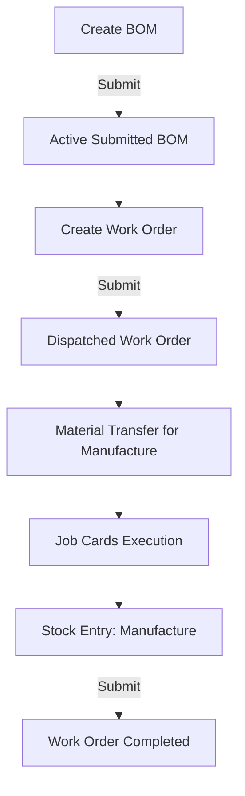

# Manufacturing & Production Engineering Domain Skill

## 1. Domain Overview
The **Manufacturing** module drives factory shop-floor execution, raw material explosion, job scheduling, and assembly cost rollups. In this instance, Manufacturing is tightly coupled with custom fields linking industrial **Projects** and **BOMs**.

### Key Entities:
1. **BOM (Bill of Materials)**: Engineering recipe defining raw materials, quantities, scrap factor, operations, and workstations to produce 1 unit of a finished product.
2. **Work Order**: Shop floor authorization document to manufacture a given quantity of an item using a specific submitted BOM.
3. **Job Card**: Dispatched operational task allocated to a workstation and operator.
4. **Operation**: Discrete manufacturing activity (e.g., "Milling", "CNC Turning", "Soldering", "Quality Testing").
5. **Workstation**: Physical machine or assembly bench with operating costs per hour.
6. **Production Plan**: High-level planner exploding open Sales Orders into aggregated Material Requests and Work Orders.

---

## 2. Field Requirements & Custom Integrations

### BOM
- **item** (Link Item, Required): Finished product or subassembly to manufacture.
- **quantity** (Float, Required, default 1.0): Output quantity produced.
- **company** (Link Company, Required).
- **is_active** (Check, Default 1): Indicates if BOM can be selected for production.
- **is_default** (Check): Sets default BOM for the item.
- **with_operations** (Check): Enables operation routing and Job Cards.
- **items** (Table BOM Item, Required): Raw materials and sub-assemblies.
  - **item_code** (Link Item, Required)
  - **qty** (Float, Required, > 0)
  - **rate** (Currency, Required)
- **custom_sarathi_project** (Link Project, Custom): Directly links this engineering recipe to a specific Sarathi Industrial Project (`allow_on_submit = 1`).

### Work Order
- **production_item** (Link Item, Required): Finished item to manufacture.
- **bom_no** (Link BOM, Required): Must point to an Active, Submitted BOM.
- **qty** (Float, Required, > 0): Target production batch quantity.
- **company** (Link Company, Required).
- **wip_warehouse** (Link Warehouse, Required): Staging warehouse for raw materials.
- **fg_warehouse** (Link Warehouse, Required): Target warehouse for finished goods.
- **project** (Link Project, Optional): Connects manufacturing run to project cost ledger.

---

## 3. Shop-Floor Production Lifecycle

1. **Staging**: `Stock Entry` of type `Material Transfer for Manufacture` transfers raw materials from `Stores` to `wip_warehouse`.
2. **Execution**: Job Cards track time and operator logs.
3. **Finalization**: `Stock Entry` of type `Manufacture` consumes raw materials from `wip_warehouse` and posts finished goods to `fg_warehouse`.

---

## 4. Edge Cases & Constraints
1. **BOM Must Be Submitted**: A Work Order cannot be created or saved against a Draft BOM (`docstatus = 0`). The referenced BOM must have `docstatus = 1` and `is_active = 1`.
2. **Negative Stock Block**: Staging raw materials requires checking that raw materials actually exist in the source warehouse before submitting `Material Transfer for Manufacture`.
