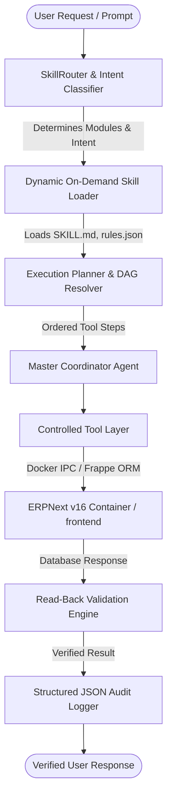

# ERPNext Autonomous AI Agent System

A production-ready, enterprise-grade AI Agent for **Frappe v16.31.0** and **ERPNext v16.33.0**, with specialized domain skills for all 13 core modules, dynamic on-demand skill loading, controlled tool execution, read-back verification, and structured audit logging.

---

## 1. System Architecture



### Core Components

1. **`core/master_agent.py`**:
   The end-to-end coordinator. Manages the lifecycle of intent routing, skill context loading, dependency graph resolution, multi-step execution, and response synthesis.

2. **`core/router.py`**:
   Intent classifier and semantic router. Detects DocTypes, actions (QUERY, CREATE, UPDATE, SUBMIT, CANCEL, AMEND, REPORT), and routes requests to the relevant module skills.

3. **`core/loader.py`**:
   On-demand lazy loader for module skills. Prevents context bloat by loading domain knowledge (`SKILL.md`, `rules.json`, `workflows.json`, `examples.json`) only when needed.

4. **`core/resolver.py`**:
   Cross-module dependency resolver. Validates foreign keys (e.g., Company, Customer, Supplier, Warehouse) and topologically orders creation steps before mutations happen.

5. **`core/validator.py`**:
   Strict post-mutation verification engine. Asserts that records exist, field values match expectations, `docstatus` matches target (Draft=0, Submitted=1, Cancelled=2), and checks stock availability before material movements.

6. **`core/audit.py`**:
   Structured JSONL audit logger (`logs/agent_audit.jsonl`). Records timestamp, tool, inputs (with sensitive keys masked), raw outputs, latency, and validation status.

7. **`tools/` (Controlled Tool Layer)**:
   - `client.py`: Secure IPC bridge to `frappe_docker_main-backend-1` on site `frontend`.
   - `document_tools.py`: `CreateDocumentTool`, `GetDocumentTool`, `UpdateDocumentTool`, `DeleteDocumentTool`.
   - `workflow_tools.py`: `SubmitDocumentTool`, `CancelDocumentTool`, `AmendDocumentTool`.
   - `query_tools.py`: `SearchDocumentsTool`, `GetValueTool`, `GetCountTool`.
   - `meta_tools.py`: `GetDocMetaTool`, `CheckPermissionTool`.
   - `report_tools.py`: `RunReportTool`.

---

## 2. The 13 Module Skills

Each of the 13 modules has a dedicated package containing:
- `SKILL.md`: Detailed domain rules, lifecycle transitions, constraints, and instructions.
- `rules.json`: Machine-readable validation rules, required fields, and constraints.
- `workflows.json`: Valid state machine transitions.
- `examples.json`: Few-shot verified execution plans.

| Module | Key DocTypes & Scope |
|---|---|
| **Organization** | Company, Fiscal Year, Cost Center, Department, Branch, Sarathi Customer Org |
| **Stock** | Item, Warehouse, Bin, Stock Entry (Receipt, Issue, Transfer), Delivery Note, Purchase Receipt |
| **Buying** | Supplier, Supplier Group, Purchase Order, Purchase Invoice, RFQ, Supplier Quotation |
| **Selling** | Customer, Customer Group, Sales Order, Sales Invoice, Quotation, Lead |
| **Manufacturing** | BOM, Work Order, Job Card, Operation, Workstation, Production Plan, Sarathi Custom BOM/Project Links |
| **Projects** | Project, Task, Timesheet, Sarathi Manufacturing Check & BOM Link |
| **Subcontracting** | Subcontracting Order, Subcontracting Receipt, Subcontracting BOM |
| **Quality** | Quality Inspection, Quality Inspection Parameter, Quality Template, Quality Action |
| **Accounting** | Journal Entry, Payment Entry, Account, Mode of Payment, Tax Templates |
| **Assets** | Asset, Asset Category, Asset Movement, Depreciation Schedule |
| **Framework** | DocType, Custom Field, Property Setter, Server Script, Client Script |
| **Users and System** | User, Role, Role Profile, User Permission, System Settings |
| **ERPNext Settings** | Stock Settings (`allow_negative_stock = 0`), Manufacturing Settings, Accounts Settings |

---

## 3. Running the Agent CLI

### Interactive Mode:
```bash
python ERPNext_Agent/run_agent.py --interactive
```

### Single-Prompt Query:
```bash
python ERPNext_Agent/run_agent.py --prompt "What is the default currency of company SarathiAILabs?"
```

---

## 4. Running Automated Tests

Run the full suite of unit and live integration tests:
```bash
python ERPNext_Agent/tests/run_all_tests.py
```
