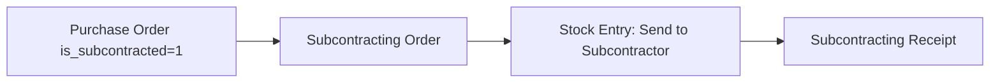

# Subcontracting Domain Skill

## 1. Domain Overview
The **Subcontracting** module oversees outsourced manufacturing operations. The company provides raw materials to a third-party vendor (job worker), and receives back processed sub-assemblies or finished goods while paying for service/machining charges.

### Key Entities:
1. **Subcontracting BOM**: Specialized bill of materials detailing supplier-provided vs company-provided materials for outsourced jobs.
2. **Subcontracting Order (SCO)**: Submittable purchase commitment detailing items to be produced by the vendor, supplied raw materials, and service rates. Created automatically from a Purchase Order where `is_subcontracted = 1`.
3. **Subcontracting Receipt (SCR)**: Submittable receipt document recording arrival of finished subcontracted items into company warehouses and consumption of raw materials previously transferred to the vendor warehouse.

---

## 2. Field Requirements & Rules

### Subcontracting Order
- **purchase_order** (Link Purchase Order, Required): Upstream PO.
- **supplier** (Link Supplier, Required).
- **company** (Link Company, Required).
- **supplier_warehouse** (Link Warehouse, Required): External staging warehouse holding company raw materials at vendor premises.
- **items** (Table Subcontracting Order Item, Required): Finished items to receive.
- **supplied_items** (Table Subcontracting Order Supplied Item, Required): Raw materials provided by company.

### Subcontracting Receipt
- **subcontracting_order** (Link Subcontracting Order, Required).
- **supplier** (Link Supplier, Required).
- **company** (Link Company, Required).
- **items** (Table Subcontracting Receipt Item, Required).
- **supplied_items** (Table Subcontracting Receipt Supplied Item, Required).

---

## 3. Workflow & Lifecycle Transitions

1. **PO Generation**: Create PO marked `is_subcontracted = 1`. Submitting creates `Subcontracting Order`.
2. **Material Staging**: Create `Stock Entry` (Send to Subcontractor) moving components from `Stores` to `supplier_warehouse`.
3. **Receipt**: Create `Subcontracting Receipt` on delivery, which consumes raw materials from `supplier_warehouse` and posts finished product into `fg_warehouse`.
