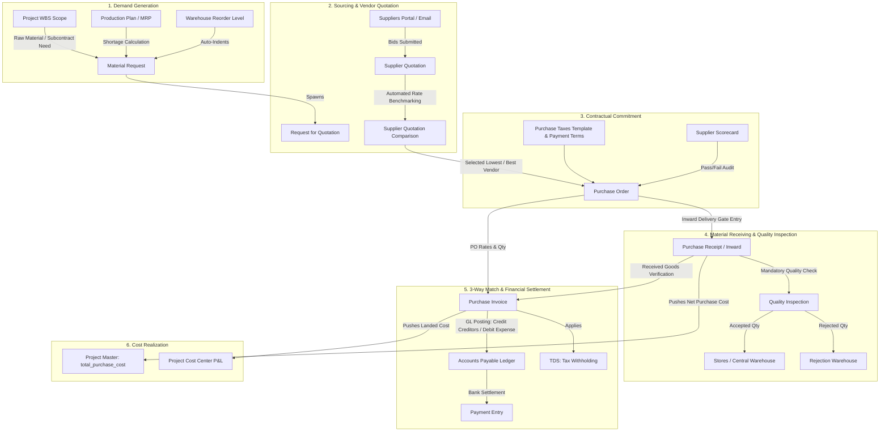
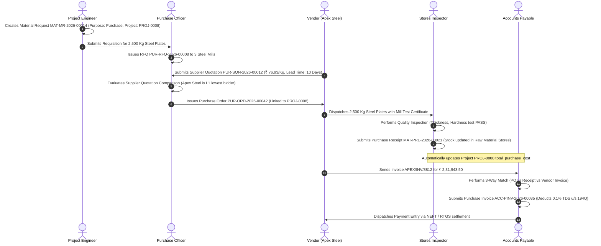

# ERPNext Buying Module: Complete In-Depth Field & Operational Manual

> **Module Base Path:** `/desk/buying`  
> **Environment:** ERPNext v14 / v15 & Frappe Framework with Sarathi AI Labs Industrial Foundation  
> **Target Audience:** Procurement Managers, Purchase Officers, Plant Sourcing Heads, Quality Inspectors, and ERP Administrators  
> **Format:** Pure Markdown (`.md`) Specification Manual  

---

## Master Table of Contents
1. [Architecture & System Flow Overview](#1-architecture--system-flow-overview)
2. [Sidebar Master Navigation Map](#2-sidebar-master-navigation-map)
3. [Sidebar 1: Buying Home & Dashboard](#sidebar-1-buying-home--dashboard)
4. [Sidebar 2: Material Request (`/desk/material-request`)](#sidebar-2-material-request-deskmaterial-request)
   - [Header, Request Types & Logistics](#material-request-header--request-types)
   - [Nested Table: Item Details (`Material Request Item`)](#nested-table-item-details-material-request-item)
5. [Sidebar 3: Request for Quotation - RFQ (`/desk/request-for-quotation`)](#sidebar-3-request-for-quotation---rfq-deskrequest-for-quotation)
   - [RFQ Header & Schedule](#rfq-header--schedule)
   - [Suppliers Table & Sourcing Dispatch](#suppliers-table--sourcing-dispatch)
   - [Items Table](#rfq-items-table)
6. [Sidebar 4: Supplier Quotation (`/desk/supplier-quotation`)](#sidebar-4-supplier-quotation-desksupplier-quotation)
   - [Quotation Header & Validity](#quotation-header--validity)
   - [Items Table, Rates & Discounts](#quotation-items-table)
   - [Taxes, Charges & Comparison](#quotation-taxes--comparison)
7. [Sidebar 5: Purchase Order - PO (`/desk/purchase-order`) - Complete Form & Tabs](#sidebar-5-purchase-order---po-deskpurchase-order)
   - [Tab 1: Details (Supplier, Series & Project)](#tab-1-purchase-order-details)
   - [Tab 2: Items Table (`Purchase Order Item` - Complete Row Modal)](#tab-2-purchase-order-items-table)
   - [Tab 3: Taxes & Charges (`Purchase Taxes and Charges`)](#tab-3-taxes--charges)
   - [Tab 4: Address & Contact](#tab-4-address--contact)
   - [Tab 5: Terms (Payment Schedule & Legal Terms)](#tab-5-terms--conditions)
   - [Tab 6: More Info & Subcontracting Raw Materials](#tab-6-more-info--subcontracting)
   - [Tab 7: Connections Matrix](#tab-7-connections-matrix)
8. [Sidebar 6: Purchase Invoice - PI (`/desk/purchase-invoice`)](#sidebar-6-purchase-invoice---pi-deskpurchase-invoice)
   - [3-Way Matching, Billing Details & Accounting](#3-way-matching--accounting)
   - [Taxes, TDS (Tax Withholding) & Payment Schedule](#taxes-tds--payment-schedule)
9. [Sidebar 7: Supplier Master (`/desk/supplier`)](#sidebar-7-supplier-master-desksupplier)
   - [Basic Info, Defaults & Banking](#supplier-basic-info--banking)
   - [Tax Identification & Withholding](#supplier-tax--withholding)
   - [Settings, Hold Controls & Scorecard Blocking](#supplier-settings--hold-controls)
10. [Sidebar 8: Supplier Group (`/desk/supplier-group`)](#sidebar-8-supplier-group-desksupplier-group)
11. [Sidebar 9: Items & Pricing Masters](#sidebar-9-items--pricing-masters)
    - [Item Master Procurement Fields](#item-master-procurement-fields)
    - [Item Price & Price List Setup](#item-price--price-list-setup)
12. [Sidebar 10: Supplier Scorecard System](#sidebar-10-supplier-scorecard-system)
    - [Supplier Scorecard Setup & Formulas](#supplier-scorecard-setup--formulas)
    - [Criteria, Variables & Standings Actions](#criteria-variables--standings)
13. [Sidebar 11: Buying Settings (`/desk/buying-settings`)](#sidebar-11-buying-settings-deskbuying-settings)
14. [Sidebar 12: Purchase Taxes and Charges Template](#sidebar-12-purchase-taxes-and-charges-template)
15. [Sidebar 13: Reports & Procurement Analytics](#sidebar-13-reports--procurement-analytics)
    - [Purchase Order Analysis](#report-1-purchase-order-analysis)
    - [Purchase Analytics](#report-2-purchase-analytics)
    - [Procurement Tracker](#report-3-procurement-tracker)
    - [Item Wise Consumption](#report-4-item-wise-consumption)
    - [Requested Items to Order and Receive](#report-5-requested-items-to-order-and-receive)
    - [Supplier Quotation Comparison](#report-6-supplier-quotation-comparison)
16. [End-to-End Real-World Industrial Procurement Blueprint](#16-end-to-end-real-world-industrial-procurement-blueprint)

---

## 1. Architecture & System Flow Overview

The **Buying Module** in ERPNext governs the complete Procure-to-Pay (P2P) lifecycle. In an industrial or manufacturing enterprise, it acts as the primary gatekeeper for raw material acquisition, subcontracted machining, tooling, and capital expenditure.



---

## 2. Sidebar Master Navigation Map

When you access the **Buying** workspace (`/desk/buying`), the navigation interface organizes procurement into distinct operational cards and sidebar links:

| Group / Card | Sidebar Item Label | Route / URL | Core Operational Role |
| :--- | :--- | :--- | :--- |
| **Buying Operations** | **Material Request** | `/desk/material-request` | Internal purchase requisition raised by production, projects, or maintenance. |
| **Buying Operations** | **Request for Quotation** | `/desk/request-for-quotation` | Formal sourcing inquiry sent to multiple suppliers inviting competitive bids. |
| **Buying Operations** | **Supplier Quotation** | `/desk/supplier-quotation` | Vendor proposal recording quoted unit prices, delivery lead times, and terms. |
| **Buying Operations** | **Purchase Order** | `/desk/purchase-order` | Legally binding commercial purchase contract sent to the chosen vendor. |
| **Buying Operations** | **Purchase Invoice** | `/desk/purchase-invoice` | Vendor bill booking financial liabilities into Accounts Payable with 3-way matching. |
| **Items & Pricing** | **Item** | `/desk/item` | Item master configuring purchase lead time, default suppliers, and reorder levels. |
| **Items & Pricing** | **Item Price** | `/desk/item-price` | Standard or negotiated purchase prices tied to specific buying price lists. |
| **Items & Pricing** | **Price List** | `/desk/price-list` | Currency-specific purchasing price lists (e.g., Standard Buying, Import USD). |
| **Supplier Masters** | **Supplier** | `/desk/supplier` | Primary vendor entity master containing tax IDs, bank accounts, and payment terms. |
| **Supplier Masters** | **Supplier Group** | `/desk/supplier-group` | Vendor classification (e.g., Raw Material, Electrical, Subcontractor, Logistics). |
| **Supplier Scorecard**| **Supplier Scorecard** | `/desk/supplier-scorecard` | Automated quality, delivery timeliness, and commercial rating engine. |
| **Supplier Scorecard**| **Scorecard Criteria** | `/desk/supplier-scorecard-criteria` | Evaluation parameters (e.g., On-Time Delivery %, Rejection Rate %, Price Competitiveness). |
| **Settings** | **Buying Settings** | `/desk/buying-settings` | Enterprise rules for PO requirement, over-receipt tolerance, and subcontracting backflush. |
| **Settings** | **Purchase Taxes Template** | `/desk/purchase-taxes-and-charges-template` | Predefined GST/VAT/Freight expense tax distribution structures. |
| **Key Reports** | **Purchase Order Analysis** | `/desk/query-report/Purchase%20Order%20Analysis` | Status matrix comparing ordered vs received vs billed quantities and pending balances. |
| **Key Reports** | **Purchase Analytics** | `/desk/query-report/Purchase%20Analytics` | Time-series spend analytics plotted by supplier, item group, and monthly trends. |
| **Key Reports** | **Procurement Tracker** | `/desk/query-report/Procurement%20Tracker` | Comprehensive audit trail from Material Request $\rightarrow$ PO $\rightarrow$ Receipt $\rightarrow$ Invoice. |
| **Key Reports** | **Item Wise Consumption** | `/desk/query-report/Item%20Wise%20Consumption` | Historical raw material consumption trends across shop-floor jobs. |
| **Key Reports** | **Supplier Quotation Comparison**| `/desk/query-report/Supplier%20Quotation%20Comparison`| Side-by-side bid comparison matrix highlighting the lowest quoted rates. |

---

## Sidebar 1: Buying Home & Dashboard

### 1. Purpose of this Screen
The **Buying Workspace** (`/desk/buying`) is the operational command center for purchase officers and sourcing heads. It tracks procurement spend volume, pending purchase orders, and monthly requisition trends.

### 2. Screen Layout & Component Structure
```
+---------------------------------------------------------------------------------------------------------------------------------+
| / Buying                                                                                       [ Filter: Last Year v ] [ Monthly v ] |
+---------------------------------------------------------------------------------------------------------------------------------+
| LINE CHART: Purchase Order Trends                                                                                              |
| (Visual monthly curve plotting total purchase spend volume in currency against historical fiscal periods)                      |
+---------------------------------------------------------------------------------------------------------------------------------+
| NUMBER CARDS:                                                                                                                   |
| [ Purchase Orders Count: 42 ]      [ Total Purchase Amount: ₹ 84,20,500.00 ]     [ Average Order Values: ₹ 2,00,488.00 ]        |
+---------------------------------------------------------------------------------------------------------------------------------+
| OPERATIONAL SECTIONS & WORKSPACE SHORTCUTS:                                                                                     |
| - Buying Operations: Material Request, Purchase Order, Purchase Invoice, Request for Quotation, Supplier Quotation              |
| - Items & Pricing: Item, Item Price, Price List, Product Bundle, Item Group                                                     |
| - Supplier: Supplier, Supplier Group, Contact, Address                                                                          |
| - Supplier Scorecard: Scorecard, Scorecard Variable, Scorecard Criteria, Standing                                               |
| - Key Reports: Purchase Order Analysis, Purchase Analytics, Procurement Tracker, Supplier Quotation Comparison                  |
+---------------------------------------------------------------------------------------------------------------------------------+
```

### 3. Detailed Component Explanations
1. **Purchase Order Trends (Time-Series Chart):**
   - **Data Source:** Aggregates `Purchase Order` records where `docstatus = 1` (Submitted).
   - **X/Y Axis:** X-axis shows months; Y-axis plots total contractual spend.
   - **Business Value:** Prevents cash flow surprises by tracking future committed vendor payables.
2. **Purchase Orders Count (Number Card):**
   - **Logic:** `SELECT count(name) FROM tabPurchase Order WHERE status != 'Cancelled'`.
   - **Business Value:** Measures procurement operational workload.
3. **Total Purchase Amount (Number Card):**
   - **Logic:** `SELECT sum(base_grand_total) FROM tabPurchase Order WHERE docstatus = 1`.
   - **Business Value:** Total enterprise capital committed to external vendors in the current fiscal period.
4. **Average Order Values (Number Card):**
   - **Logic:** $\frac{\text{Total Purchase Amount}}{\text{Purchase Orders Count}}$.
   - **Business Value:** Identifies purchasing consolidation efficiency (higher AOV indicates consolidated bulk purchasing rather than fragmented, expensive micro-orders).

---

## Sidebar 2: Material Request (`/desk/material-request`)

Navigating to **Material Request** opens the requisition list. Clicking **+ Add Material Request** opens the primary internal demand document.

```
+---------------------------------------------------------------------------------------------------------------------------------+
| New Material Request Form                                                                                                       |
+----------------------------------------------------------------+----------------------------------------------------------------+
| Series *: [ MAT-MR-.YYYY.-                                   v ]| Purpose *: [ Purchase                                        v ]|
| Required By Date *: [ 2026-10-25                              ]| Set Target Warehouse: [ Stores - SL                          v ]|
| Company *: [ SarathiAILabs                                   v ]| Status: [ Draft                                              v ]|
| Scan Barcode: [                                                ]|                                                                |
+----------------------------------------------------------------+----------------------------------------------------------------+
```

---

### Material Request Header & Request Types

#### Field-by-Field Detailed Specifications:

| Field Label | Fieldname | Field Type | Mandatory / Default | Available Options / Fill Mode | Why Use This Field? | How to Use This Field? | Where Does It Connect / Impact? |
| :--- | :--- | :--- | :--- | :--- | :--- | :--- | :--- |
| **Series** | `naming_series` | `Select` | **Yes (Required)** | **Static Options:**<br>&bull; `MAT-MR-.YYYY.-` | Generates unique sequential ID for every requisition. | Select series prefix from dropdown. | Generates primary key (e.g. `MAT-MR-2026-00014`). |
| **Purpose** | `material_request_type` | `Select` | **Yes (Required)** | **Static Options:**<br>&bull; `Purchase`<br>&bull; `Material Transfer`<br>&bull; `Material Issue`<br>&bull; `Manufacture`<br>&bull; `Customer Provided` | Governs downstream workflow routing. | Select exact operational purpose matching user requirement (see operational breakdown below). | Determines which downstream button appears upon submission: *Create $\rightarrow$ Purchase Order / RFQ / Stock Entry / Work Order*. |
| **Required By Date** | `schedule_date` | `Date` | **Yes (Required)** | Date picker (`YYYY-MM-DD`). | Target deadline when requested items must physically arrive at the plant. | Pick target date needed by shop-floor or project site. | Populates into PO schedule date; drives `Requested Items to Order and Receive` report. |
| **Set Target Warehouse** | `set_warehouse` | `Link` | Optional | **Dynamic Link:** Links to `Warehouse` master (e.g., `Stores - SL`). | Default destination warehouse for all line items. | Select storage location where goods should be placed upon arrival. | Automatically populates `warehouse` column across all line items in the items table. |
| **Company** | `company` | `Link` | **Yes (Required)** | **Dynamic Link:** Links to `Company` master. | Legal entity paying for the materials. | Select purchasing company from dropdown. | Constrains warehouses, budgets, and cost centers. |
| **Status** | `status` | `Select` | Default: `Draft` (Read-only) | **Static Options:**<br>&bull; `Draft`<br>&bull; `Submitted`<br>&bull; `Stopped`<br>&bull; `Ordered`<br>&bull; `Issued`<br>&bull; `Transferred`<br>&bull; `Received`<br>&bull; `Partially Ordered`<br>&bull; `Partially Received`<br>&bull; `Cancelled` | Tracks requisition lifecycle. | Managed automatically by ERPNext as downstream RFQs, POs, and Receipts are booked. | Displays color-coded badges in list views and prevents duplicate procurement once marked `Ordered`. |

#### Operational Breakdown of `Purpose` (Material Request Types):
1. **Purchase:** Items are purchased externally from third-party suppliers $\rightarrow$ Spawns **Request for Quotation** or **Purchase Order**.
2. **Material Transfer:** Items exist in another company warehouse $\rightarrow$ Spawns **Stock Entry (Material Transfer)** to move items between warehouses.
3. **Material Issue:** Items are required for internal departmental consumption or testing $\rightarrow$ Spawns **Stock Entry (Material Issue)** to write off stock to an expense account.
4. **Manufacture:** Items are finished assemblies produced in-house $\rightarrow$ Spawns **Work Order** to trigger plant assembly.
5. **Customer Provided:** Specialized raw materials provided free of charge by the client $\rightarrow$ Spawns **Stock Entry (Material Receipt)** with zero valuation.

---

### Nested Table: Item Details (`Material Request Item`)

Clicking **Add Row** or opening the row edit modal reveals the following fields:

```
+---------------------------------------------------------------------------------------------------------------------------------+
| ROW EDIT MODAL: Material Request Item                                                                                          |
+----------------------------------------------------------------+----------------------------------------------------------------+
| Item Code *: [ RM-STL-PLT-20MM                               v ]| Required By *: [ 2026-10-25                                  ]|
| Item Name *: [ High-Tensile Steel Plate 20mm                  ]| Target Warehouse *: [ Raw Material Stores - SL               v ]|
| Quantity *: [ 2500.00                                         ]| Stock UOM *: [ Kg                                            v ]|
| UOM *: [ Kg                                                  v ]| Conversion Factor *: [ 1.000000                              ]|
+----------------------------------------------------------------+----------------------------------------------------------------+
| SECTION: Accounting & Project Dimensions                                                                                        |
+----------------------------------------------------------------+----------------------------------------------------------------+
| Project: [ PROJ-0008                                         v ]| Cost Center: [ Industrial Projects - SL                      v ]|
| Lead Time Days: [ 14 ]                                         | Manufacturer: [ Tata Steel                                   v ]|
+----------------------------------------------------------------+----------------------------------------------------------------+
```

#### Row Modal Field Specifications:

| Child Field Label | Fieldname | Field Type | Mandatory / Default | Available Options / Fill Mode | Why Use This Field? | How to Use This Field? | Where Does It Connect / Impact? |
| :--- | :--- | :--- | :--- | :--- | :--- | :--- | :--- |
| **Item Code** | `item_code` | `Link` | **Yes (Required)** | **Dynamic Link:** Links to `Item` master. | Identifies exact material or component required. | Search by item code or part description. | Auto-fetches Item Name, Stock UOM, Description, and default Lead Time. |
| **Item Name** | `item_name` | `Data` | **Yes (Required)** | Auto-fetched text. | Human-readable part description. | Auto-populated from Item master. | Displayed in print formats and supplier RFQ emails. |
| **Quantity** | `qty` | `Float` | **Yes (Required)** | Decimal number (e.g., `2500.00`). | Quantity of material required. | Enter quantity needed. | Flowed into RFQ and PO; checked against minimum order quantity (MOQ). |
| **Required By** | `schedule_date` | `Date` | **Yes (Required)** | Date picker (`YYYY-MM-DD`). | Item-specific deadline. | Defaults to header date; adjust if different lines have staggered deliveries. | Controls scheduling in Purchase Order line items. |
| **Target Warehouse** | `warehouse` | `Link` | **Yes (Required)** | **Dynamic Link:** Links to `Warehouse` master. | Destination warehouse bin where material will be placed. | Select receiving store. | Directs inventory valuation postings upon goods receipt. |
| **Stock UOM** | `stock_uom` | `Link` | Read-only | Links to `UOM` master (e.g., `Kg`, `Nos`, `Mtr`). | Standard unit of inventory measurement. | Auto-fetched from Item master. | Inventory valuation and warehouse ledger balance tracking. |
| **UOM** | `uom` | `Link` | **Yes (Required)** | **Dynamic Link:** Links to `UOM` master. | Purchasing unit of measurement (e.g., `Boxes`, `Pallets`, `Tons`). | Select purchase unit. | Converted to stock quantity using conversion factor. |
| **Conversion Factor** | `conversion_factor`| `Float` | **Yes (Required)** | Decimal multiplier (e.g., `1 Box = 100 Nos`). | Mathematical conversion factor between purchase UOM and stock UOM. | Auto-fetched from Item master UOM table; editable if custom packaging. | Formula: $\text{Stock Qty} = \text{Quantity} \times \text{Conversion Factor}$. |
| **Project** | `project` | `Link` | Optional | **Dynamic Link:** Links to `Project` master (e.g., `PROJ-0008`). | Assigns procurement cost to a specific customer or internal project. | Select target project from dropdown. | Automatically tags project into downstream PO and Purchase Invoice. |
| **Cost Center** | `cost_center` | `Link` | Optional | **Dynamic Link:** Links to `Cost Center` master. | Financial P&L accounting dimension. | Select cost center. | Tags general ledger postings upon invoicing. |
| **Lead Time Days** | `lead_time_days` | `Int` | Optional | Integer days. | Expected vendor manufacturing and transit lead time. | Auto-fetched from Item master. | Suggests order placement date: $\text{Order Date} = \text{Required By} - \text{Lead Time}$. |

---

## Sidebar 3: Request for Quotation - RFQ (`/desk/request-for-quotation`)

Navigating to **Request for Quotation** and clicking **+ Add Request for Quotation** initiates competitive supplier bidding.

```
+---------------------------------------------------------------------------------------------------------------------------------+
| New Request for Quotation Form                                                                                                  |
+----------------------------------------------------------------+----------------------------------------------------------------+
| Series: [ PUR-RFQ-.YYYY.-                                    v ]| Transaction Date *: [ 2026-10-15                             ]|
| Company *: [ SarathiAILabs                                   v ]| Status: [ Draft                                              v ]|
| Quotation Deadline: [ 2026-10-20                              ]|                                                                |
+----------------------------------------------------------------+----------------------------------------------------------------+
| NESTED TABLE: Suppliers (Sourcing List)                                                                                         |
+---------------------------------------------------------------------------------------------------------------------------------+
| No. | Supplier *                 | Supplier Name (RO)           | Contact (RO)             | Email (RO)           | Quote Sent   |
| 1   | [ SUP-00124              ] | Apex Steel & Alloys Ltd      | Rajesh Sharma            | sales@apexsteel.in   | [X]          |
| 2   | [ SUP-00189              ] | Bharat Heavy Metals Corp     | Vikram Singh             | bids@bharatmetal.com | [X]          |
+---------------------------------------------------------------------------------------------------------------------------------+
```

### Complete Field Specifications:
1. **`naming_series` [Select]:** Numbering series (e.g., `PUR-RFQ-2026-00008`).
2. **`transaction_date` [Date - Required]:** Issue date of the tender inquiry.
3. **`quotation_deadline` [Date]:** Cut-off date after which vendor bids will not be accepted.
4. **`suppliers` (Child Table: `Request for Quotation Supplier`):**
   - **`supplier` [Link to Supplier - Required]:** Vendor invited to bid.
   - **`supplier_name` [Data - Read-only]:** Auto-fetched vendor legal name.
   - **`email_id` [Data - Read-only]:** Primary contact email address where the RFQ is sent.
   - **`quote_status` [Select]:** `Pending`, `Received`, `Cancelled`.
   - **`send_email` [Button]:** Clicking sends automated email with a secure web portal link allowing the vendor to submit their prices directly into ERPNext without human data entry.
5. **`items` (Child Table: `Request for Quotation Item`):**
   - **`item_code` [Link to Item - Required]:** Material requested.
   - **`qty` [Float - Required]:** Tendered quantity.
   - **`warehouse` [Link to Warehouse]:** Destination plant.
   - **`material_request` [Link to Material Request]:** Requisition traceability link.

---

## Sidebar 4: Supplier Quotation (`/desk/supplier-quotation`)

Navigating to **Supplier Quotation** records formal price bids submitted by suppliers (either entered manually by procurement or submitted directly by the vendor via the supplier portal).

```
+---------------------------------------------------------------------------------------------------------------------------------+
| New Supplier Quotation Form                                                                                                     |
+----------------------------------------------------------------+----------------------------------------------------------------+
| Series: [ PUR-SQN-.YYYY.-                                    v ]| Supplier *: [ SUP-00124 - Apex Steel & Alloys Ltd           v ]|
| Quotation Date *: [ 2026-10-18                                ]| Valid Till: [ 2026-11-18                                      ]|
| Supplier Quotation No: [ APEX/QT/26-904                       ]| Status: [ Submitted                                          v ]|
+----------------------------------------------------------------+----------------------------------------------------------------+
| NESTED TABLE: Items (Quoted Rates)                                                                                              |
+---------------------------------------------------------------------------------------------------------------------------------+
| Item Code *        | Qty *   | Quoted Rate * | Discount % | Net Rate    | Amount        | Lead Time | Request for Quotation     |
| RM-STL-PLT-20MM    | 2500 Kg | ₹ 78.50       | 2.00 %     | ₹ 76.93     | ₹ 1,92,325.00 | 10 Days   | PUR-RFQ-2026-00008        |
+---------------------------------------------------------------------------------------------------------------------------------+
| Taxes and Charges: [ In-State GST 18% (Input Claimable)                                                                      v ]|
| Total Taxes: [ ₹ 34,618.50                                     ]| Grand Total: [ ₹ 2,26,943.50                                  ]|
+---------------------------------------------------------------------------------------------------------------------------------+
```

### Complete Field Specifications:
1. **`supplier` [Link to Supplier - Required]:** Vendor who submitted the quote.
2. **`supplier_quotation_no` [Data]:** External quote reference number printed on vendor quotation letter.
3. **`valid_till` [Date]:** Expiration date of quoted prices. ERPNext warns buyers if attempting to convert an expired quote into a Purchase Order.
4. **`items` (Child Table: `Supplier Quotation Item`):**
   - **`rate` [Currency - Required]:** Unit price quoted per UOM.
   - **`discount_percentage` [Percent]:** Volume or commercial discount offered.
   - **`net_rate` [Currency - Read-only]:** Effective rate after discount: $\text{rate} \times (1 - \frac{\text{discount \%}}{100})$.
   - **`lead_time_days` [Int]:** Delivery commitment in days.
   - **`request_for_quotation` [Link to RFQ]:** Sourcing linkage.
5. **Supplier Quotation Comparison Tool:** Clicking **Make $\rightarrow$ Compare Quotations** opens a matrix comparing rates, payment terms, and lead times across all competing suppliers, highlighting the L1 (lowest bidder) in green.

---

## Sidebar 5: Purchase Order - PO (`/desk/purchase-order`)

Navigating to **Purchase Order** opens the commercial contracts list. Clicking **+ Add Purchase Order** opens the legally binding purchasing agreement containing **7 comprehensive tabs**.

```
+---------------------------------------------------------------------------------------------------------------------------------+
| Purchase Order Form: [ Details ] [ Items ] [ Taxes ] [ Address ] [ Terms ] [ More Info ] [ Connections ]                        |
+---------------------------------------------------------------------------------------------------------------------------------+
```

---

### Tab 1: Purchase Order Details

```
+---------------------------------------------------------------------------------------------------------------------------------+
| TAB: Details                                                                                                                    |
+----------------------------------------------------------------+----------------------------------------------------------------+
| Series *: [ PUR-ORD-.YYYY.-                                  v ]| Supplier *: [ SUP-00124 - Apex Steel & Alloys Ltd           v ]|
| Date *: [ 2026-10-19                                          ]| Supplier Name: [ Apex Steel & Alloys Ltd                     ]|
| Required By *: [ 2026-11-02                                   ]| Company *: [ SarathiAILabs                                   v ]|
| Status: [ To Receive and Bill                                v ]| Is Subcontracted: [ No                                       v ]|
+----------------------------------------------------------------+----------------------------------------------------------------+
| SECTION: Currency and Price List                                                                                                |
+----------------------------------------------------------------+----------------------------------------------------------------+
| Currency *: [ INR                                            v ]| Price List *: [ Standard Buying                               v ]|
| Exchange Rate *: [ 1.000000                                   ]|                                                                |
+----------------------------------------------------------------+----------------------------------------------------------------+
| SECTION: Project & Dimensions                                                                                                   |
+----------------------------------------------------------------+----------------------------------------------------------------+
| Project: [ PROJ-0008                                         v ]| Cost Center: [ Industrial Projects - SL                      v ]|
+----------------------------------------------------------------+----------------------------------------------------------------+
```

#### Field-by-Field Detailed Breakdown:

| Field Label | Fieldname | Field Type | Mandatory / Default | Available Options / Fill Mode | Why Use This Field? | How to Use This Field? | Where Does It Connect / Impact? |
| :--- | :--- | :--- | :--- | :--- | :--- | :--- | :--- |
| **Series** | `naming_series` | `Select` | **Yes (Required)** | **Static Options:**<br>&bull; `PUR-ORD-.YYYY.-` | Generates official legal Purchase Order contract number. | Select series from dropdown. | Generates ID (e.g., `PUR-ORD-2026-00042`). Printed on all PO PDFs sent to vendors. |
| **Supplier** | `supplier` | `Link` | **Yes (Required)** | **Dynamic Link:** Links to `Supplier` master. | Contracting vendor entity. | Select approved vendor from dropdown. | Auto-fetches Supplier Name, Default Currency, Address, Payment Terms, and Tax ID. |
| **Date** | `transaction_date` | `Date` | **Yes (Required)** | Date picker (`YYYY-MM-DD`). | Legally binding agreement date. | Defaults to today's date. | Establishes commitment date for financial audit and aging reports. |
| **Required By** | `schedule_date` | `Date` | **Yes (Required)** | Date picker (`YYYY-MM-DD`). | Contractual delivery deadline. | Select expected plant arrival date. | Evaluated in `Purchase Order Analysis` and supplier on-time delivery scorecard ratings. |
| **Is Subcontracted** | `is_subcontracted` | `Select` | Default: `No` | **Static Options:**<br>&bull; `No`<br>&bull; `Yes` | Flags subcontracted manufacturing where company provides raw material to vendor. | Select `Yes` if this PO is for outsourced machining, heat treatment, or painting. | Activates the **Raw Materials Supplied** table in Tab 6 and routes PO to Subcontracting module. |
| **Currency** | `currency` | `Link` | **Yes (Required)** | **Dynamic Link:** Links to `Currency` master (e.g., `INR`, `USD`, `EUR`). | Transaction purchasing currency. | Auto-fetched from Supplier master or select custom. | All amounts are multiplied by `conversion_rate` to calculate base company currency amounts. |
| **Price List** | `buying_price_list` | `Link` | **Yes (Required)** | **Dynamic Link:** Links to `Price List` master. | Establishes standard price list for items. | Select purchasing price list from dropdown. | Auto-fetches unit prices into items table. |
| **Project** | `project` | `Link` | Optional | **Dynamic Link:** Links to `Project` master. | Commercial binding tying PO expenditure directly to a project charter. | Select target project (e.g., `PROJ-0008`). | Pushes purchase commitment values directly to Project `total_purchase_cost`. |
| **Cost Center** | `cost_center` | `Link` | Optional | **Dynamic Link:** Links to `Cost Center` master. | P&L department bearing the purchase cost. | Select cost center. | Tags general ledger postings upon invoicing. |

---

### Tab 2: Purchase Order Items Table

Clicking **Add Row** or opening the row edit modal in `items` (`Purchase Order Item`) reveals **107 fields**. The critical operational fields are detailed below:

```
+---------------------------------------------------------------------------------------------------------------------------------+
| ROW EDIT MODAL: Purchase Order Item                                                                                             |
+----------------------------------------------------------------+----------------------------------------------------------------+
| Item Code *: [ RM-STL-PLT-20MM                               v ]| Required By *: [ 2026-11-02                                  ]|
| Item Name *: [ High-Tensile Steel Plate 20mm                  ]| Expected Delivery Date: [ 2026-11-02                          ]|
| Quantity *: [ 2500.00                                         ]| Target Warehouse *: [ Raw Material Stores - SL               v ]|
| Rate *: [ ₹ 76.93                                             ]| Amount: [ ₹ 1,92,325.00                                      ]|
| Discount %: [ 0.00 %                                          ]| Net Amount: [ ₹ 1,92,325.00                                   ]|
+----------------------------------------------------------------+----------------------------------------------------------------+
| SECTION: References & Traceability                                                                                              |
+----------------------------------------------------------------+----------------------------------------------------------------+
| Material Request: [ MAT-MR-2026-00014                        v ]| Supplier Quotation: [ PUR-SQN-2026-00012                     v ]|
| Blanket Order: [                                             v ]| Project: [ PROJ-0008                                         v ]|
+----------------------------------------------------------------+----------------------------------------------------------------+
| SECTION: Receiving & Billing Status (Auto-updated by ERPNext)                                                                   |
+----------------------------------------------------------------+----------------------------------------------------------------+
| Received Qty: [ 2500.00 ]                                      | Returned Qty: [ 0.00 ]                                         |
| Billed Amount: [ ₹ 1,92,325.00 ]                               |                                                                |
+----------------------------------------------------------------+----------------------------------------------------------------+
```

#### Key Row Modal Field Specifications:

| Child Field Label | Fieldname | Field Type | Mandatory / Default | Available Options / Fill Mode | Why Use This Field? | How to Use This Field? | Where Does It Connect / Impact? |
| :--- | :--- | :--- | :--- | :--- | :--- | :--- | :--- |
| **Item Code** | `item_code` | `Link` | **Yes (Required)** | **Dynamic Link:** Links to `Item` master. | Identifies exact part being contracted. | Select item from dropdown or scan barcode. | Fetches description, UOM, tax template, and last purchase rate. |
| **Quantity** | `qty` | `Float` | **Yes (Required)** | Decimal number. | Quantity contracted for purchase. | Type total quantity to order. | Multiplied by rate to compute Amount; controls receipt limits in Goods Receipt. |
| **Rate** | `rate` | `Currency` | **Yes (Required)** | Decimal currency rate. | Unit price agreed with vendor. | Type negotiated rate or auto-fetch from quote. | Contractual unit price printed on PO. |
| **Amount** | `amount` | `Currency` | Read-only | Auto-calculated currency amount. | Line total before taxes: $\text{Quantity} \times \text{Rate}$. | Auto-calculated by ERPNext. | Summed into PO Net Total. |
| **Target Warehouse** | `warehouse` | `Link` | **Yes (Required)** | **Dynamic Link:** Links to `Warehouse` master. | Destination store receiving the goods. | Select target warehouse bin. | Directs stock movement upon Purchase Receipt. |
| **Received Qty** | `received_qty` | `Float` | Read-only | System-updated float. | Cumulative quantity physically received via submitted Purchase Receipts. | Automatically updated by ERPNext upon receipt submission. | Used to calculate pending receipt balance in `Purchase Order Analysis`. |
| **Billed Amount** | `billed_amt` | `Currency` | Read-only | System-updated currency. | Cumulative value invoiced via submitted Purchase Invoices. | Automatically updated by ERPNext upon invoice submission. | Compares against total amount to prevent over-invoicing. |
| **Material Request** | `material_request` | `Link` | Read-only | Links to `Material Request`. | Originating requisition reference. | Auto-populated when PO is spawned from MR. | Updates MR status to `Ordered`. |
| **Supplier Quotation** | `supplier_quotation` | `Link` | Read-only | Links to `Supplier Quotation`. | Sourcing bid reference. | Auto-populated when PO is created from quote. | Closes quotation lifecycle. |

---

### Tab 3: Taxes & Charges

ERPNext applies structured tax rules using the **Purchase Taxes and Charges** child table:

```
+---------------------------------------------------------------------------------------------------------------------------------+
| TAB: Taxes & Charges                                                                                                            |
+----------------------------------------------------------------+----------------------------------------------------------------+
| Purchase Taxes and Charges Template: [ In-State GST 18% (Input Claimable)                                                    v ]|
+----------------------------------------------------------------+----------------------------------------------------------------+
| NESTED TABLE: Purchase Taxes and Charges                                                                                        |
+---------------------------------------------------------------------------------------------------------------------------------+
| No. | Type *               | Account Head *                    | Rate %  | Amount        | Total         | Category        |
| 1   | On Net Total         | CGST Input - SL                   | 9.00 %  | ₹ 17,309.25   | ₹ 2,09,634.25 | Valuation & T...|
| 2   | On Net Total         | SGST Input - SL                   | 9.00 %  | ₹ 17,309.25   | ₹ 2,26,943.50 | Valuation & T...|
| 3   | Actual               | Inward Freight Charges - SL       | 0.00    | ₹ 5,000.00    | ₹ 2,31,943.50 | Valuation       |
+---------------------------------------------------------------------------------------------------------------------------------+
| Net Total: [ ₹ 1,92,325.00                                    ]| Total Taxes & Charges: [ ₹ 39,618.50                          ]|
| Grand Total: [ ₹ 2,31,943.50                                  ]| In Words: [ INR Two Lakh Thirty-One Thousand Nine Hundred... ]|
+----------------------------------------------------------------+----------------------------------------------------------------+
```

#### Tax Category Explanations:
1. **Valuation & Total:** Tax amount (e.g., non-claimable duties) is added to item inventory valuation AND added to vendor payment total.
2. **Valuation:** Expense (e.g., freight/insurance) is added to inventory valuation but paid directly to a third-party transporter.
3. **Total:** Tax (e.g., Input GST/VAT) is claimable as tax credit; increases vendor payable total but does NOT inflate inventory valuation.

---

### Tab 5: Terms (Payment Schedule & Legal Terms)

```
+---------------------------------------------------------------------------------------------------------------------------------+
| TAB: Terms                                                                                                                      |
+----------------------------------------------------------------+----------------------------------------------------------------+
| Payment Terms Template: [ 30% Advance, 70% Net 30 Days                                                                       v ]|
+----------------------------------------------------------------+----------------------------------------------------------------+
| NESTED TABLE: Payment Schedule                                                                                                  |
+---------------------------------------------------------------------------------------------------------------------------------+
| Payment Term               | Description             | Due Date   | Invoice Portion | Payment Amount | Outstanding Amount       |
| Advance Milestone          | 30% on PO Confirmation  | 2026-10-22 | 30.00 %         | ₹ 69,583.05    | ₹ 69,583.05              |
| Net 30 Days                | 70% 30 Days after MRN   | 2026-11-22 | 70.00 %         | ₹ 1,62,360.45  | ₹ 1,62,360.45            |
+---------------------------------------------------------------------------------------------------------------------------------+
| Terms and Conditions: [ Standard Industrial Machinery Procurement Terms                                                      v ]|
+---------------------------------------------------------------------------------------------------------------------------------+
| [ Rich Text Editor: Warranty obligations, liquidated damages for late delivery (0.5% per week), NDT inspection criteria... ]    |
+---------------------------------------------------------------------------------------------------------------------------------+
```

---

### Tab 6: More Info & Subcontracting

If `is_subcontracted = 'Yes'`, ERPNext automatically expands the **Raw Materials Supplied** table (`supplied_items`):
- **`main_item_code` [Link to Item]:** The finished machined part to be received from the vendor (e.g., *Machined Robot Arm Casting*).
- **`raw_material_item_code` [Link to Item]:** Company-owned raw material provided to the vendor (e.g., *Raw Aluminum Billet Grade 7075*).
- **`required_qty` [Float]:** Quantity of raw material needed per BOM.
- **`supplied_qty` [Float - Read-only]:** Actual quantity transferred to vendor via **Subcontracting Delivery / Stock Entry**.

---

### Tab 7: Connections Matrix

```
+---------------------------------------------------------------------------------------------------------------------------------+
| Connections Dashboard                                                                                                          |
+---------------------------------------------------------------------------------------------------------------------------------+
| [ 1 Material Request ]    [ 1 Supplier Quotation ]   [ 2 Purchase Receipts ]  [ 1 Purchase Invoice ]                            |
| [ 1 Payment Entry ]       [ 0 Subcontract Orders ]   [ 1 Quality Inspection ] [ 0 Landed Cost Vouchers ]                        |
+---------------------------------------------------------------------------------------------------------------------------------+
```

---

## Sidebar 6: Purchase Invoice - PI (`/desk/purchase-invoice`)

Navigating to **Purchase Invoice** books legal vendor bills into the General Ledger.

```
+---------------------------------------------------------------------------------------------------------------------------------+
| New Purchase Invoice Form                                                                                                       |
+----------------------------------------------------------------+----------------------------------------------------------------+
| Series: [ ACC-PINV-.YYYY.-                                   v ]| Supplier *: [ SUP-00124 - Apex Steel & Alloys Ltd           v ]|
| Posting Date *: [ 2026-11-04                                  ]| Bill No (Vendor Invoice #): [ INV-2026-8812                   ]|
| Posting Time: [ 14:30:00                                      ]| Bill Date: [ 2026-11-03                                       ]|
| Due Date: [ 2026-12-04                                        ]| Credit To (Payable Account) *: [ Creditors - SL              v ]|
+----------------------------------------------------------------+----------------------------------------------------------------+
```

### 3-Way Matching & Accounting Controls:
1. **3-Way Matching Validation:** ERPNext checks:
   $$\text{Purchase Order Quantity \& Price} \longleftrightarrow \text{Purchase Receipt Accepted Quantity} \longleftrightarrow \text{Purchase Invoice Billed Amount}$$
   If the invoice quantity exceeds the received quantity and `pr_required = 'Yes'` in Buying Settings, ERPNext blocks invoice submission.
2. **General Ledger Accounting Postings:**
   - **Debit:** Stock Received But Not Billed (Clearing Account) or Direct Expense Account.
   - **Debit:** Input GST / Tax Asset Accounts.
   - **Credit:** Creditors / Accounts Payable (Supplier Ledger).
   - **Credit:** TDS Payable Account (if Tax Withholding applies).

---

## Sidebar 7: Supplier Master (`/desk/supplier`)

Navigating to **Supplier** and clicking **+ Add Supplier** creates vendor profiles containing **7 tabs**.

```
+---------------------------------------------------------------------------------------------------------------------------------+
| Supplier Form: [ Details ] [ Address & Contact ] [ Accounting ] [ Tax ] [ Settings ] [ Scorecard ] [ Connections ]              |
+---------------------------------------------------------------------------------------------------------------------------------+
```

### Complete Field Specifications:
1. **`supplier_name` [Data - Mandatory]:** Registered company title of vendor (e.g., `Apex Steel & Alloys Ltd`).
2. **`supplier_group` [Link to Supplier Group]:** Classification (e.g., *Raw Material*, *Machining Jobwork*, *Consumables*).
3. **`supplier_type` [Select]:** `Company`, `Individual`, `Partnership`.
4. **`default_currency` [Link to Currency]:** Default invoicing currency.
5. **`tax_id` [Data]:** GSTIN, VAT, or Tax Identification Number.
6. **`tax_withholding_category` [Link]:** Automatically deducts TDS under section 194C / 194Q during invoice posting.
7. **`on_hold` [Check] & `hold_type` [Select]:** Allows blocking a supplier (`All`, `Invoices`, `Payments`) if quality audits fail or legal disputes arise.
8. **`prevent_pos` [Check - Read-only]:** Automatically checked by the system if the vendor's Supplier Scorecard drops below minimum threshold grade.

---

## Sidebar 8: Supplier Group (`/desk/supplier-group`)

- **`supplier_group_name` [Data - Mandatory]:** Name of group.
- **`parent_supplier_group` [Link to Supplier Group]:** Enables tree hierarchy (e.g., *Raw Materials $\rightarrow$ Ferrous Metals $\rightarrow$ Alloy Steels*).
- **`payment_terms` [Link to Payment Terms Template]:** Default payment schedule inherited by all suppliers in this group.

---

## Sidebar 9: Items & Pricing Masters

### 1. Item Master Procurement Fields (`/desk/item`)
- **`is_purchase_item` [Check]:** Must be checked (`1`) to allow this item on Purchase Orders and Material Requests.
- **`lead_time_days` [Int]:** Standard supply lead time used by MRP engine to calculate reorder schedules.
- **`safety_stock` & `reorder_level` [Float]:** When warehouse balance drops below `reorder_level`, ERPNext automatically generates a draft **Material Request**.
- **`min_order_qty` [Float]:** Minimum order quantity enforced during PO generation.

### 2. Item Price & Price List Setup (`/desk/item-price`, `/desk/price-list`)
- **`price_list` [Link to Price List]:** Tagged with `buying = 1` for procurement lists.
- **`price_list_rate` [Currency]:** Contractual price negotiated with the supplier.
- **`valid_from` & `valid_upto` [Date]:** Period for which price agreements remain active.

---

## Sidebar 10: Supplier Scorecard System

ERPNext features an automated algorithmic vendor evaluation engine:

### 1. Scorecard Setup & Formulas (`/desk/supplier-scorecard`)
- **`period` [Select]:** `Per Month`, `Per Year`.
- **`weighting_function` [Formula]:** Mathematical weight curve prioritizing recent performance over older quarters:
  $$\text{Weight} = \text{total\_score} \times \max\left(0, \min\left(1, \frac{12 - \text{period\_number}}{12}\right)\right)$$

### 2. Criteria & Variables (`/desk/supplier-scorecard-criteria`)
- **Quality Rejection Rate:** $\left(\frac{\text{Rejected Qty}}{\text{Total Received Qty}}\right) \times 100$ (Target: $\le 1.0\%$).
- **On-Time Delivery Rate:** $\left(\frac{\text{Deliveries On or Before Schedule Date}}{\text{Total Deliveries}}\right) \times 100$ (Target: $\ge 95\%$).

### 3. Automated Scorecard Actions (`/desk/supplier-scorecard-standing`):
- **Grade A ($\ge 90\%$):** Preferred Supplier (Unrestricted PO creation).
- **Grade B ($75\% - 89\%$):** Acceptable (Warning on RFQs).
- **Grade C ($50\% - 74\%$):** At Risk (Warning on PO creation).
- **Grade D ($< 50\%$):** Blocked (**Prevent POs** checkbox auto-activated; system blocks buyer from saving POs).

---

## Sidebar 11: Buying Settings (`/desk/buying-settings`)

System-wide administrative procurement policies:

1. **`supp_master_name` [Select]:** Controls how supplier IDs are created (`Supplier Name`, `Naming Series`, `Auto Name`).
2. **`maintain_same_rate` [Check]:** Enforces that item rate in Purchase Invoice must match Purchase Order rate exactly. Action: `Stop` or `Warn`.
3. **`po_required` [Select: `Yes`, `No`]:** When set to `Yes`, prevents accounts team from creating Purchase Invoices without linking a valid Purchase Order.
4. **`pr_required` [Select: `Yes`, `No`]:** When set to `Yes`, blocks invoice creation until the warehouse team submits a Goods Receipt (`Purchase Receipt`).
5. **`over_order_allowance` [Float]:** Percentage tolerance allowing warehouse receiving to accept slight overages (e.g., $5\%$ over-delivery on bulk steel coils).
6. **`bill_for_rejected_quantity_in_purchase_invoice` [Check]:** Controls whether rejected quantities are billed to vendor and subsequently deducted via Debit Note.
7. **`backflush_raw_materials_of_subcontract_based_on` [Select]:** `BOM` or `Material Transferred for Subcontract`.

---

## Sidebar 12: Purchase Taxes and Charges Template

- **Route:** `/desk/purchase-taxes-and-charges-template`
- **Purpose:** Standardizes multi-tier tax applications (e.g., *Interstate IGST 18%*, *In-State CGST+SGST 18%*, *Import Customs Duty + SWS + IGST*).
- **Fields:** `title`, `company`, `tax_category`, `is_default`, and the child table `taxes` specifying Account Heads, tax rates, and valuation categories.

---

## Sidebar 13: Reports & Procurement Analytics

### Report 1: Purchase Order Analysis
- **Route:** `/desk/query-report/Purchase%20Order%20Analysis`
- **Filters:** `company`, `from_date`, `to_date`, `supplier`, `project`, `status`.
- **Columns:** `Purchase Order` | `Date` | `Required By` | `Supplier` | `Item Code` | `Qty Ordered` | `Qty Received` | `Pending Qty` | `Billed Qty` | `Amount` | `% Received` | `% Billed`.
- **Business Intelligence:** Identifies open supplier delivery backlogs and expedites overdue material shipments.

### Report 2: Purchase Analytics
- **Route:** `/desk/query-report/Purchase%20Analytics`
- **Filters:** `tree_type` (`Supplier`, `Item Group`, `Item`), `range` (`Monthly`, `Quarterly`), `year`.
- **Columns:** Matrix plotting historical monthly spend columns across every supplier or item group.
- **Business Intelligence:** Sourcing consolidation analysis identifying enterprise spend concentration and vendor dependency risks.

### Report 3: Procurement Tracker
- **Route:** `/desk/query-report/Procurement%20Tracker`
- **Columns:** `Material Request` | `Requisition Date` | `Purchase Order` | `PO Date` | `Supplier` | `Purchase Receipt` | `Receipt Date` | `Purchase Invoice` | `Invoice Date` | `Time Taken (Days)`.
- **Business Intelligence:** Measures procurement cycle lead time from initial engineering request to final warehouse delivery.

### Report 4: Item Wise Consumption
- **Route:** `/desk/query-report/Item%20Wise%20Consumption`
- **Columns:** `Item Code` | `Description` | `Issue Date` | `Issued Qty` | `Valuation Rate` | `Total Cost` | `Project` | `Work Order`.
- **Business Intelligence:** Audits raw material yield and detects shop-floor material waste.

### Report 5: Requested Items to Order and Receive
- **Route:** `/desk/query-report/Requested%20Items%20to%20Order%20and%20Receive`
- **Columns:** `Material Request` | `Item Code` | `Required Date` | `Requested Qty` | `Ordered Qty` | `Received Qty` | `Qty to Order` | `Qty to Receive`.
- **Business Intelligence:** Shortage radar showing what parts have been indented by production but not yet ordered by procurement.

### Report 6: Supplier Quotation Comparison
- **Route:** `/desk/query-report/Supplier%20Quotation%20Comparison`
- **Filters:** `item_code`, `request_for_quotation`.
- **Columns:** Side-by-side comparison of supplier quotes highlighting `Quoted Rate`, `Discount %`, `Net Rate`, and `Lead Time`.
- **Business Intelligence:** Justification document required by corporate governance before awarding high-value purchase orders.

---

## 16. End-to-End Real-World Industrial Procurement Blueprint

### Blueprint: Turnkey Machine Procurement (*High-Tensile Steel & Machined Tooling*)

#### Procurement Scope:
- **Project:** `PROJ-0008` (EV Battery Stamping Line Phase 2)
- **Target Material:** 2,500 Kg High-Tensile Steel Plates (`RM-STL-PLT-20MM`)
- **Total Purchase Value:** ₹ 2,31,943.50 (incl. GST & Freight)
- **Primary Supplier:** Apex Steel & Alloys Ltd (`SUP-00124`)



#### Step-by-Step Execution Walkthrough:
1. **Demand Creation:** Project Engineer raises **Material Request** `MAT-MR-2026-00014` with `purpose = 'Purchase'`, tagging `project = 'PROJ-0008'`.
2. **Competitive Sourcing:** Purchase Officer generates **Request for Quotation** `PUR-RFQ-2026-00008` inviting bids from 3 shortlisted steel mills.
3. **Quotation Evaluation:** Apex Steel submits quote `PUR-SQN-2026-00012` at ₹ 76.93/Kg. The **Supplier Quotation Comparison** report confirms Apex Steel is the lowest compliant bidder.
4. **Contract Issuance:** Purchase Officer converts quote into formal **Purchase Order** `PUR-ORD-2026-00042` with 18% GST and ₹ 5,000 freight.
5. **Quality Receiving:** Materials arrive at plant. Stores inspector completes **Quality Inspection** and submits **Purchase Receipt** `MAT-PRE-2026-00021`. Inventory increases in *Raw Material Stores - SL*.
6. **Project Cost Update:** ERPNext automatically updates `total_purchase_cost` on Project `PROJ-0008`.
7. **3-Way Match & Invoicing:** Finance verifies quantities, rates, and test certificates against the PO and Receipt, creating **Purchase Invoice** `ACC-PINV-2026-00035` with TDS withholding, concluding the procurement cycle.
