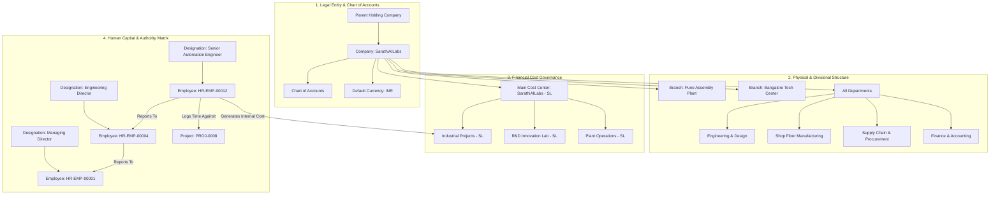

# ERPNext Organization Module: Complete In-Depth Field & Operational Manual

> **Module Base Path:** Core Enterprise Setup (`Company`, `Department`, `Designation`, `Branch`, `Employee`, `Cost Center`)  
> **Environment:** ERPNext v14 / v15 & Frappe Framework with Sarathi AI Labs Industrial Foundation  
> **Target Audience:** Managing Directors, HR Directors, Financial Controllers, Operations Heads, and System Administrators  
> **Format:** Pure Markdown (`.md`) Specification Manual  

---

## Master Table of Contents
1. [Architecture & Enterprise Organizational Hierarchy](#1-architecture--enterprise-organizational-hierarchy)
2. [Master Organization Navigation Map](#2-master-organization-navigation-map)
3. [Section 1: Company Master (`/desk/company`) - Complete Form & Tabs](#section-1-company-master-deskcompany)
   - [Tab 1: Company Details & Legal Profile](#tab-1-company-details--legal-profile)
   - [Tab 2: Accounts & General Ledger Defaults](#tab-2-accounts--general-ledger-defaults)
   - [Tab 3: Accounts Closing & Books Freezing](#tab-3-accounts-closing--books-freezing)
   - [Tab 4: Buying and Selling Commercial Defaults](#tab-4-buying-and-selling-commercial-defaults)
   - [Tab 5: Stock and Manufacturing Defaults](#tab-5-stock-and-manufacturing-defaults)
   - [Tab 6: Connections & Corporate Dashboard](#tab-6-connections--corporate-dashboard)
4. [Section 2: Department Master (`/desk/department`)](#section-2-department-master-deskdepartment)
   - [Tree Hierarchy, Roles & Approval Routing](#department-tree-hierarchy--approval-routing)
   - [Field-by-Field Specifications](#department-field-specifications)
5. [Section 3: Designation Master (`/desk/designation`)](#section-3-designation-master-deskdesignation)
   - [Job Titles, Authority Matrix & Permissions](#designation-authority-matrix)
   - [Field-by-Field Specifications](#designation-field-specifications)
6. [Section 4: Branch Master (`/desk/branch`)](#section-4-branch-master-deskbranch)
   - [Physical Plants, Regional Depots & Field Offices](#branch-physical-plants--depots)
   - [Field-by-Field Specifications](#branch-field-specifications)
7. [Section 5: Cost Center Master (`/desk/cost-center`)](#section-5-cost-center-master-deskcost-center)
   - [Chart of Cost Centers, P&L Dimensions & Budget Control](#chart-of-cost-centers--p-l-dimensions)
   - [Field-by-Field Specifications](#cost-center-field-specifications)
8. [Section 6: Employee Master (`/desk/employee`) - Complete Form & 8 Tabs](#section-6-employee-master-deskemployee)
   - [Tab 1: Overview (Identification, User Linking & Reporting)](#tab-1-employee-overview)
   - [Tab 2: Address & Contacts (Corporate vs Personal)](#tab-2-address--contacts)
   - [Tab 3: Attendance & Leaves (Biometric Integration)](#tab-3-attendance--leaves)
   - [Tab 4: Salary & Banking Details (Payroll Mode)](#tab-4-salary--banking-details)
   - [Tab 5: Personal Details & Statutory Records](#tab-5-personal-details)
   - [Tab 6: Profile, Education & Experience](#tab-6-profile-education--experience)
   - [Tab 7: Joining & Probation Confirmation](#tab-7-joining--confirmation)
   - [Tab 8: Exit, Resignation & Clearance Feedback](#tab-8-exit--clearance)
9. [Section 7: Organizational Security & Role-Based Permissions](#section-7-organizational-security--role-based-permissions)
10. [End-to-End Real-World Industrial Enterprise Organization Blueprint](#10-end-to-end-real-world-industrial-enterprise-organization-blueprint)

---

## 1. Architecture & Enterprise Organizational Hierarchy

In ERPNext, the **Organization** structure forms the backbone upon which all commercial, manufacturing, accounting, and human resource transactions operate. Every ledger entry, warehouse stock movement, purchase order, and employee timesheet requires structural anchoring to this hierarchy.



---

## 2. Master Organization Navigation Map

The core organizational masters are accessed via the following standard Desk routes:

| Master Name | Desk Route / URL | Core Enterprise Role |
| :--- | :--- | :--- |
| **Company** | `/desk/company` | Legal corporate entity owning the balance sheet, tax registrations, and default accounting ledgers. |
| **Department** | `/desk/department` | Functional operational division (e.g., Engineering, Fabrication, Quality, Purchasing, Accounts). |
| **Designation** | `/desk/designation` | Standardized organizational job titles defining professional hierarchy, pay scales, and approval limits. |
| **Branch** | `/desk/branch` | Physical geographical operations (e.g., Pune Manufacturing Unit, Mumbai Corporate HQ, Chennai Depot). |
| **Cost Center** | `/desk/cost-center` | Tree-structured financial accounting dimensions tracking profit and loss per project, plant, or business line. |
| **Employee** | `/desk/employee` | Individual workforce personnel profile linking system logins, payroll costing, timesheets, and reporting trees. |

---

## Section 1: Company Master (`/desk/company`)

Navigating to **Company** and clicking **+ Add Company** opens the top-level corporate document containing **6 specialized tabs**.

```
+---------------------------------------------------------------------------------------------------------------------------------+
| Company Form: [ Details ]  [ Accounts ]  [ Accounts Closing ]  [ Buying and Selling ]  [ Stock and Manufacturing ]  [ Dashboard ] |
+---------------------------------------------------------------------------------------------------------------------------------+
```

---

### Tab 1: Company Details & Legal Profile

```
+---------------------------------------------------------------------------------------------------------------------------------+
| TAB: Details                                                                                                                    |
+----------------------------------------------------------------+----------------------------------------------------------------+
| Company Name *: [ Sarathi AI Labs Private Limited             ]| Abbreviation *: [ SL                                          ]|
| Default Currency *: [ INR                                    v ]| Country *: [ India                                           v ]|
| Is Group: [ No                                               v ]| Parent Company: [                                            v ]|
+----------------------------------------------------------------+----------------------------------------------------------------+
| SECTION: Tax and Legal Registrations                                                                                            |
+----------------------------------------------------------------+----------------------------------------------------------------+
| Tax ID (GSTIN / VAT): [ 27AAAAA0000A1Z5                       ]| Corporate Identity Number (CIN): [ U72900PN2024PTC198421      ]|
| Date of Incorporation: [ 2024-01-15                           ]| Date of Commencement: [ 2024-02-01                             ]|
| Email: [ corporate@sarathiai.com                              ]| Phone: [ +91 20 6712 4000                                     ]|
+----------------------------------------------------------------+----------------------------------------------------------------+
```

#### Field-by-Field Detailed Breakdown:

| Field Label | Fieldname | Field Type | Mandatory / Default | Available Options / Fill Mode | Why Use This Field? | How to Use This Field? | Where Does It Connect / Impact? |
| :--- | :--- | :--- | :--- | :--- | :--- | :--- | :--- |
| **Company Name** | `company_name` | `Data` | **Yes (Required)** | Full legal registered name (e.g., `Sarathi AI Labs Private Limited`). | Identifies legal corporate identity across invoices, tax filings, and balance sheets. | Type exact legal entity name. | Displays as primary entity title across all financial statements and print headers. |
| **Abbreviation** | `abbr` | `Data` | **Yes (Required)** | Short alphanumeric prefix (e.g., `SL`, `CORP`). Max 5 chars. | Appended to all general ledger accounts, cost centers, and warehouse codes to avoid duplicate names in multi-company setups. | Enter a 2 to 4 letter unique code. | Appended as suffix to accounts (e.g. `Debtors - SL`, `Stores - SL`, `Main - SL`). |
| **Default Currency** | `default_currency` | `Link` | **Yes (Required)** | **Dynamic Link:** Links to `Currency` master (e.g., `INR`, `USD`, `EUR`). | Base functional currency in which company balance sheets and tax returns are prepared. | Select functional legal currency from dropdown. | Anchors all financial conversions; transactions in foreign currencies convert to this base currency. |
| **Country** | `country` | `Link` | **Yes (Required)** | **Dynamic Link:** Links to `Country` master (e.g., `India`, `United States`). | Dictates statutory tax templates, chart of accounts templates, and legal holiday defaults. | Select country of incorporation. | Auto-loads regional GST/VAT rules, default address formats, and standard tax rates. |
| **Is Group** | `is_group` | `Check` | Default: `0` (Unchecked) | **Checkbox Toggle:**<br>&bull; `0` = Operating entity<br>&bull; `1` = Holding / Consolidation entity | Enables parent-subsidiary corporate consolidation. | Check if this company does not execute operations directly but consolidates child company balances. | Group companies produce consolidated Balance Sheets and P&Ls rolling up child ledgers. |
| **Parent Company** | `parent_company` | `Link` | Optional | **Dynamic Link:** Links to `Company` master (where `is_group = 1`). | Establishes corporate ownership hierarchy. | Select parent holding company from dropdown. | Establishes consolidation rollup path. |
| **Tax ID** | `tax_id` | `Data` | Optional | Alphanumeric tax code (e.g., GSTIN `27AAAAA0000A1Z5`). | Corporate tax registration number. | Enter registered tax identifier. | Printed on all outward commercial Sales Invoices and e-Invoices. |

---

### Tab 2: Accounts & General Ledger Defaults

```
+---------------------------------------------------------------------------------------------------------------------------------+
| TAB: Accounts                                                                                                                   |
+----------------------------------------------------------------+----------------------------------------------------------------+
| SECTION: Chart of Accounts Setup (Used on initial creation)                                                                     |
+----------------------------------------------------------------+----------------------------------------------------------------+
| Create Chart of Accounts Based On: [ Standard Template       v ]| Chart of Accounts Template: [ India Chart of Accounts        v ]|
+----------------------------------------------------------------+----------------------------------------------------------------+
| SECTION: Default Control Accounts (Double-Entry Anchors)                                                                        |
+----------------------------------------------------------------+----------------------------------------------------------------+
| Default Bank Account: [ HDFC Current Account - SL            v ]| Default Cost of Goods Sold Account: [ Cost of Goods Sold - SL v ]|
| Default Cash Account: [ Petty Cash - SL                      v ]| Default Income Account: [ Sales - SL                         v ]|
| Default Receivable Account: [ Debtors - SL                   v ]| Default Cost Center: [ Main - SL                             v ]|
| Default Payable Account: [ Creditors - SL                    v ]| Default Round Off Account: [ Round Off - SL                  v ]|
+----------------------------------------------------------------+----------------------------------------------------------------+
| SECTION: Exchange Rate & Revaluation Defaults                                                                                   |
+----------------------------------------------------------------+----------------------------------------------------------------+
| Exchange Gain / Loss Account: [ Exchange Gain/Loss - SL       v ]| Unrealized Exchange Gain/Loss: [ Unrealized Gain/Loss - SL   v ]|
| [X] Auto Create Exchange Rate Revaluation                       | Frequency: [ Monthly                                         v ]|
+----------------------------------------------------------------+----------------------------------------------------------------+
```

#### Field-by-Field Detailed Breakdown:

| Field Label | Fieldname | Field Type | Mandatory / Default | Available Options / Fill Mode | Why Use This Field? | How to Use This Field? | Where Does It Connect / Impact? |
| :--- | :--- | :--- | :--- | :--- | :--- | :--- | :--- |
| **Create COA Based On** | `create_chart_of_accounts_based_on` | `Select` | Required on Creation | **Static Options:**<br>&bull; `Standard Template`<br>&bull; `Existing Company` | Initializes General Ledger account tree for the new enterprise. | Choose `Standard Template` for country standard, or `Existing Company` to clone accounts from a sister firm. | Automatically generates the entire double-entry Chart of Accounts upon initial save. |
| **Default Bank Account** | `default_bank_account` | `Link` | Optional | **Dynamic Link:** Links to `Account` master (Bank). | Primary operational checking account. | Select main operating bank account from dropdown. | Automatically pre-fills Bank Account on Payment Entries and Invoices. |
| **Default Receivable Account** | `default_receivable_account` | `Link` | Optional | **Dynamic Link:** Links to `Account` master (Receivable). | Primary Accounts Receivable debtor ledger. | Select standard Debtors control account. | Credited and debited in Sales Invoices and client customer receipts. |
| **Default Payable Account** | `default_payable_account` | `Link` | Optional | **Dynamic Link:** Links to `Account` master (Payable). | Primary Accounts Payable vendor ledger. | Select standard Creditors control account. | Credited in Purchase Invoices and debited in vendor payments. |
| **Default Income Account** | `default_income_account` | `Link` | Optional | **Dynamic Link:** Links to `Account` master (Income). | Default general revenue ledger for sales transactions. | Select primary sales turnover account. | Pre-fills line items on Sales Orders and Sales Invoices. |
| **Default Cost Center** | `cost_center` | `Link` | Optional | **Dynamic Link:** Links to `Cost Center` master. | Fallback operational cost center. | Select default enterprise cost center (e.g., `Main - SL`). | Automatically populates financial transactions when no project or department cost center is specified. |

---

### Tab 3: Accounts Closing & Books Freezing

```
+---------------------------------------------------------------------------------------------------------------------------------+
| TAB: Accounts Closing                                                                                                           |
+----------------------------------------------------------------+----------------------------------------------------------------+
| Accounts Frozen Till Date: [ 2026-03-31                        ]| Role Allowed to Edit Frozen Entries: [ Accounts Manager      v ]|
+----------------------------------------------------------------+----------------------------------------------------------------+
```
- **`accounts_frozen_till_date` [Date]:** Cut-off date prior to which no back-dated journal vouchers, invoices, or stock entries can be posted.
- **`role_allowed_for_frozen_entries` [Link to Role]:** Executive role (e.g., *Auditor*, *Accounts Manager*) permitted to post prior-period adjustments.
- **Operational Value:** Enforces statutory compliance and prevents tampering with audited past fiscal years.

---

### Tab 4: Buying and Selling Commercial Defaults

```
+---------------------------------------------------------------------------------------------------------------------------------+
| TAB: Buying and Selling                                                                                                         |
+----------------------------------------------------------------+----------------------------------------------------------------+
| Default Buying Terms: [ Standard Vendor Terms - SL           v ]| Default Selling Terms: [ Standard Commercial Contract - SL   v ]|
| Monthly Sales Target: [ ₹ 1,50,00,000.00                       ]| Total Monthly Sales: [ ₹ 1,42,80,000.00 ] (RO)                |
| Credit Limit: [ ₹ 50,00,000.00                                 ]| Default Warehouse for Sales Return: [ Stores - SL            v ]|
+----------------------------------------------------------------+----------------------------------------------------------------+
```
- Standard legal contract terms automatically attached to outbound customer quotes and inbound supplier purchase orders.
- Tracks enterprise sales velocity against budgeted monthly targets.

---

### Tab 5: Stock and Manufacturing Defaults

```
+---------------------------------------------------------------------------------------------------------------------------------+
| TAB: Stock and Manufacturing                                                                                                    |
+----------------------------------------------------------------+----------------------------------------------------------------+
| [X] Enable Perpetual Inventory                                 | Default Stock Valuation Method *: [ FIFO                     v ]|
| Default Inventory Account: [ Stock In Hand - SL              v ]| Stock Adjustment Account: [ Stock Adjustment - SL            v ]|
| Stock Received But Not Billed: [ Stock Received Unbilled - SLv ]| Default In-Transit Warehouse: [ In Transit - SL              v ]|
+----------------------------------------------------------------+----------------------------------------------------------------+
| SECTION: Manufacturing Defaults                                                                                                 |
+----------------------------------------------------------------+----------------------------------------------------------------+
| Default Work In Progress Warehouse: [ Work In Progress - SL  v ]| Default Finished Goods Warehouse: [ Finished Goods - SL      v ]|
| Default Scrap Warehouse: [ Scrap Store - SL                  v ]| Default Operating Cost Account: [ Direct Labor & O/H - SL    v ]|
+----------------------------------------------------------------+----------------------------------------------------------------+
```

#### Complete Field Specifications:
1. **`enable_perpetual_inventory` [Check - Default: Checked `1`]:**
   - **When Checked (Real-Time Accounting):** Every single stock movement (receiving, manufacturing issue, delivery note) creates an automated double-entry General Ledger posting immediately updating inventory valuation.
   - **When Unchecked (Periodic System):** Inventory value is only updated periodically via physical stock audit journal vouchers.
2. **`valuation_method` [Select - Default: `FIFO`]:**
   - **Options:** `FIFO` (First-In, First-Out), `Moving Average`, `LIFO`.
   - Dictates how raw materials issued to shop-floor manufacturing jobs are priced.
3. **`default_wip_warehouse` [Link to Warehouse]:** Buffer warehouse where raw materials reside while undergoing active machining or assembly on the shop floor.
4. **`default_fg_warehouse` [Link to Warehouse]:** Destination warehouse where completed industrial machines are stored awaiting FAT sign-off and dispatch.

---

## Section 2: Department Master (`/desk/department`)

Navigating to **Department** opens the tree and list view of company operational divisions.

```
+---------------------------------------------------------------------------------------------------------------------------------+
| Department: Engineering & Assembly - SL                                                                                         |
+----------------------------------------------------------------+----------------------------------------------------------------+
| Department Name *: [ Engineering & Assembly                    ]| Parent Department: [ Operations - SL                         v ]|
| Company *: [ SarathiAILabs                                   v ]| [X] Is Group                                                   |
| [ ] Disabled                                                   |                                                                |
+----------------------------------------------------------------+----------------------------------------------------------------+
```

### Complete Field Specifications:

| Field Label | Fieldname | Field Type | Mandatory / Default | Available Options / Fill Mode | Why Use This Field? | How to Use This Field? | Where Does It Connect / Impact? |
| :--- | :--- | :--- | :--- | :--- | :--- | :--- | :--- |
| **Department Name** | `department_name` | `Data` | **Yes (Required)** | Free text name (e.g., `Engineering & Assembly`, `Quality Control`, `Finance`). | Human-readable division title. | Enter name of operational department. | Primary identifier in employee records, timesheets, and payroll allocations. |
| **Parent Department** | `parent_department` | `Link` | Optional | **Dynamic Link:** Links to `Department` master (where `is_group = 1`). | Establishes organizational division hierarchy (e.g., `Plant Operations $\rightarrow$ Fabrication`). | Select parent department from dropdown. | Builds tree hierarchy and enables multi-level departmental rollups. |
| **Company** | `company` | `Link` | **Yes (Required)** | **Dynamic Link:** Links to `Company` master. | Company owning the department. | Select company from dropdown. | Isolates departments across independent legal entities. |
| **Is Group** | `is_group` | `Check` | Default: `0` | **Checkbox Toggle:**<br>&bull; `0` = Operational leaf<br>&bull; `1` = Container division | Designates whether this department contains sub-departments. | Check if this is an umbrella division heading. | Group departments roll up employee counts and expenses. |
| **Disabled** | `disabled` | `Check` | Default: `0` | **Checkbox Toggle:**<br>&bull; `0` = Active<br>&bull; `1` = Archived | Soft archive switch. | Check to decommission restructured departments. | Hides department from active dropdowns without breaking historical records. |

---

## Section 3: Designation Master (`/desk/designation`)

Navigating to **Designation** defines corporate professional roles across the enterprise.

```
+---------------------------------------------------------------------------------------------------------------------------------+
| Designation: Senior Automation & Robotics Engineer                                                                             |
+----------------------------------------------------------------+----------------------------------------------------------------+
| Designation Name *: [ Senior Automation & Robotics Engineer   ]| (Column Break)                                                 |
| Description: [ Responsible for PLC code, SCADA integration, robot kinematics commissioning, and client FAT sign-off. ]          |
+----------------------------------------------------------------+----------------------------------------------------------------+
```

### Complete Field Specifications:
1. **`designation_name` [Data - Mandatory]:** Official job title (e.g., *Managing Director*, *Engineering Director*, *Lead Mechanical Designer*, *CNC Machinist*, *Quality Inspector*).
2. **`description` [Text]:** Comprehensive role charter, core competencies, and statutory responsibilities.
3. **Enterprise Integration:** Attached to Employee profiles; drives ERPNext workflow approval limits (e.g., POs over ₹ 5,00,000 require approval by an *Engineering Director*).

---

## Section 4: Branch Master (`/desk/branch`)

Navigating to **Branch** establishes physical company facilities.

```
+---------------------------------------------------------------------------------------------------------------------------------+
| Branch: Pune Machine Assembly Plant                                                                                            |
+----------------------------------------------------------------+----------------------------------------------------------------+
| Branch *: [ Pune Machine Assembly Plant                       ]| (Single Field Master)                                          |
+----------------------------------------------------------------+----------------------------------------------------------------+
```
- **`branch` [Data - Mandatory]:** Name of physical facility (e.g., *Pune Machine Assembly Plant*, *Bangalore Tech Center*, *Mumbai Export Depot*).
- **Enterprise Integration:** Tags employee duty locations, filters plant-specific shift rosters, and aligns with physical warehouse addresses for GST e-Way Bill generation.

---

## Section 5: Cost Center Master (`/desk/cost-center`)

Navigating to **Cost Center** opens the financial dimension tree. Every expenditure, stock valuation loss, project timesheet, and purchase invoice tags a Cost Center to enable segmented P&L reporting.

```
+---------------------------------------------------------------------------------------------------------------------------------+
| Cost Center: Industrial Projects - SL                                                                                           |
+----------------------------------------------------------------+----------------------------------------------------------------+
| Cost Center Name *: [ Industrial Projects                      ]| Cost Center Number: [ CC-1040                                 ]|
| Parent Cost Center *: [ Main - SL                            v ]| Company *: [ SarathiAILabs                                   v ]|
| [ ] Is Group                                                   | [ ] Disabled                                                   |
+----------------------------------------------------------------+----------------------------------------------------------------+
```

### Complete Field Specifications:

| Field Label | Fieldname | Field Type | Mandatory / Default | Available Options / Fill Mode | Why Use This Field? | How to Use This Field? | Where Does It Connect / Impact? |
| :--- | :--- | :--- | :--- | :--- | :--- | :--- | :--- |
| **Cost Center Name** | `cost_center_name` | `Data` | **Yes (Required)** | Free text name (e.g., `Industrial Projects`, `R&D Lab`, `Plant Operations`). | Core accounting dimension name. | Enter cost center title. | Appended with company abbreviation (e.g., `Industrial Projects - SL`). |
| **Cost Center Number** | `cost_center_number` | `Data` | Optional | Alphanumeric accounting code (e.g., `CC-1040`). | Internal corporate chart of accounts numeric reference. | Enter cost center reference code. | Displayed in financial audit reports and trial balance sheets. |
| **Parent Cost Center** | `parent_cost_center` | `Link` | **Yes (Required)** | **Dynamic Link:** Links to `Cost Center` master (where `is_group = 1`). | Establishes cost rollup hierarchy. | Select parent group cost center from dropdown. | Aggregates divisional expenses up to corporate level. |
| **Company** | `company` | `Link` | **Yes (Required)** | **Dynamic Link:** Links to `Company` master. | Company owning the cost ledger. | Select company from dropdown. | Segregates financial ledgers per corporate balance sheet. |
| **Is Group** | `is_group` | `Check` | Default: `0` | **Checkbox Toggle:**<br>&bull; `0` = Postable ledger<br>&bull; `1` = Summary parent heading | Controls whether transactions can be posted directly to this node. | Set to `1` for category headings; leave `0` for leaf cost centers where actual transactions are booked. | Group cost centers cannot be selected in invoices or timesheets. |

---

## Section 6: Employee Master (`/desk/employee`)

Navigating to **Employee** opens the workforce directory. Clicking **+ Add Employee** opens the complete employee profile containing **8 comprehensive tabs**.

```
+---------------------------------------------------------------------------------------------------------------------------------+
| Employee Form: [ Overview ] [ Address & Contacts ] [ Attendance & Leaves ] [ Salary ] [ Personal Details ] [ Profile ] [ Joining ] [ Exit ] |
+---------------------------------------------------------------------------------------------------------------------------------+
```

---

### Tab 1: Employee Overview

```
+---------------------------------------------------------------------------------------------------------------------------------+
| TAB: Overview                                                                                                                   |
+----------------------------------------------------------------+----------------------------------------------------------------+
| Series *: [ HR-EMP-                                          v ]| First Name *: [ Rahul                                         ]|
| Middle Name: [ V.                                              ]| Last Name: [ Kulkarni                                         ]|
| Full Name: [ Rahul V. Kulkarni ] (RO)                          | Gender *: [ Male                                             v ]|
| Date of Birth *: [ 1990-06-15                                  ]| Date of Joining *: [ 2024-03-01                               ]|
| Status *: [ Active                                           v ]| Image: [ (Attached Profile Photograph)                         ]|
+----------------------------------------------------------------+----------------------------------------------------------------+
| SECTION: User Account & Security                                                                                                |
+----------------------------------------------------------------+----------------------------------------------------------------+
| User ID: [ rahul.k@example.com                               v ]| [X] Create User Permission                                     |
+----------------------------------------------------------------+----------------------------------------------------------------+
| SECTION: Company & Hierarchy                                                                                                    |
+----------------------------------------------------------------+----------------------------------------------------------------+
| Company *: [ SarathiAILabs                                   v ]| Department: [ Engineering & Assembly - SL                    v ]|
| Designation: [ Senior Automation Engineer                    v ]| Reports to: [ HR-EMP-00004 - Amit Patel                      v ]|
| Branch: [ Pune Machine Assembly Plant                        v ]| Employee Number: [ EMP-2024-082                                ]|
+----------------------------------------------------------------+----------------------------------------------------------------+
```

#### Field-by-Field Detailed Breakdown:

| Field Label | Fieldname | Field Type | Mandatory / Default | Available Options / Fill Mode | Why Use This Field? | How to Use This Field? | Where Does It Connect / Impact? |
| :--- | :--- | :--- | :--- | :--- | :--- | :--- | :--- |
| **Series** | `naming_series` | `Select` | **Yes (Required)** | **Static Options:**<br>&bull; `HR-EMP-` | Sequential ID generator for worker profiles. | Select series from dropdown. | Generates primary key (e.g., `HR-EMP-00012`). |
| **First Name** | `first_name` | `Data` | **Yes (Required)** | Worker given name. | Personal identification. | Type first name. | Concatenated into `employee_name`. |
| **Status** | `status` | `Select` | Default: `Active` | **Static Options:**<br>&bull; `Active`<br>&bull; `Inactive`<br>&bull; `Suspended`<br>&bull; `Left` | Operational employment state. | Managed by HR as worker joins, takes leave of absence, or separates. | When set to `Left` or `Suspended`, automatically revokes system login access and blocks timesheet logging. |
| **User ID** | `user_id` | `Link` | Optional | **Dynamic Link:** Links to `User` master. | Links real human worker to system login credentials. | Select user email account from dropdown. | Bridges ERPNext login session to employee profile for timesheet auto-population and workflow approvals. |
| **Create User Permission** | `create_user_permission` | `Check` | Default: `1` (Checked) | **Checkbox Toggle:**<br>&bull; `0` = Global view<br>&bull; `1` = Strict self-record isolation | Security control restricting worker to only view their own payroll, leaves, and timesheets. | Keep checked for standard engineering and shop-floor personnel. | Creates Frappe User Permission rule filtering DocTypes by `employee = self`. |
| **Company** | `company` | `Link` | **Yes (Required)** | **Dynamic Link:** Links to `Company` master. | Legal employing entity bearing salary liability. | Select company from dropdown. | Tags payroll expense to the company ledger. |
| **Department** | `department` | `Link` | Optional | **Dynamic Link:** Links to `Department` master. | Worker operational unit. | Select department from dropdown. | Auto-populates into Timesheet header and project labor logs. |
| **Designation** | `designation` | `Link` | Optional | **Dynamic Link:** Links to `Designation` master. | Professional job role. | Select official corporate designation. | Determines role-based approval authorities and billing rate tiers. |
| **Reports to** | `reports_to` | `Link` | Optional | **Dynamic Link:** Links to `Employee` master. | Establishes managerial reporting chain. | Select direct reporting manager. | Powers multi-level leave approvals, expense sign-offs, and organization charts. |
| **Branch** | `branch` | `Link` | Optional | **Dynamic Link:** Links to `Branch` master. | Physical plant or office location. | Select facility where worker is stationed. | Links to plant holiday lists and attendance devices. |

---

### Tab 3: Attendance & Leaves

```
+---------------------------------------------------------------------------------------------------------------------------------+
| TAB: Attendance & Leaves                                                                                                        |
+----------------------------------------------------------------+----------------------------------------------------------------+
| Attendance Device ID: [ BIO-PUN-0428                          ]| Holiday List: [ Maharashtra Industrial 2026                  v ]|
+----------------------------------------------------------------+----------------------------------------------------------------+
```
- **`attendance_device_id` [Data]:** Biometric fingerprint, facial recognition, or RFID badge ID. Used by background sync scripts to auto-generate daily **Attendance** records directly from turnstile gate events.
- **`holiday_list` [Link to Holiday List]:** Plant holiday calendar governing working days and overtime calculations.

---

### Tab 4: Salary & Banking Details

```
+---------------------------------------------------------------------------------------------------------------------------------+
| TAB: Salary                                                                                                                     |
+----------------------------------------------------------------+----------------------------------------------------------------+
| Cost to Company (CTC): [ ₹ 14,50,000.00                       ]| Salary Currency: [ INR                                       v ]|
| Salary Mode: [ Bank                                          v ]| Bank Name: [ HDFC Bank Limited                               ]|
| Bank Account Number: [ 50100428912345                         ]| IFSC / IBAN: [ HDFC0001042                                    ]|
+----------------------------------------------------------------+----------------------------------------------------------------+
```
- Records annual total compensation package (CTC) for management reporting.
- Bank account coordinates automated electronic salary disbursement via bank payout files.

---

### Tab 6: Profile, Education & Experience

- **`education` (Child Table: `Employee Education`):** Degree, university, year of passing, qualification major.
- **`external_work_history` (Child Table: `Employee External Work History`):** Past employers, previous designations, duration, and verified references.
- **`internal_work_history` (Child Table: `Employee Internal Work History`):** Track record of promotions, department transfers, and pay raises within the company.

---

### Tab 8: Exit, Resignation & Clearance Feedback

```
+---------------------------------------------------------------------------------------------------------------------------------+
| TAB: Exit                                                                                                                       |
+----------------------------------------------------------------+----------------------------------------------------------------+
| Resignation Letter Date: [ 2026-10-01                         ]| Relieving Date: [ 2026-10-31                                  ]|
| Exit Interview Held On: [ 2026-10-28                          ]| New Workplace: [ Leading EV OEM                              ]|
| Reason for Leaving: [ Relocation to regional headquarters...  ]| Feedback: [ Highly supportive engineering mentorship team... ] |
+----------------------------------------------------------------+----------------------------------------------------------------+
```
- Governs formal offboarding, asset returns, NDAs, and full-and-final (FnF) payroll settlements.

---

## Section 7: Organizational Security & Role-Based Permissions

ERPNext leverages the Organizational hierarchy to enforce tight security boundaries:

```
+---------------------------------------------------------------------------------------------------------------------------------+
| ERPNext Permission Layering                                                                                                    |
+---------------------------------------------------------------------------------------------------------------------------------+
| LEVEL 1: Role Permissions (System-Wide)                                                                                         |
| - Controls what DocTypes a role can Read, Write, Create, Submit, or Cancel (e.g., 'Projects User' vs 'Projects Manager').       |
+---------------------------------------------------------------------------------------------------------------------------------+
| LEVEL 2: User Permissions (Data-Level Row Filtering)                                                                            |
| - Restricts users to records matching their assigned Company, Department, Cost Center, or specific Project.                     |
| - Example: An engineer assigned to Department 'Engineering - SL' cannot view purchase invoices belonging to 'Finance - SL'.     |
+---------------------------------------------------------------------------------------------------------------------------------+
| LEVEL 3: Departmental & Managerial Hierarchy Approval Chains                                                                   |
| - Purchase Orders, Expense Claims, and Timesheets automatically route up the 'reports_to' hierarchy for managerial sign-off.   |
+---------------------------------------------------------------------------------------------------------------------------------+
```

---

## 10. End-to-End Real-World Industrial Enterprise Organization Blueprint

### Blueprint: Industrial Automation Machine Manufacturer (*Sarathi AI Labs Enterprise Structure*)

#### Organization Master Configurations:
- **Corporate Entity:** `Sarathi AI Labs Private Limited` (Abbr: `SL`)
- **Functional Currency:** `INR` (₹)
- **Primary Operating Plant:** `Pune Machine Assembly Plant`
- **Chart of Cost Centers Structure:**
  - `Main - SL` (Group Cost Center)
    - `Industrial Turnkey Projects - SL` (Direct Project Execution)
    - `R&D & Robotics Prototyping - SL` (Internal Innovation)
    - `Plant Overhead & Maintenance - SL` (Shared Infrastructure)
- **Departmental Structure:**
  - `Operations - SL` (Group Department)
    - `Mechanical Engineering & 3D CAD - SL`
    - `Electrical & PLC Automation - SL`
    - `Shop Floor Assembly & Integration - SL`
    - `Quality Assurance & FAT Testing - SL`

```mermaid
sequenceDiagram
    autonumber
    actor HR as HR & Corporate Admin
    actor Fin as Financial Controller
    actor Mgr as Engineering Director
    actor Eng as Automation Engineer
    participant ERP as ERPNext Core Database

    HR->>ERP: Sets up Company 'Sarathi AI Labs Private Limited' (Abbr: SL)
    Fin->>ERP: Configures Chart of Accounts & Cost Center Tree (Main - SL -> Industrial Projects - SL)
    HR->>ERP: Establishes Branch 'Pune Machine Assembly Plant' and Department 'Engineering & Assembly'
    HR->>ERP: Creates Designation 'Senior Automation Engineer'
    HR->>ERP: Onboards Employee HR-EMP-00012 (Rahul Kulkarni, reports to Amit Patel)
    HR->>ERP: Links Employee to User ID 'rahul.k@example.com' with User Permissions
    Note over Eng,ERP: Rahul logs in; can only see Projects & Timesheets relevant to his Department
    Eng->>ERP: Submits Timesheet against PROJ-0008 (Cost Center: Industrial Projects - SL)
    ERP->>Mgr: Automatically routes Timesheet to Amit Patel (reports_to) for approval
    Mgr->>ERP: Approves Timesheet; Labor expense posts to Company 'SL' under Cost Center 'Industrial Projects - SL'
```

#### Step-by-Step Execution Walkthrough:
1. **Legal Company Initialization:** The corporate entity `Sarathi AI Labs Private Limited` is created with base currency `INR`, country `India`, and abbreviation `SL`. Perpetual Inventory is activated.
2. **Chart of Cost Centers Setup:** Financial control centers are organized under `Main - SL`. The operating cost center `Industrial Turnkey Projects - SL` is created to isolate project expenditure from plant administrative overhead.
3. **Divisional Structuring:** The physical `Pune Machine Assembly Plant` is created as a Branch. Departments are configured under parent group `Operations - SL`.
4. **Workforce Onboarding:** Employee `HR-EMP-00012` (Rahul Kulkarni) is onboarded as *Senior Automation Engineer*, assigned to `Pune Machine Assembly Plant` and `Engineering & Assembly - SL`, reporting to `HR-EMP-00004` (Amit Patel).
5. **System Identity & Security Binding:** The employee profile is linked to login account `rahul.k@example.com` with `Create User Permission` enabled.
6. **Operational Transaction Execution:** When Rahul logs 8.5 hours of PLC programming on a Timesheet for Project `PROJ-0008`, ERPNext:
   - Auto-fetches his hourly costing rate (₹ 1,100/hr).
   - Accrues ₹ 9,350 to Company `SL` under Cost Center `Industrial Turnkey Projects - SL`.
   - Routes the submission to his manager Amit Patel for formal sign-off.
   - Accurately posts labor costs into project margin calculations without exposing sensitive financial ledgers of other corporate entities.
