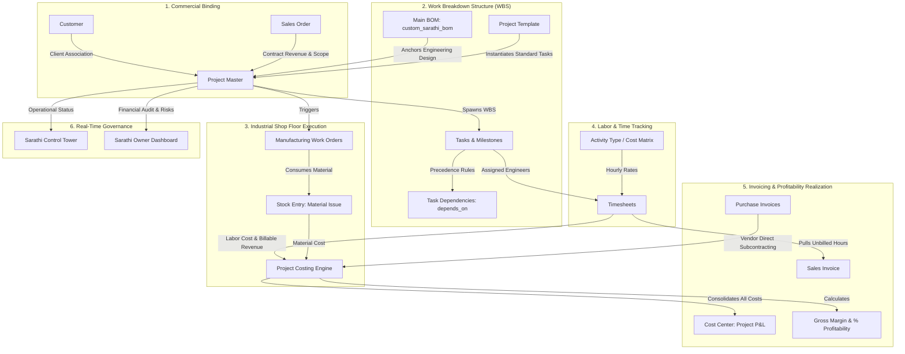
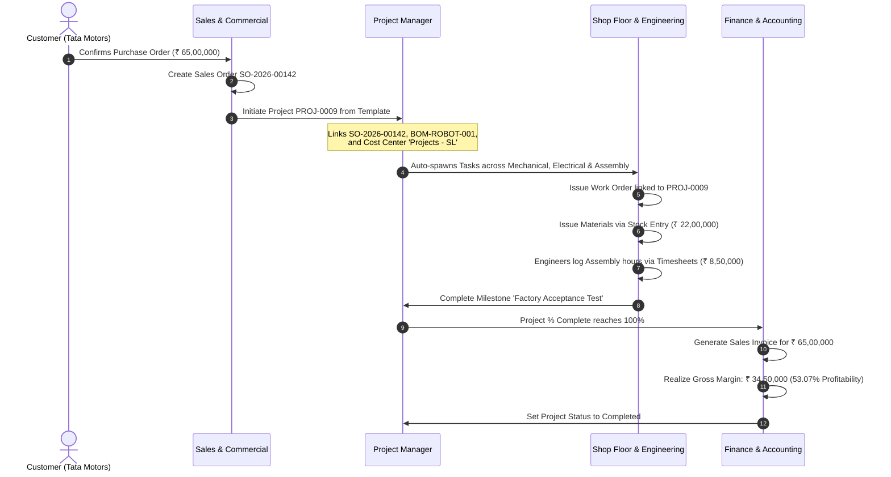

# ERPNext Projects Module: The Complete In-Depth Field & Operational Manual

> **Module Base Path:** `/desk/projects`  
> **Environment:** ERPNext v14 / v15 & Frappe Framework with Sarathi AI Labs Industrial Foundation  
> **Target Audience:** Project Managers, Plant Directors, Systems Analysts, Industrial Planners, and ERP Administrators  
> **Format:** Pure Markdown (`.md`) Specification Manual  

---

## Master Table of Contents
1. [Architecture & System Flow Overview](#1-architecture--system-flow-overview)
2. [Sidebar Master Navigation Map](#2-sidebar-master-navigation-map)
3. [Sidebar 1: Home (`/desk/projects`)](#sidebar-1-home-deskprojects)
4. [Sidebar 2: Dashboard (`/desk/dashboard-view/Project`)](#sidebar-2-dashboard-deskdashboard-viewproject)
5. [Sidebar 3: Project (`/desk/project`) - Complete Form & 5 Tabs](#sidebar-3-project-deskproject)
   - [Tab 1: Details (General & Timeline)](#tab-1-details-general--timeline)
   - [Tab 2: Costing (Costing, Billing & Margins)](#tab-2-costing-costing-billing--margins)
   - [Tab 3: Progress (Automated Polling & Schedules)](#tab-3-progress-automated-polling--schedules)
   - [Tab 4: More Info (Customer, BOM & Users Table)](#tab-4-more-info-customer-bom--users-table)
   - [Tab 5: Connections Dashboard (Real-Time Linked Documents)](#tab-5-connections-dashboard-real-time-linked-documents)
6. [Sidebar 4: Task (`/desk/task`) - Complete Form & 3 Tabs](#sidebar-4-task-desktask)
   - [Tab 1: Details (WBS, Status, Dates & Milestones)](#tab-1-task-details)
   - [Tab 2: Dependencies (Dependent Tasks Table & Costing)](#tab-2-task-dependencies)
   - [Tab 3: More Info (Company, Department & Tree Hierarchy)](#tab-3-task-more-info)
7. [Sidebar 5: Timesheet (`/desk/timesheet`) - Complete Form & Time Logs](#sidebar-5-timesheet-desktimesheet)
   - [Header & Employee Details](#timesheet-header--employee-details)
   - [Nested Table: Time Sheets (`Timesheet Detail`)](#nested-child-table-time-sheets-timesheet-detail)
   - [Tab 2: Billing Summary & Currency Postings](#tab-2-timesheet-billing-summary)
8. [Sidebar 6: Setup $\rightarrow$ Activity Type (`/desk/activity-type`)](#sidebar-6-setup--activity-type-deskactivity-type)
9. [Sidebar 7: Setup $\rightarrow$ Activity Cost (`/desk/activity-cost`)](#sidebar-7-setup--activity-cost-deskactivity-cost)
10. [Sidebar 8: Setup $\rightarrow$ Project Template (`/desk/project-template`)](#sidebar-8-setup--project-template-deskproject-template)
11. [Sidebar 9: Setup $\rightarrow$ Project Type (`/desk/project-type`)](#sidebar-9-setup--project-type-deskproject-type)
12. [Sidebar 10: Setup $\rightarrow$ Project Update (`/desk/project-update`)](#sidebar-10-setup--project-update-deskproject-update)
13. [Sidebar 11: Reports $\rightarrow$ Project Summary](#sidebar-11-reports--project-summary)
14. [Sidebar 12: Reports $\rightarrow$ Daily Timesheet Summary](#sidebar-12-reports--daily-timesheet-summary)
15. [Sidebar 13: Reports $\rightarrow$ Timesheet Billing Summary](#sidebar-13-reports--timesheet-billing-summary)
16. [Sidebar 14: Reports $\rightarrow$ Project wise Stock Tracking](#sidebar-14-reports--project-wise-stock-tracking)
17. [Sidebar 15: Reports $\rightarrow$ Delayed Tasks Summary](#sidebar-15-reports--delayed-tasks-summary)
18. [System Settings: Projects Settings (`/desk/projects-settings`)](#system-settings-projects-settings-deskprojects-settings)
19. [End-to-End Real-World Industrial Implementation Blueprints](#19-end-to-end-real-world-industrial-implementation-blueprints)

---

## 1. Architecture & System Flow Overview

The **Projects Module** in ERPNext serves as the centralized operational and financial control tower for all structured activities within an organization—spanning engineering design, discrete manufacturing delivery, installation, turnkey contracting, and internal R&D initiatives.



---

## 2. Sidebar Master Navigation Map

When you enter ERPNext and access the Projects workspace (`/desk/projects`), the left navigation sidebar displays exactly 15 options divided into functional groups:

| # | Group | Sidebar Item Label | Route / URL | Core Purpose & Workflow Role |
| :-: | :--- | :--- | :--- | :--- |
| **1** | Workspace | **Home** | `/desk/projects` | Default dashboard showing project completion charts, KPI summary cards, and quick links. |
| **2** | Workspace | **Dashboard** | `/desk/dashboard-view/Project` | Visual analytics hub plotting task status distribution, billable vs non-billable hours, and workload. |
| **3** | Core | **Project** | `/desk/project` | Primary master document defining contract scope, WBS schedule, budgets, material costs, and margin. |
| **4** | Core | **Task** | `/desk/task` | Discrete work units with assignees, Gantt dates, milestone status, task weight, and precedence dependencies. |
| **5** | Core | **Timesheet** | `/desk/timesheet` | Employee time logs capturing shift hours against tasks, calculating payroll costs and client invoices. |
| **6** | Setup | **Activity Type** | `/desk/activity-type` | Standard labor categories (e.g., Mechanical Design, PLC Coding, Assembly, Quality Audit). |
| **7** | Setup | **Activity Cost** | `/desk/activity-cost` | Role- or employee-specific hourly rate matrices overriding default billing and costing rates. |
| **8** | Setup | **Project Template** | `/desk/project-template` | Standardized project task hierarchies that automatically instantiate WBS trees on new projects. |
| **9** | Setup | **Project Type** | `/desk/project-type` | High-level organizational segmentation (e.g., External Turnkey, Plant Maintenance, Internal R&D). |
| **10** | Setup | **Project Update** | `/desk/project-update` | Automated narrative broadcast briefings distributed to clients and executive stakeholders via email. |
| **11** | Reports | **Project Summary** | `/desk/query-report/Project%20Summary` | Cross-project financial and schedule comparison report tracking task completion, costs, and delays. |
| **12** | Reports | **Daily Timesheet Summary** | `/desk/query-report/Daily%20Timesheet%20Summary` | Daily labor audit report tracking employee productivity, timestamps, and activity breakdowns. |
| **13** | Reports | **Timesheet Billing Summary** | `/desk/query-report/Timesheet%20Billing%20Summary` | Financial WIP report grouping hours into billable, non-billable, billed, and unbilled amounts. |
| **14** | Reports | **Project wise Stock Tracking** | `/desk/query-report/Project%20wise%20Stock%20Tracking` | Material movement audit comparing purchase receipts, stock issues, and customer deliveries. |
| **15** | Reports | **Delayed Tasks Summary** | `/desk/query-report/Delayed%20Tasks%20Summary` | Critical path bottleneck radar tracking overdue tasks, days of delay, and assigned personnel. |
| **--** | Settings | **Projects Settings** | `/desk/projects-settings` | System-wide configuration controlling time overlap validations and sales invoice auto-population. |

---

## Sidebar 1: Home (`/desk/projects`)

### 1. Purpose of this Screen
The **Home** view is the primary operational cockpit for Project Managers, Department Heads, and Planners. It consolidates macro KPIs, completion trends, and quick access navigation shortcuts.

### 2. Screen Layout & Element Breakdown
```
+---------------------------------------------------------------------------------------------------------------------------------+
| / Projects                                                                                     [ Filter: Last Year v ] [ Monthly v ] |
+---------------------------------------------------------------------------------------------------------------------------------+
| LINE CHART: Completed Projects                                                                                                  |
| (Visual historical curve showing number of projects completed month-by-month)                                                   |
+---------------------------------------------------------------------------------------------------------------------------------+
| NUMBER CARDS:                                                                                                                   |
| [ Open Projects: 9 ]             [ Non Completed Tasks: 0 ]         [ Working Hours: 0.000 hrs ]                                |
+---------------------------------------------------------------------------------------------------------------------------------+
| SHORTCUTS & QUICK ACCESS CARDS:                                                                                                 |
| - Projects: Project (List), Task (List), Project Template, Project Type, Project Update                                         |
| - Time Tracking: Timesheet, Activity Type, Activity Cost                                                                        |
| - Reports: Daily Timesheet Summary, Project wise Stock Tracking, Timesheet Billing Summary, Delayed Tasks Summary               |
| - Settings: Projects Settings                                                                                                   |
+---------------------------------------------------------------------------------------------------------------------------------+
```

### 3. Detailed Component Explanations
1. **Completed Projects Chart:**
   - **Data Source:** Aggregates `Project` records where `status = 'Completed'`.
   - **Time Filters:** Top dropdowns allow switching between *Last Year*, *This Year*, *Last Quarter*, and granularity (*Monthly*, *Weekly*).
   - **Business Value:** Provides leadership an instant velocity gauge of completed deliverables over time.
2. **Open Projects (Number Card):**
   - **Logic:** `SELECT count(name) FROM tabProject WHERE status = 'Open'`.
   - **Business Value:** Reflects active commitments currently consuming company resources.
3. **Non Completed Tasks (Number Card):**
   - **Logic:** `SELECT count(name) FROM tabTask WHERE status NOT IN ('Completed', 'Cancelled')`.
   - **Business Value:** Radar for operational WIP backlog. A sudden spike indicates workflow bottlenecks.
4. **Working Hours (Number Card):**
   - **Logic:** Cumulative sum of `hours` logged in `Timesheet Detail` records for the current calendar period.
   - **Business Value:** Live labor capacity consumption across all active jobs.

---

## Sidebar 2: Dashboard (`/desk/dashboard-view/Project`)

### 1. Purpose of this Screen
The **Project Dashboard** is an analytics-driven visual workspace providing deep visual insight across project execution health, labor allocations, and milestone delivery.

### 2. Standard Analytics Widgets
1. **Task Status Distribution (Donut Chart):**
   - **Slices:** `Open`, `Working`, `Pending Review`, `Overdue`, `Completed`.
   - **Why Use It:** Instantly identifies if work is progressing smoothly or piling up in *Pending Review* or *Overdue*.
2. **Project-Wise Working Hours (Bar Chart):**
   - **Metrics:** X-axis shows Project names; Y-axis plots cumulative hours logged via Timesheets.
   - **Why Use It:** Reveals which projects are consuming disproportionate engineering hours compared to their contractual budget.
3. **Billable vs. Non-Billable Hours (Split Metric):**
   - **Metrics:** Total hours flagged with `is_billable = 1` versus internal overhead hours (`is_billable = 0`).
   - **Why Use It:** Essential for professional services and engineering consultancies to maintain billable utilization targets (typically $\ge 75\%$).

---

## Sidebar 3: Project (`/desk/project`)

Navigating to **Project** opens the Project list view. Clicking the **+ Add Project** button in the top right opens the complete project master creation window containing **5 specialized tabs**.

```
+---------------------------------------------------------------------------------------------------------------------------------+
| Project Form: [ Details ]  [ Costing ]  [ Progress ]  [ More Info ]  [ Connections ]                                            |
+---------------------------------------------------------------------------------------------------------------------------------+
```

---

### TAB 1: Details (General & Timeline)

```
+---------------------------------------------------------------------------------------------------------------------------------+
| TAB: Details                                                                                                                    |
+----------------------------------------------------------------+----------------------------------------------------------------+
| Series *: [ PROJ-.####                                      v ]| From Template: [ Turnkey Robotics Line                       v ]|
| Project Name *: [ EV Battery Pack Line Phase 2                ]| Priority: [ High                                             v ]|
| Status: [ Open                                              v ]| Department: [ Engineering & Assembly - SL                    v ]|
| Project Type: [ External Turnkey                            v ]| Is Active: [ Yes                                             v ]|
| [X] Sarathi Manufacturing Project                               | % Completed: [ 35.00 %                                         ]|
| % Complete Method: [ Task Completion                        v ]|                                                                |
+----------------------------------------------------------------+----------------------------------------------------------------+
| SECTION: Timeline                                                                                                               |
+----------------------------------------------------------------+----------------------------------------------------------------+
| Expected Start Date: [ 2026-09-01                             ]| Expected End Date: [ 2026-12-31                               ]|
| Actual Start Date (via Timesheet): [ 2026-09-03               ]| Actual End Date (via Timesheet): [                             ]|
| Actual Time in Hours (via Timesheet): [ 142.50                ]|                                                                |
+----------------------------------------------------------------+----------------------------------------------------------------+
```

#### Field-by-Field Detailed Breakdown:

| Field Label | Fieldname | Field Type | Mandatory / Default | Available Options / Fill Mode | Why Use This Field? | How to Use This Field? | Where Does It Connect / Impact? |
| :--- | :--- | :--- | :--- | :--- | :--- | :--- | :--- |
| **Series** | `naming_series` | `Select` | **Yes (Required)** | **Static Options:**<br>&bull; `PROJ-.####`<br>*(Additional series can be configured in Naming Series tool)* | Unique primary key generator for every project record. | Select the appropriate prefix numbering pattern from the dropdown. | Generates the unique DocType ID (e.g., `PROJ-0008`). Displayed in all GL entries, stock movements, and invoices. |
| **Project Name** | `project_name` | `Data` | **Yes (Required)** | Free text manual entry (up to 140 characters). Example: `EV Battery Pack Line Phase 2`. | Human-readable title for search, identification, and client reporting. | Type the full commercial or engineering title of the project. | Surfaces on all Kanban boards, Gantt charts, Timesheets, and Executive Dashboards. |
| **Status** | `status` | `Select` | Default: `Open` | **Static Options:**<br>&bull; `Open`<br>&bull; `On hold`<br>&bull; `Completed`<br>&bull; `Cancelled` | Dictates the operational life-cycle state of the project. | Choose from dropdown. When work begins leave `Open`. If paused, set `On hold`. When finished, set `Completed`. | When set to `Completed` or `Cancelled`, ERPNext blocks further timesheet bookings and material issue entries. |
| **Project Type** | `project_type` | `Link` | Optional | **Dynamic Link:** Links to `Project Type` master (e.g., *External Turnkey*, *Internal R&D*, *Tooling*). | Categorizes projects for organizational reporting and portfolio grouping. | Click dropdown or type to search and link an existing Project Type master record. | Filter criteria in `Project Summary` report, P&L dimension analysis, and Owner Executive Dashboard. |
| **Sarathi Manufacturing Project** | `custom_sarathi_manufacturing` | `Check` | Default: `0` (Unchecked) | **Checkbox Toggle:**<br>&bull; `0` = Off<br>&bull; `1` = On | **Sarathi AI Labs Industrial Extension.** Informs the system that this project involves physical discrete manufacturing. | Check this box if this project requires Work Orders, CNC machining, cutting, or mechanical assembly. | Surfaces this project in the Sarathi Control Tower, routing Work Orders and shop-floor tracking. |
| **% Complete Method** | `percent_complete_method` | `Select` | Default: `Task Completion` | **Static Options:**<br>&bull; `Manual`<br>&bull; `Task Completion`<br>&bull; `Task Progress`<br>&bull; `Task Weight` | Governs the mathematical logic used to compute overall project completion %. | Select the appropriate calculation method matching organizational governance policy. | Determines how the read-only `% Completed` field updates as tasks progress: see formulas below. |
| **From Template** | `project_template` | `Link` | Optional | **Dynamic Link:** Links to `Project Template` master. | Enables 1-click instantiation of pre-configured task structures and dependencies. | Select an existing template from dropdown before saving a new project. | On initial save, ERPNext clones all tasks and dependencies from the template into live Tasks under this project. |
| **Priority** | `priority` | `Select` | Default: `Medium` | **Static Options:**<br>&bull; `Low`<br>&bull; `Medium`<br>&bull; `High` | Designates operational urgency and scheduling importance. | Select urgency level from dropdown. | Colors the project badge in list views and prioritizes tasks in dispatch lists and reports. |
| **Department** | `department` | `Link` | Optional | **Dynamic Link:** Links to `Department` master (e.g., *Engineering & Assembly - SL*). | Identifies the business department responsible for project execution. | Select the department from dropdown. | Used for departmental cost accounting, payroll allocation, and manager approvals. |
| **Is Active** | `is_active` | `Select` | Default: `Yes` | **Static Options:**<br>&bull; `Yes`<br>&bull; `No` | Operational filter flag to hide inactive or closed projects. | Set to `No` when archiving older projects. | Filters out inactive projects from search dropdowns in Timesheets and Purchase Invoices. |
| **% Completed** | `percent_complete` | `Percent` | Read-only | Numeric percentage (0.00% to 100.00%). | Real-time gauge of project completion. | Auto-calculated by ERPNext (or manually typed if `% Complete Method = Manual`). | Rendered as progress bars in Project lists, Gantt views, and Executive Summary reports. |
| **Expected Start Date** | `expected_start_date` | `Date` | Optional | Date picker (`YYYY-MM-DD`). | Target scheduled kickoff baseline. | Click field and pick date from calendar widget. | Sets baseline start for Gantt charts and schedule variance calculations. |
| **Expected End Date** | `expected_end_date` | `Date` | Optional | Date picker (`YYYY-MM-DD`). | Target contractual completion deadline. | Click field and pick date from calendar widget. | Used to detect project slippage and drives the `Delayed Tasks Summary` report. |
| **Actual Start Date** | `actual_start_date` | `Date` | Read-only | Auto-fetched date. | Records when actual work commenced on the ground. | Automatically updated by ERPNext when the first submitted Timesheet is logged. | Measures kickoff delay against `expected_start_date`. |
| **Actual End Date** | `actual_end_date` | `Date` | Read-only | Auto-fetched date. | Records when the final work session was completed. | Automatically updated when project status is changed to `Completed`. | Determines total project cycle duration. |
| **Actual Time in Hours** | `actual_time` | `Float` | Read-only | Numeric decimal hours (e.g., `142.50`). | Total cumulative labor hours logged across all work sessions. | Auto-summed by ERPNext across all submitted Timesheet detail rows for this project. | Displayed in Project Summary report and compared against budgeted hours. |

#### Mathematical Formulas for `% Complete Method`:
1. **Manual:** User enters `percent_complete` manually on the project document.
2. **Task Completion:**
   $$\text{\% Complete} = \left(\frac{\text{Count of Completed Tasks}}{\text{Total Count of Tasks}}\right) \times 100$$
3. **Task Progress:**
   $$\text{\% Complete} = \frac{\sum (\text{Task Progress \% for each task})}{\text{Total Count of Tasks}}$$
4. **Task Weight:**
   $$\text{\% Complete} = \frac{\sum (\text{Task Progress \%} \times \text{task\_weight})}{\sum \text{task\_weight}}$$

---

### TAB 2: Costing (Costing, Billing & Margins)

```
+---------------------------------------------------------------------------------------------------------------------------------+
| TAB: Costing                                                                                                                    |
+----------------------------------------------------------------+----------------------------------------------------------------+
| SECTION: Costing and Billing                                                                                                    |
+----------------------------------------------------------------+----------------------------------------------------------------+
| Estimated Cost: [ ₹ 45,00,000.00                              ]| Default Cost Center: [ Industrial Projects - SL              v ]|
| Company *: [ SarathiAILabs                                   v ]| Total Sales Amount (via Sales Order): [ ₹ 65,00,000.00         ]|
| Total Costing Amount (via Timesheet): [ ₹ 8,50,000.00          ]| Total Billable Amount (via Timesheet): [ ₹ 12,00,000.00      ]|
| Total Purchase Cost (via Purchase Invoice): [ ₹ 22,00,000.00  ]| Total Billed Amount (via Sales Invoice): [ ₹ 65,00,000.00      ]|
| Total Consumed Material Cost (via Stock Entry): [ ₹ 4,20,000.00]|                                                                |
+----------------------------------------------------------------+----------------------------------------------------------------+
| SECTION: Margin                                                                                                                 |
+----------------------------------------------------------------+----------------------------------------------------------------+
| Gross Margin: [ ₹ 30,30,000.00                                ]| Gross Margin %: [ 46.62 %                                      ]|
+----------------------------------------------------------------+----------------------------------------------------------------+
```

#### Field-by-Field Detailed Breakdown:

| Field Label | Fieldname | Field Type | Mandatory / Default | Available Options / Fill Mode | Why Use This Field? | How to Use This Field? | Where Does It Connect / Impact? |
| :--- | :--- | :--- | :--- | :--- | :--- | :--- | :--- |
| **Company** | `company` | `Link` | **Yes (Required)** | **Dynamic Link:** Links to `Company` master (e.g., `SarathiAILabs`). | Establishes the corporate legal entity owning the contract. | Select your company from the dropdown. | Dictates currency formatting, Chart of Accounts, Cost Centers, and tax rules. |
| **Estimated Cost** | `estimated_costing` | `Currency` | Optional | Currency number entry (e.g., `4500000.00`). | Budgeted expenditure ceiling allocated for this project. | Enter the total financial budget approved for labor + materials + overheads. | Compared against actual costs in `Project Summary` report to flag cost overruns. |
| **Default Cost Center** | `cost_center` | `Link` | Optional | **Dynamic Link:** Links to `Cost Center` master (e.g., `Industrial Projects - SL`). | Accounting dimension for financial reporting and P&L segregation. | Select the appropriate project or department cost center from the dropdown. | Automatically inherits into Purchase Orders, Invoices, and Stock Entries linked to this project. |
| **Total Costing Amount** | `total_costing_amount` | `Currency` | Read-only | Auto-calculated currency amount. | Tracks cumulative internal labor expense incurred by employees. | System-calculated: $\sum (\text{Timesheet Hours} \times \text{Employee Costing Rate})$. | Feeds the gross margin calculation and project cost center expense postings. |
| **Total Purchase Cost** | `total_purchase_cost` | `Currency` | Read-only | Auto-calculated currency amount. | Tracks external vendor expenses (subcontracting, outsourced machining, direct services). | System-calculated: $\sum (\text{Net Amount of submitted Purchase Invoices linked to this project})$. | Contributes to total actual project cost. |
| **Total Consumed Material Cost** | `total_consumed_material_cost` | `Currency` | Read-only | Auto-calculated currency amount. | Tracks warehouse raw material inventory issued to this project. | System-calculated: $\sum (\text{Valuation of submitted Stock Entries of type 'Material Issue' or 'Manufacture'})$. | Crucial for manufacturing and EPC projects where raw material makes up $\ge 60\%$ of cost. |
| **Total Sales Amount** | `total_sales_amount` | `Currency` | Read-only | Auto-calculated currency amount. | Tracks total committed revenue under contract. | System-calculated: $\sum (\text{Net Total of submitted Sales Orders linked to this project})$. | Serves as the top-line contractual revenue benchmark. |
| **Total Billable Amount** | `total_billable_amount` | `Currency` | Read-only | Auto-calculated currency amount. | Tracks unbilled labor value awaiting invoicing. | System-calculated: $\sum (\text{Timesheet Hours} \times \text{Billing Rate for unbilled logs})$. | Identifies pending work-in-progress (WIP) revenue to be billed to the client. |
| **Total Billed Amount** | `total_billed_amount` | `Currency` | Read-only | Auto-calculated currency amount. | Tracks actual recognized revenue invoiced to the client. | System-calculated: $\sum (\text{Net Total of submitted Sales Invoices linked to this project})$. | Used as the revenue numerator in calculating gross profit margin. |
| **Gross Margin** | `gross_margin` | `Currency` | Read-only | Auto-calculated currency amount. | Absolute financial profit realized on the project. | System-calculated: $\text{Total Billed Amount} - (\text{Total Costing Amount} + \text{Total Purchase Cost} + \text{Total Consumed Material Cost})$. | Appears on Owner Executive Dashboard and financial profitability reports. |
| **Gross Margin %** | `per_gross_margin` | `Percent` | Read-only | Auto-calculated percentage. | Profitability percentage realized against billed turnover. | System-calculated: $\left(\frac{\text{Gross Margin}}{\text{Total Billed Amount}}\right) \times 100$. | Benchmarks project profitability against enterprise targets (e.g., target $\ge 35\%$). |

---

### TAB 3: Progress (Automated Polling & Schedules)

```
+---------------------------------------------------------------------------------------------------------------------------------+
| TAB: Progress                                                                                                                   |
+----------------------------------------------------------------+----------------------------------------------------------------+
| [X] Collect Progress                                           | Subject *: [ Daily Progress Check: {project_name}              ]|
| Holiday List: [ Maharashtra Industrial 2026                  v ]| Message *:                                                     |
| Frequency To Collect Progress: [ Daily                       v ]| Hello {user_name}, please reply with today's completed tasks  |
| Daily Time to send: [ 17:30:00                                 ]| and log your working hours in Timesheet.                       |
+----------------------------------------------------------------+----------------------------------------------------------------+
```

#### Field-by-Field Detailed Breakdown:

| Field Label | Fieldname | Field Type | Mandatory / Default | Available Options / Fill Mode | Why Use This Field? | How to Use This Field? | Where Does It Connect / Impact? |
| :--- | :--- | :--- | :--- | :--- | :--- | :--- | :--- |
| **Collect Progress** | `collect_progress` | `Check` | Default: `0` (Unchecked) | **Checkbox Toggle:**<br>&bull; `0` = Off<br>&bull; `1` = On | Automates regular email reminders sent to assigned project users to collect status updates. | Check the box to activate background automated email polling. | Triggers Frappe scheduled background worker to dispatch check-in emails. |
| **Holiday List** | `holiday_list` | `Link` | Optional | **Dynamic Link:** Links to `Holiday List` master. | Prevents automated polling emails from being sent on plant shutdowns, Sundays, or holidays. | Select company holiday calendar from dropdown. | Checks the calendar before queueing reminder emails. |
| **Frequency To Collect Progress** | `frequency` | `Select` | Optional | **Static Options:**<br>&bull; `Hourly`<br>&bull; `Twice Daily`<br>&bull; `Daily`<br>&bull; `Weekly` | Sets the recurring interval for status collection emails. | Select desired check-in frequency matching project sprint cadence. | Determines which scheduling sub-fields become visible and active below. |
| **From Time / To Time** | `from_time`, `to_time` | `Time` | Conditional (if `Hourly`) | Time pickers (`HH:MM:SS`). | Constrains hourly check-ins within active working hours. | Enter shift start (e.g. `09:00:00`) and shift end (e.g. `18:00:00`). | Restricts hourly polling to operational plant hours. |
| **First Email / Second Email** | `first_email`, `second_email` | `Time` | Conditional (if `Twice Daily`) | Time pickers (`HH:MM:SS`). | Sets specific times for mid-shift and end-of-shift check-ins. | Enter mid-day time (e.g. `13:00:00`) and evening time (e.g. `18:00:00`). | Dispatches two scheduled emails per working day. |
| **Daily Time to send** | `daily_time_to_send` | `Time` | Conditional (if `Daily`) | Time picker (`HH:MM:SS`). | Sets the evening time for daily wrap-up check-ins. | Enter shift end time (e.g. `17:30:00`). | Dispatches daily check-in email to all users in the Users table. |
| **Day to Send** | `day_to_send` | `Select` | Conditional (if `Weekly`) | **Static Options:**<br>&bull; `Monday` to `Sunday` | Day of the week for weekly progress reporting. | Select day (e.g. `Friday`) from dropdown. | Triggers weekly dispatch on the selected day. |
| **Weekly Time to send** | `weekly_time_to_send` | `Time` | Conditional (if `Weekly`) | Time picker (`HH:MM:SS`). | Time of day for weekly check-in. | Enter time (e.g. `16:00:00`). | Dispatches weekly check-in at the specified hour. |
| **Subject** | `subject` | `Data` | Conditional | Text template. Example: `Daily Progress Check: {project_name}`. | Subject line of the automated status email. | Type subject template; supports `{project_name}` merge variable. | Appears as email subject line in team member inboxes. |
| **Message** | `message` | `Text` | Conditional | Multi-line text. Example: `Please reply with tasks completed today.` | Body instructions prompting team members to log progress. | Type instructions outlining required daily updates and timesheet entries. | Rendered as email message body. |

---

### TAB 4: More Info (Customer, BOM & Users Table)

```
+---------------------------------------------------------------------------------------------------------------------------------+
| TAB: More Info                                                                                                                  |
+----------------------------------------------------------------+----------------------------------------------------------------+
| SECTION: Customer Details                                                                                                       |
+----------------------------------------------------------------+----------------------------------------------------------------+
| Customer: [ Tata Motors Limited                              v ]| Main BOM: [ BOM-ROBOT-STAMP-001                              v ]|
| Sales Order: [ SO-2026-00142                                 v ]|                                                                |
+----------------------------------------------------------------+----------------------------------------------------------------+
| SECTION: Users (Project Team Table)                                                                                             |
+---------------------------------------------------------------------------------------------------------------------------------+
| No. | User *                 | Email (RO)         | Full Name (RO)   | Welcome Email | View Attachments | Hide Timesheets       |
| 1   | [ rahul.k@example.com] | rahul.k@example... | Rahul Kulkarni   | [X]           | [X]              | [ ]                   |
| 2   | [ amit.p@example.com ] | amit.p@example...  | Amit Patel       | [ ]           | [X]              | [X]                   |
+---------------------------------------------------------------------------------------------------------------------------------+
| SECTION: Notes                                                                                                                  |
+---------------------------------------------------------------------------------------------------------------------------------+
| [ Rich Text Editor: Technical scope boundaries, client safety protocols, and commissioning sign-off criteria... ]               |
+---------------------------------------------------------------------------------------------------------------------------------+
```

#### Field-by-Field Detailed Breakdown:

| Field Label | Fieldname | Field Type | Mandatory / Default | Available Options / Fill Mode | Why Use This Field? | How to Use This Field? | Where Does It Connect / Impact? |
| :--- | :--- | :--- | :--- | :--- | :--- | :--- | :--- |
| **Customer** | `customer` | `Link` | Optional | **Dynamic Link:** Links to `Customer` master (e.g., `Tata Motors Limited`). | Connects project to client account for commercial billing and receivables. | Select the customer from the dropdown. | Automatically tags Customer into Sales Orders and Invoices; drives Customer 360 view. |
| **Sales Order** | `sales_order` | `Link` | Optional | **Dynamic Link:** Links to `Sales Order` master (e.g., `SO-2026-00142`). | Establishes commercial origin and contract traceability. | Select client's confirmed Sales Order. | Automatically populates `total_sales_amount` and links line items. |
| **Main BOM** | `custom_sarathi_bom` | `Link` | Optional | **Dynamic Link:** Links to `BOM` master (e.g., `BOM-ROBOT-STAMP-001`). | **Sarathi AI Labs Industrial Extension.** Ties top-level engineering assembly to project. | Select the primary engineering Bill of Materials for this project. | Enables automatic generation of manufacturing Work Orders directly from project scope. |
| **Users** | `users` | `Table` | Optional | **Child Table:** Links to `Project User`. See detailed child fields below. | Grants project access, email notifications, and permission overrides to team members. | Click **Add Row** and select system users assigned to execute this project. | Controls document permissions and routes task assignment notifications. |
| **Copied From** | `copied_from` | `Data` | Read-only | Text ID string. | Audit traceability identifying if project was duplicated from an older record. | System-populated when using Menu $\rightarrow$ Duplicate. | Audit log tracking. |
| **Notes** | `notes` | `Text Editor` | Optional | Rich text formatting editor (headings, bold, lists, tables). | Project charter, technical specifications, safety protocols, and client meeting notes. | Type or paste comprehensive technical guidelines and scope boundaries. | Accessible by all assigned project engineers for operational guidance. |

#### Nested Child Table: `users` (Child DocType: `Project User`)
Clicking **Add Row** inside the Users table reveals:
- **`user` [Link to User - Required]:** System login account for the team member.
- **`email` [Data - Read-only]:** Auto-fetched email address of the user.
- **`full_name` [Data - Read-only]:** Auto-fetched name of the user.
- **`welcome_email_sent` [Check]:** Checked if an introductory email briefing was sent to the user upon project creation.
- **`view_attachments` [Check]:** Checkbox granting the user access to download technical CAD drawings and confidential attachments.
- **`hide_timesheets` [Check]:** Checkbox hiding other team members' timesheets and payroll costing rates from this user.
- **`project_status` [Text]:** Latest individual progress remark logged by this user.

---

### TAB 5: Connections Dashboard (Real-Time Linked Documents)

ERPNext automatically creates a real-time connection matrix displaying live counts of all documents referencing this project:

```
+---------------------------------------------------------------------------------------------------------------------------------+
| Connections Dashboard                                                                                                          |
+---------------------------------------------------------------------------------------------------------------------------------+
| [ 14 Tasks ]         [ 28 Timesheets ]       [ 2 Work Orders ]       [ 5 Stock Entries ]                                        |
| [ 1 Sales Order ]    [ 4 Purchase Orders ]   [ 4 Purchase Invoices ] [ 2 Sales Invoices ]                                       |
| [ 0 Issues ]         [ 3 Project Updates ]   [ 1 BOM ]                                                                          |
+---------------------------------------------------------------------------------------------------------------------------------+
```
*Clicking any badge instantly opens that DocType's list view pre-filtered for this specific project ID.*

---

## Sidebar 4: Task (`/desk/task`)

Navigating to **Task** opens the complete list of tasks across all projects. Clicking **+ Add Task** opens the full Task document containing **3 tabs**.

```
+---------------------------------------------------------------------------------------------------------------------------------+
| New Task Form: [ Details ]  [ Dependencies ]  [ More Info ]                                                                     |
+---------------------------------------------------------------------------------------------------------------------------------+
```

---

### Tab 1: Task Details

```
+---------------------------------------------------------------------------------------------------------------------------------+
| TAB: Details                                                                                                                    |
+----------------------------------------------------------------+----------------------------------------------------------------+
| Subject *: [ Structural Frame Fabrication & Welding           ]| Status: [ Working                                             v ]|
| Project: [ PROJ-0008                                         v ]| Priority: [ High                                             v ]|
| Issue: [                                                     v ]| Task Weight: [ 15.00                                         ]|
| Type: [ Fabrication & Assembly                               v ]| Parent Task: [                                               v ]|
| Color: [ #3b82f6                                               ]| Completed By: [                                             v ]|
| [ ] Is Group                                                   | Completed On: [                                                ]|
+----------------------------------------------------------------+----------------------------------------------------------------+
| SECTION: Template Configuration (Used when building Project Templates)                                                         |
+----------------------------------------------------------------+----------------------------------------------------------------+
| [ ] Is Template                                                | Begin On (Days): [ 5 ]             Duration (Days): [ 10 ]      |
+----------------------------------------------------------------+----------------------------------------------------------------+
| SECTION: Timeline                                                                                                               |
+----------------------------------------------------------------+----------------------------------------------------------------+
| Expected Start Date: [ 2026-09-10 09:00:00                    ]| Expected End Date: [ 2026-09-20 18:00:00                      ]|
| Expected Time (in hours): [ 80.00                              ]| % Progress: [ 45.00 %                                         ]|
|                                                                | [X] Is Milestone                                               |
+----------------------------------------------------------------+----------------------------------------------------------------+
| SECTION: Task Description                                                                                                       |
+---------------------------------------------------------------------------------------------------------------------------------+
| [ Rich Text Editor: Welding specifications per ISO 5817-B, fixture clamp alignment, NDT testing criteria... ]                 |
+---------------------------------------------------------------------------------------------------------------------------------+
```

#### Field-by-Field Detailed Breakdown:

| Field Label | Fieldname | Field Type | Mandatory / Default | Available Options / Fill Mode | Why Use This Field? | How to Use This Field? | Where Does It Connect / Impact? |
| :--- | :--- | :--- | :--- | :--- | :--- | :--- | :--- |
| **Subject** | `subject` | `Data` | **Yes (Required)** | Free text manual entry. Example: `Structural Frame Fabrication & Welding`. | Identifies the specific work package to be executed. | Type descriptive, action-oriented task name. | Appears in Gantt charts, Kanban boards, Timesheets, and employee assignment notifications. |
| **Project** | `project` | `Link` | Optional | **Dynamic Link:** Links to `Project` master. | Anchors task within a parent project. | Select parent project from dropdown. | Ties task progress and labor costs into parent project totals. |
| **Issue** | `issue` | `Link` | Optional | **Dynamic Link:** Links to `Issue` master. | Connects customer support tickets or plant breakdown tickets to corrective tasks. | Select related Issue ticket if this task is resolving a problem. | Updates Issue resolution status when task completes. |
| **Type** | `type` | `Link` | Optional | **Dynamic Link:** Links to `Task Type` master (e.g., *Engineering*, *Assembly*, *Quality Inspection*). | Categorizes work packages by technical domain. | Select task type from dropdown. | Used for task filtering and engineering capacity analysis. |
| **Color** | `color` | `Color` | Optional | Hex color picker (e.g., `#3b82f6`). | Visual identification on Gantt charts. | Click color picker or enter hex code. | Sets color of the task bar on the visual interactive Gantt chart. |
| **Is Group** | `is_group` | `Check` | Default: `0` (Unchecked) | **Checkbox Toggle:**<br>&bull; `0` = Leaf task<br>&bull; `1` = Container task | Enables multi-level Work Breakdown Structures (WBS). | Check this box if this task is a parent heading containing subtasks. | A Group task cannot be completed until all its child tasks reach `Completed` status. |
| **Status** | `status` | `Select` | Default: `Open` | **Static Options:**<br>&bull; `Open`<br>&bull; `Working`<br>&bull; `Pending Review`<br>&bull; `Overdue`<br>&bull; `Template`<br>&bull; `Completed`<br>&bull; `Cancelled` | Tracks execution progress lifecycle. | Update as work moves from `Open` to `Working`, then `Pending Review` to `Completed`. | Drives Project `% Complete` calculations and alerts managers in `Delayed Tasks Summary`. |
| **Priority** | `priority` | `Select` | Default: `Medium` | **Static Options:**<br>&bull; `Low`<br>&bull; `Medium`<br>&bull; `High`<br>&bull; `Urgent` | Sets operational urgency. | Choose priority level based on critical path impact. | Sorts tasks on Kanban boards and flags urgent items in red on dispatch lists. |
| **Weight** | `task_weight` | `Float` | Optional | Decimal number (e.g., `15.00`). | Relative effort weighting used for parent project progress calculation. | Assign weight representing effort proportion relative to other tasks. | Used when parent project `% Complete Method = Task Weight`. |
| **Parent Task** | `parent_task` | `Link` | Optional | **Dynamic Link:** Links to `Task` master (where `is_group = 1`). | Establishes parent-child WBS hierarchy. | Select parent group task from dropdown. | Builds tree hierarchy; subtask progress rolls up into parent group task. |
| **Completed By** | `completed_by` | `Link` | Read-only | Links to `User`. | Audit record of the user who signed off task completion. | Auto-populated by ERPNext when status changes to `Completed`. | Quality audit trail for compliance. |
| **Completed On** | `completed_on` | `Date` | Read-only | Date picker (`YYYY-MM-DD`). | Date when task was formally closed. | Auto-populated by ERPNext when status changes to `Completed`. | Used to compute actual delay in `Delayed Tasks Summary`. |
| **Is Template** | `is_template` | `Check` | Default: `0` | **Checkbox Toggle:**<br>&bull; `0` = Live task<br>&bull; `1` = Template master | Flags this task as a reusable template item rather than a live project task. | Check when creating standard task templates in Project Template setup. | Tells ERPNext to hide this task from active project execution views. |
| **Begin On (Days)** | `start` | `Int` | Optional | Integer day offset (e.g., `5`). | Day offset relative to project kickoff when using templates. | Enter day number (e.g., `0` for kickoff, `5` for 5 days after kickoff). | Cloned into live tasks with calculated calendar dates: $\text{Kickoff} + \text{start days}$. |
| **Duration (Days)** | `duration` | `Int` | Optional | Integer days (e.g., `10`). | Scheduled duration in days. | Enter planned working days needed to finish this task. | Cloned into live tasks with calculated end date: $\text{Start Date} + \text{duration days}$. |
| **Expected Start Date** | `exp_start_date` | `Datetime` | Optional | Datetime picker (`YYYY-MM-DD HH:MM:SS`). | Scheduled kickoff timestamp. | Pick scheduled start date and time. | Plots task start position on Gantt charts. |
| **Expected End Date** | `exp_end_date` | `Datetime` | Optional | Datetime picker (`YYYY-MM-DD HH:MM:SS`). | Scheduled completion deadline. | Pick scheduled finish date and time. | Plots task finish position on Gantt charts; overdue if today > end date. |
| **Expected Time** | `expected_time` | `Float` | Default: `0.00` | Decimal hours (e.g., `80.00`). | Budgeted labor hours allocated to complete this task. | Enter estimated engineering hours. | Compared against `actual_time` logged via Timesheets to calculate labor variance. |
| **% Progress** | `progress` | `Percent` | Default: `0.00` | Percentage (0.00% to 100.00%). | Current progress estimate for this specific task. | Engineer or manager types current progress % (e.g., `45%`). | Aggregated into parent project `% Complete` if method is `Task Progress` or `Task Weight`. |
| **Is Milestone** | `is_milestone` | `Check` | Default: `0` | **Checkbox Toggle:**<br>&bull; `0` = Standard task<br>&bull; `1` = Major phase gate | Designates critical milestone deliverable (e.g., FAT sign-off, design freeze). | Check this box for milestone review gates. | Renders as a diamond icon on Gantt charts and appears in milestone executive reports. |
| **Task Description** | `description` | `Text Editor` | Optional | Rich text formatting editor. | Detailed work instructions, standard operating procedures (SOP), and acceptance criteria. | Paste technical guidelines, safety requirements, and test checklists. | Displayed to assigned engineers opening the task on mobile or desktop. |

---

### Tab 2: Task Dependencies

```
+---------------------------------------------------------------------------------------------------------------------------------+
| TAB: Dependencies                                                                                                               |
+---------------------------------------------------------------------------------------------------------------------------------+
| NESTED TABLE: Dependent Tasks (Predecessors)                                                                                    |
+---------------------------------------------------------------------------------------------------------------------------------+
| No. | Task * (Predecessor)                       | Subject (Read-only)                                                         |
| 1   | [ TASK-00042                             ] | Raw Material Procurement & Laser Cutting                                    |
| 2   | [ TASK-00043                             ] | Welding Jig Alignment & Fixture Clamping                                    |
+---------------------------------------------------------------------------------------------------------------------------------+
| SECTION: Actual Timeline & Labor (Auto-derived from Timesheets)                                                                 |
+----------------------------------------------------------------+----------------------------------------------------------------+
| Actual Start Date (via Timesheet): [ 2026-09-12               ]| Actual End Date (via Timesheet): [                             ]|
| Actual Time in Hours (via Timesheet): [ 38.50                 ]|                                                                |
+----------------------------------------------------------------+----------------------------------------------------------------+
| SECTION: Costing (Auto-derived from Timesheets)                                                                                 |
+----------------------------------------------------------------+----------------------------------------------------------------+
| Total Costing Amount: [ ₹ 42,350.00                           ]| Total Billable Amount: [ ₹ 96,250.00                          ]|
+----------------------------------------------------------------+----------------------------------------------------------------+
```

#### Detailed Breakdown of Tab 2:
1. **Dependent Tasks Table (`depends_on`) [Child DocType: `Task Depends On`]:**
   - **`task` [Link to Task - Required]:** Selects the predecessor task that must finish before this task can begin.
   - **`subject` [Text - Read-only]:** Auto-fetched title of the predecessor task.
   - **Operational Logic:** Enforces critical path precedence rules. In Gantt charts, creates directional dependency arrows connecting predecessor finish to successor start.
2. **Actual Start Date (`act_start_date`) [Date - Read-only]:** Automatically set to the date of the earliest submitted Timesheet logged against this task.
3. **Actual End Date (`act_end_date`) [Date - Read-only]:** Automatically set to the date of the latest submitted Timesheet when task status is set to `Completed`.
4. **Actual Time in Hours (`actual_time`) [Float - Read-only]:** Sum of all hours logged on submitted Timesheets for this task.
5. **Total Costing Amount (`total_costing_amount`) [Currency - Read-only]:** Internal labor cost accrued: $\sum (\text{Hours} \times \text{Costing Rate})$.
6. **Total Billable Amount (`total_billing_amount`) [Currency - Read-only]:** Client-chargeable labor accrued: $\sum (\text{Hours} \times \text{Billing Rate})$.

---

### Tab 3: Task More Info

```
+---------------------------------------------------------------------------------------------------------------------------------+
| TAB: More Info                                                                                                                  |
+----------------------------------------------------------------+----------------------------------------------------------------+
| SECTION: Additional Info                                                                                                        |
+----------------------------------------------------------------+----------------------------------------------------------------+
| Company: [ SarathiAILabs                                     v ]| Department: [ Engineering & Assembly - SL                    v ]|
| Review Date: [ 2026-09-25                                     ]| Closing Date: [                                                ]|
+----------------------------------------------------------------+----------------------------------------------------------------+
```
- **`company` [Link to Company]:** Inherited from parent project. Constrains cost center and accounting rules.
- **`department` [Link to Department]:** Identifies the specific engineering or production department executing the task.
- **`review_date` [Date]:** Formal governance review date scheduled for quality inspection.
- **`closing_date` [Date]:** Date when all financial and operational handovers for this task were finalized.

---

## Sidebar 5: Timesheet (`/desk/timesheet`)

Navigating to **Timesheet** opens the time logs list view. Clicking **+ Add Timesheet** opens the time tracking document used by engineers, shop-floor workers, and consultants to record daily labor.

```
+---------------------------------------------------------------------------------------------------------------------------------+
| New Timesheet Form: [ Details ]  [ Billing ]                                                                                    |
+---------------------------------------------------------------------------------------------------------------------------------+
```

---

### Timesheet Header & Employee Details

```
+----------------------------------------------------------------+----------------------------------------------------------------+
| Series *: [ TS-.YYYY.-                                       v ]| Status: [ Draft                                              v ]|
| Company *: [ SarathiAILabs                                   v ]| Parent Project: [ PROJ-0008                                  v ]|
| Customer: [ Tata Motors Limited                              v ]| User: [ rahul.k@example.com                                  v ]|
+----------------------------------------------------------------+----------------------------------------------------------------+
| SECTION: Employee Detail                                                                                                        |
+----------------------------------------------------------------+----------------------------------------------------------------+
| Employee: [ HR-EMP-00012                                     v ]| Employee Name: [ Rahul Kulkarni                              ]|
| Department: [ Engineering - SL                               v ]|                                                                |
+----------------------------------------------------------------+----------------------------------------------------------------+
```

#### Field-by-Field Detailed Breakdown:

| Field Label | Fieldname | Field Type | Mandatory / Default | Available Options / Fill Mode | Why Use This Field? | How to Use This Field? | Where Does It Connect / Impact? |
| :--- | :--- | :--- | :--- | :--- | :--- | :--- | :--- |
| **Series** | `naming_series` | `Select` | **Yes (Required)** | **Static Options:**<br>&bull; `TS-.YYYY.-` | Generates unique sequential ID for each timesheet. | Select series prefix from dropdown. | Generates primary key (e.g. `TS-2026-00084`). |
| **Company** | `company` | `Link` | **Yes (Required)** | **Dynamic Link:** Links to `Company` master. | Legal entity bearing the payroll expense. | Select company from dropdown. | Sets currency and payroll journal entry accounts. |
| **Customer** | `customer` | `Link` | Optional | **Dynamic Link:** Links to `Customer` master. | Client associated with the labor session. | Select customer from dropdown. | Automatically populated if parent project has a linked customer. |
| **Status** | `status` | `Select` | Default: `Draft` (Read-only) | **Static Options:**<br>&bull; `Draft`<br>&bull; `Submitted`<br>&bull; `Partially Billed`<br>&bull; `Billed`<br>&bull; `Payslip`<br>&bull; `Completed`<br>&bull; `Cancelled` | Tracks document and billing lifecycle. | Managed automatically by ERPNext as document is submitted, billed, or processed in payroll. | When `Billed`, prevents double-invoicing; when `Payslip`, prevents duplicate wage claims. |
| **Parent Project** | `parent_project` | `Link` | Optional | **Dynamic Link:** Links to `Project` master. | Sets default project for all child time log rows in this timesheet. | Select the project the employee worked on today. | Automatically populates into new rows added in the child table. |
| **User** | `user` | `Link` | Read-only | Links to `User`. | System user account creating the timesheet. | Auto-populated by ERPNext with current session user. | Audit log and security permission checking. |
| **Employee** | `employee` | `Link` | Optional | **Dynamic Link:** Links to `Employee` master (e.g., `HR-EMP-00012`). | Worker who performed the labor. | Select employee ID from dropdown. | Auto-fetches employee name, department, and employee-specific costing rates. |
| **Employee Name** | `employee_name` | `Data` | Read-only | Text string. | Human-readable worker name. | Auto-fetched from Employee master. | Displayed in Daily Timesheet Summary report and invoices. |
| **Department** | `department` | `Link` | Read-only | Links to `Department` master. | Department where worker belongs. | Auto-fetched from Employee master. | Used for departmental labor cost analysis. |

---

### Nested Child Table: Time Sheets (`Timesheet Detail`)

Clicking **Add Row** or opening the row edit modal reveals the following detailed fields:

```
+---------------------------------------------------------------------------------------------------------------------------------+
| ROW EDIT MODAL: Timesheet Detail                                                                                                |
+----------------------------------------------------------------+----------------------------------------------------------------+
| Activity Type *: [ PLC Programming & Commissioning           v ]| Expected Hrs: [ 8.00                                         ]|
| From Time *: [ 2026-10-15 09:00:00                            ]| To Time *: [ 2026-10-15 17:30:00                              ]|
| Hrs *: [ 8.50                                                 ]| [X] Completed                                                  |
| Description: [ Commissioned Modbus TCP communication between PLC and robotic stamping cell... ]                                |
+----------------------------------------------------------------+----------------------------------------------------------------+
| Project: [ PROJ-0008                                         v ]| Task: [ TASK-00045                                           v ]|
| Project Name: [ EV Battery Pack Line Phase 2                  ]|                                                                |
+----------------------------------------------------------------+----------------------------------------------------------------+
| [X] Is Billable                                                | Sales Invoice: [                                             v ]|
| Billing Hours: [ 8.50                                         ]|                                                                |
+----------------------------------------------------------------+----------------------------------------------------------------+
| Billing Rate: [ ₹ 2,500.00                                    ]| Billing Amount: [ ₹ 21,250.00                                  ]|
| Costing Rate: [ ₹ 1,100.00                                    ]| Costing Amount: [ ₹ 9,350.00                                   ]|
+----------------------------------------------------------------+----------------------------------------------------------------+
```

#### Row Modal Field Specifications:

| Child Field Label | Fieldname | Field Type | Mandatory / Default | Available Options / Fill Mode | Why Use This Field? | How to Use This Field? | Where Does It Connect / Impact? |
| :--- | :--- | :--- | :--- | :--- | :--- | :--- | :--- |
| **Activity Type** | `activity_type` | `Link` | **Yes (Required)** | **Dynamic Link:** Links to `Activity Type` master (e.g., *PLC Programming*). | Classifies the nature of the labor. | Select activity type from dropdown. | Automatically fetches default `costing_rate` and `billing_rate`. |
| **From Time** | `from_time` | `Datetime` | **Yes (Required)** | Datetime picker (`YYYY-MM-DD HH:MM:SS`). | Exact timestamp when shift or task started. | Pick date and time work began. | Used with `to_time` to calculate total duration and check for time overlaps. |
| **To Time** | `to_time` | `Datetime` | **Yes (Required)** | Datetime picker (`YYYY-MM-DD HH:MM:SS`). | Exact timestamp when shift or task finished. | Pick date and time work finished. | Calculates duration: `to_time - from_time`. |
| **Hrs** | `hours` | `Float` | **Yes (Required)** | Decimal hours (e.g., `8.50`). | Total duration of the work session. | Auto-calculated from `from_time` and `to_time` (or manually entered). | Multiplied by rates to calculate `costing_amount` and `billing_amount`. |
| **Expected Hrs** | `expected_hours` | `Float` | Optional | Decimal hours. | Target duration planned for this session. | Enter target planned hours. | Benchmarked against actual hours logged. |
| **Completed** | `completed` | `Check` | Default: `0` | **Checkbox Toggle:**<br>&bull; `0` = Incomplete<br>&bull; `1` = Task finished | Indicates whether the assigned task was fully finished during this session. | Check box if task was completed during this work session. | If checked, updates linked Task status to `Completed`. |
| **Project** | `project` | `Link` | Optional | **Dynamic Link:** Links to `Project` master. | Assigns labor hours to a specific project. | Select project from dropdown (inherits from parent project). | Updates Project `actual_time` and `total_costing_amount`. |
| **Task** | `task` | `Link` | Optional | **Dynamic Link:** Links to `Task` master (filtered by project). | Assigns labor hours to a specific work package. | Select specific subtask from dropdown. | Updates Task `actual_time` and moves task to `Working` status. |
| **Description** | `description` | `Small Text` | Optional | Free text notes. | Shift log explaining exact work performed, accomplishments, and blockers. | Type concise engineering notes summarizing shift output. | Appears on client invoices and Daily Timesheet Summary reports. |
| **Is Billable** | `is_billable` | `Check` | Default: `0` | **Checkbox Toggle:**<br>&bull; `0` = Non-billable internal overhead<br>&bull; `1` = Billable to client | Flags whether these hours can be invoiced to the customer. | Check if client contract allows hourly billing for this activity. | Enables billing fields and pulls hours into `Timesheet Billing Summary` and Sales Invoices. |
| **Billing Hours** | `billing_hours` | `Float` | Conditional (if `is_billable`) | Decimal hours (e.g., `8.50`). | Actual hours to invoice to the customer. | Defaults to `hours`; can be discounted or adjusted for billing. | Multiplied by `billing_rate` to calculate `billing_amount`. |
| **Billing Rate** | `billing_rate` | `Currency` | Conditional (if `is_billable`) | Currency amount (e.g., `2500.00`). | Hourly rate charged to client. | Auto-fetched via Activity Cost / Type hierarchy; editable if authorized. | Invoiced on Sales Invoices. |
| **Billing Amount** | `billing_amount` | `Currency` | Read-only | Auto-calculated currency amount. | Total revenue to invoice: $\text{Billing Hours} \times \text{Billing Rate}$. | Auto-calculated by ERPNext. | Summed into `total_billable_amount`. |
| **Costing Rate** | `costing_rate` | `Currency` | Optional | Currency amount (e.g., `1100.00`). | Hourly internal payroll and overhead rate. | Auto-fetched from Employee Activity Cost or Activity Type master. | Internal payroll expense calculation. |
| **Costing Amount** | `costing_amount` | `Currency` | Read-only | Auto-calculated currency amount. | Total internal labor expense: $\text{Hours} \times \text{Costing Rate}$. | Auto-calculated by ERPNext. | Summed into Project `total_costing_amount`. |
| **Sales Invoice** | `sales_invoice` | `Link` | Read-only | Links to `Sales Invoice`. | Stamp indicating invoice number where this row was billed. | Auto-stamped by ERPNext when finance creates an invoice. | Changes row status to `Billed`. |

---

### Tab 2: Timesheet Billing Summary

```
+----------------------------------------------------------------+----------------------------------------------------------------+
| TAB: Billing                                                                                                                    |
+----------------------------------------------------------------+----------------------------------------------------------------+
| Total Working Hours: [ 8.50 hrs                               ]| Total Billed Hours: [ 0.00 hrs                                ]|
| Total Billable Hours: [ 8.50 hrs                              ]| Total Billed Amount: [ ₹ 0.00                                 ]|
| Total Billable Amount: [ ₹ 21,250.00                          ]| % Amount Billed: [ 0.00 %                                     ]|
| Total Costing Amount: [ ₹ 9,350.00                            ]|                                                                |
+----------------------------------------------------------------+----------------------------------------------------------------+
```
- **`total_hours` [Float - Read-only]:** Cumulative sum of all hours across rows.
- **`total_billable_hours` & `total_billable_amount` [Read-only]:** Aggregated metrics awaiting customer invoicing.
- **`total_costing_amount` [Read-only]:** Total internal labor payroll cost incurred for this timesheet.
- **`total_billed_amount` & `per_billed` [Read-only]:** Live metrics updated once the finance team generates a Sales Invoice.

---

## Sidebar 6: Setup $\rightarrow$ Activity Type (`/desk/activity-type`)

Navigating to **Activity Type** and clicking **+ Add Activity Type** defines standard company labor categories.

```
+---------------------------------------------------------------------------------------------------------------------------------+
| New Activity Type                                                                                                               |
+----------------------------------------------------------------+----------------------------------------------------------------+
| Activity Type *: [ PLC Programming & Commissioning            ]| (Column Break)                                                 |
| Default Costing Rate: [ 1100.00                              ]| Default Billing Rate: [ 2500.00                              ]|
| [ ] Disabled                                                   |                                                                |
+----------------------------------------------------------------+----------------------------------------------------------------+
```

### Complete Field Specifications:
1. **`activity_type` [Data - Mandatory]:** Name of the labor activity (e.g., *Mechanical CAD Design*, *MIG/TIG Welding*, *PLC Programming*, *Factory Acceptance Testing*).
2. **`costing_rate` [Currency - Optional]:** Baseline internal hourly cost paid to workers for this activity. Used when no employee-specific rate override exists.
3. **`billing_rate` [Currency - Optional]:** Baseline standard hourly rate charged to customers when quoting or invoicing this activity.
4. **`disabled` [Check]:** Soft archive toggle to prevent obsolete activities from appearing in new timesheets without breaking historical logs.

---

## Sidebar 7: Setup $\rightarrow$ Activity Cost (`/desk/activity-cost`)

Navigating to **Activity Cost** and clicking **+ Add Activity Cost** establishes role- or employee-specific rate overrides.

```
+---------------------------------------------------------------------------------------------------------------------------------+
| New Activity Cost                                                                                                               |
+----------------------------------------------------------------+----------------------------------------------------------------+
| Activity Type *: [ PLC Programming & Commissioning           v ]| (Column Break)                                                 |
| Employee: [ HR-EMP-00012 - Rahul Kulkarni                     v ]| Employee Name: [ Rahul Kulkarni                              ]|
|                                                                | Department: [ Engineering - SL                               ]|
+----------------------------------------------------------------+----------------------------------------------------------------+
| SECTION: Rates                                                                                                                  |
+----------------------------------------------------------------+----------------------------------------------------------------+
| Billing Rate: [ 3500.00                                      ]| Costing Rate: [ 1400.00                                      ]|
| per hour                                                       | per hour                                                       |
+----------------------------------------------------------------+----------------------------------------------------------------+
```

### Complete Field Specifications:
1. **`activity_type` [Link to Activity Type - Mandatory]:** Select the activity category being customized.
2. **`employee` [Link to Employee - Optional]:** Select specific worker. If left blank, this rate serves as a general departmental override for all workers in that activity.
3. **`employee_name` [Data - Read-only]:** Auto-fetched name of the employee.
4. **`department` [Link to Department - Read-only]:** Auto-fetched department of the employee.
5. **`billing_rate` [Currency - Default: `0.00`]:** Client billing rate per hour when this specific employee executes this activity (e.g., Senior Engineer rate vs Junior Engineer rate).
6. **`costing_rate` [Currency - Default: `0.00`]:** Internal hourly payroll rate for this specific employee.

#### Rate Resolution Hierarchy in Timesheets:
$$\text{Matched (Employee + Activity)} \longrightarrow \text{Matched (General Activity Cost)} \longrightarrow \text{Default Activity Type Rate} \longrightarrow ₹ 0.00$$

---

## Sidebar 8: Setup $\rightarrow$ Project Template (`/desk/project-template`)

Navigating to **Project Template** and clicking **+ Add Project Template** programs standardized project task structures.

```
+---------------------------------------------------------------------------------------------------------------------------------+
| New Project Template                                                                                                            |
+----------------------------------------------------------------+----------------------------------------------------------------+
| Name *: [ Turnkey Industrial Robotics Line                    ]| Project Type: [ External Turnkey                             v ]|
| [ ] Disabled                                                   |                                                                |
+----------------------------------------------------------------+----------------------------------------------------------------+
| NESTED TABLE: Tasks (Project Template Task)                                                                                     |
+---------------------------------------------------------------------------------------------------------------------------------+
| No. | Task * (Template Task Master)              | Subject (Read-only from Task Master)                                        |
| 1   | [ TASK-TMPL-0001                         ] | Mechanical Layout & 3D Modeling                                            |
| 2   | [ TASK-TMPL-0002                         ] | Raw Material Procurement & Laser Cutting                                   |
| 3   | [ TASK-TMPL-0003                         ] | Structural Frame Fabrication & Welding                                     |
| 4   | [ TASK-TMPL-0004                         ] | Electrical Panel Wiring & Sensor Integration                               |
| 5   | [ TASK-TMPL-0005                         ] | Factory Acceptance Test (FAT Phase Gate)                                   |
+---------------------------------------------------------------------------------------------------------------------------------+
```

### Complete Field Specifications:
1. **`name` [Data - Mandatory]:** Master title of the template (e.g., *Turnkey Industrial Robotics Line*).
2. **`project_type` [Link to Project Type]:** Default project classification tag automatically assigned to projects created from this template.
3. **`disabled` [Check]:** Soft archive toggle.
4. **`tasks` (Nested Child Table) [Child DocType: `Project Template Task`]:**
   - **`task` [Link to Task - Mandatory]:** Selects a template task master (where `is_template = 1`).
   - **`subject` [Read-only]:** Auto-fetched title of the template task.

#### How Template Tasks Work Under the Hood:
When configuring a template task (`TASK-TMPL-0001`):
- **`start` (Begin On Days):** Day offset relative to project kickoff (e.g., Day 0, Day 5, Day 15).
- **`duration` (Duration in Days):** Planned task span (e.g., 10 days).
- **`is_milestone`:** Diamond phase gate marker.
- **`depends_on`:** Predecessor template tasks.
- **`task_weight`:** Percentage effort weighting.

*When a new Project is saved with this template, ERPNext automatically clones these template tasks into live project tasks, calculating calendar dates as:*
$$\text{Expected Start Date} = \text{Project Start Date} + \text{start (days)}$$
$$\text{Expected End Date} = \text{Expected Start Date} + \text{duration (days)}$$

---

## Sidebar 9: Setup $\rightarrow$ Project Type (`/desk/project-type`)

Navigating to **Project Type** defines organizational classifications.
- **`project_type` [Data - Mandatory]:** Name of the type (e.g., *External Turnkey*, *Internal R&D*, *Plant Maintenance*, *Tooling & Fixtures*).
- **`description` [Text]:** Operational criteria defining what projects qualify under this category.

---

## Sidebar 10: Setup $\rightarrow$ Project Update (`/desk/project-update`)

Navigating to **Project Update** compiles periodic narrative progress briefings distributed to clients and executive stakeholders via email.

```
+---------------------------------------------------------------------------------------------------------------------------------+
| New Project Update                                                                                                              |
+----------------------------------------------------------------+----------------------------------------------------------------+
| Series: [ PROJ-UPD-.YYYY.-                                   v ]| Sent: [ ] (Read-only)                                          |
| Project *: [ PROJ-0008                                       v ]| Date: [ 2026-10-15 ] (RO)       Time: [ 18:00:00 ] (RO)       |
+----------------------------------------------------------------+----------------------------------------------------------------+
| SECTION: Stakeholders (Project User Table)                                                                                      |
+---------------------------------------------------------------------------------------------------------------------------------+
| [ Table of Users receiving this update briefing via email ]                                                                     |
+---------------------------------------------------------------------------------------------------------------------------------+
| SECTION: Progress Summary                                                                                                       |
+---------------------------------------------------------------------------------------------------------------------------------+
| [ Rich Text Editor: Completed electrical panel integration. Mechanical frame FAT scheduled for Monday... ]                      |
+---------------------------------------------------------------------------------------------------------------------------------+
```

### Complete Field Specifications:
1. **`naming_series` [Data]:** Sequential identifier (e.g., `PROJ-UPD-2026-00012`).
2. **`project` [Link to Project - Mandatory]:** Target project being reported.
3. **`sent` [Check - Read-only]:** Automatically checked by ERPNext once the briefing email is successfully dispatched.
4. **`date` & `time` [Date & Time - Read-only]:** Timestamp when the update was recorded.
5. **`users` [Child Table: `Project User`]:** List of stakeholders (client representatives and company directors) receiving the briefing.
6. **`progress_summary` [Text Editor]:** Rich text narrative detailing milestones achieved, current blockers, and next week's scheduled commitments.

---

## Sidebar 11: Reports $\rightarrow$ Project Summary

- **Route:** `/desk/query-report/Project%20Summary`
- **Filter Parameters on Screen:**
  - `company` [Link to Company - Mandatory, defaults to user's default company]
  - `is_active` [Select: `Yes`, `No` - Default: `Yes`]
  - `status` [Select: `Open`, `On hold`, `Completed`, `Cancelled` - Default: `Open`]
  - `project_type` [Link to Project Type - Optional]
  - `priority` [Select: `Low`, `Medium`, `High` - Optional]

- **Generated Columns:**
  1. `Project` (Link to Project, width 200)
  2. `Project Name` (Data, width 200)
  3. `Type` (Link to Project Type, width 120)
  4. `Status` (Data, width 120)
  5. `Total Tasks` (Count of all tasks linked to this project)
  6. `Completed Tasks` (Count of tasks with `status = 'Completed'`)
  7. `Overdue Tasks` (Count of tasks with `status = 'Overdue'`)
  8. `% Completed` (Current project completion percentage)
  9. `Expected Start Date` (Date)
  10. `Expected End Date` (Date)

- **Business Intelligence Purpose:** Cross-project operational dashboard used during executive review meetings to immediately spot projects with lagging task completion rates or climbing overdue task counts.

---

## Sidebar 12: Reports $\rightarrow$ Daily Timesheet Summary

- **Route:** `/desk/query-report/Daily%20Timesheet%20Summary`
- **Filter Parameters on Screen:**
  - `from_date` [Date - Defaults to today's date]
  - `to_date` [Date - Defaults to today's date]

- **Generated Columns:**
  1. `Timesheet` (Link to Timesheet, width 120)
  2. `Employee` (Link to Employee, width 150)
  3. `Employee Name` (Data, width 150)
  4. `From Datetime` (Datetime, width 140)
  5. `To Datetime` (Datetime, width 140)
  6. `Hours` (Float, width 70)
  7. `Activity Type` (Link to Activity Type, width 120)
  8. `Task` (Link to Task, width 150)
  9. `Project` (Link to Project, width 120)
  10. `Status` (Data, width 70)

- **Business Intelligence Purpose:** Daily operational muster audit verifying that all shop-floor and engineering personnel logged their required shift hours against authorized work orders and projects, preventing unallocated payroll leakages.

---

## Sidebar 13: Reports $\rightarrow$ Timesheet Billing Summary

- **Route:** `/desk/query-report/Timesheet%20Billing%20Summary`
- **Filter Parameters on Screen:**
  - `employee` [Link to Employee - Optional]
  - `project` [Link to Project - Optional]
  - `from_date` [Date - Optional]
  - `to_date` [Date - Optional]
  - `group_by` [Select: `date`, `project`, `employee` - Dynamic tree grouping]
  - `include_draft_timesheets` [Check - Checkbox to preview unsubmitted time logs]

- **Generated Columns:**
  1. `Group Entity` (`Date`, `Project`, or `Employee ID` based on `group_by` selection)
  2. `Timesheet` (Link to Timesheet)
  3. `Working Hours` (Float: total duration logged)
  4. `Billing Hours` (Float: duration approved for client billing)
  5. `Billing Amount` (Currency: $\text{Billing Hours} \times \text{Billing Rate}$)

- **Business Intelligence Purpose:** Financial work-in-progress (WIP) revenue audit. Tells accounting exactly how much billable labor has accrued that has not yet been converted into customer Sales Invoices.

---

## Sidebar 14: Reports $\rightarrow$ Project wise Stock Tracking

- **Route:** `/desk/query-report/Project%20wise%20Stock%20Tracking`
- **Filter Parameters on Screen:** Standard Frappe global project filters.

- **Generated Columns:**
  1. `Project Id` (Link to Project, width 140)
  2. `Cost of Purchased Items` (Currency, width 160: sum of `base_net_amount` from Purchase Receipts tagged to this project)
  3. `Cost of Issued Items` (Currency, width 160: sum of item amounts from Stock Entries of type *Material Issue* tagged to this project)
  4. `Cost of Delivered Items` (Currency, width 160: sum of item amounts from Delivery Notes tagged to this project)
  5. `Project Name` (Data, width 120)
  6. `Project Status` (Data, width 120)
  7. `Company` (Link to Company, width 100)
  8. `Customer` (Link to Customer, width 140)
  9. `Project Value` (Currency, width 120: `estimated_costing`)
  10. `Project Start Date` (Date, width 120)
  11. `Completion Date` (Date, width 120)

- **Business Intelligence Purpose:** Inventory consumption audit. For discrete manufacturing and engineering projects, tracks every rupee of raw steel, sensors, and components issued from central warehouses to ensure inventory consumed matches BOM estimates.

---

## Sidebar 15: Reports $\rightarrow$ Delayed Tasks Summary

- **Route:** `/desk/query-report/Delayed%20Tasks%20Summary`
- **Filter Parameters on Screen:**
  - `project` [Link to Project - Optional]
  - `from_date` [Date - Optional]
  - `to_date` [Date - Optional]
  - `priority` [Select: `Low`, `Medium`, `High`, `Urgent` - Optional]
  - `status` [Select: `Open`, `Working`, `Pending Review`, `Overdue`, `Completed` - Optional]

- **Generated Columns:**
  1. `Task` (Link to Task ID)
  2. `Subject` (Task Title)
  3. `Project` (Link to Parent Project)
  4. `Expected Start Date` (Datetime)
  5. `Expected End Date` (Datetime)
  6. `Status` (Current execution status)
  7. `Priority` (Urgency level)
  8. `Completed On` (Actual date closed)
  9. `% Progress` (Completion percentage)
  10. `Delay` (Integer days: calculated as $\text{Completed On} - \text{Expected End Date}$ or $\text{Today} - \text{Expected End Date}$)

- **Visual Alert Formatting:**
  - If `Delay > 0`: Formatted in **Bold Red text** (`#dc2626`).
  - If `Delay <= 0`: Formatted in **Bold Green text** (`#16a34a`).
- **Business Intelligence Purpose:** Bottleneck radar for project management offices (PMO). Immediately isolates which specific tasks are running behind schedule and threatening critical path milestones.

---

## System Settings: Projects Settings (`/desk/projects-settings`)

Navigating to **Projects Settings** controls system-wide validation rules and automation triggers across the entire enterprise:

```
+---------------------------------------------------------------------------------------------------------------------------------+
| Projects Settings                                                                                                               |
+---------------------------------------------------------------------------------------------------------------------------------+
| SECTION: Timesheets                                                                                                             |
+---------------------------------------------------------------------------------------------------------------------------------+
| [ ] Ignore Workstation Time Overlap                                                                                             |
| [ ] Ignore User Time Overlap                                                                                                    |
| [ ] Ignore Employee Time Overlap                                                                                                |
| [X] Fetch Timesheet in Sales Invoice                                                                                            |
+---------------------------------------------------------------------------------------------------------------------------------+
```

### Complete Setting Specifications:
1. **`ignore_workstation_time_overlap` [Check - Default: Unchecked `0`]:**
   - **When Unchecked (Enforced):** Prevents two different jobs or work orders from booking the same manufacturing workstation (e.g., CNC milling machine, paint booth) simultaneously.
   - **When Checked (Permissive):** Permits parallel batch operations on a single machine.
2. **`ignore_user_time_overlap` [Check - Default: Unchecked `0`]:**
   - **When Unchecked (Enforced):** Strict validation preventing a user login from entering overlapping timesheets for the same timestamp interval.
   - **When Checked (Permissive):** Disables user-level overlap validation.
3. **`ignore_employee_time_overlap` [Check - Default: Unchecked `0`]:**
   - **When Unchecked (Enforced):** Prevents double-booking an employee across multiple projects at the same time. Ensures 100% integrity in payroll and labor cost records.
   - **When Checked (Permissive):** Allows simultaneous time bookings for the same worker.
4. **`fetch_timesheet_in_sales_invoice` [Check - Recommended: Checked `1`]:**
   - **When Checked:** When an accountant creates a new Sales Invoice and selects a Customer and Project, ERPNext automatically searches for all submitted unbilled Timesheets for that project and pulls them directly into the invoice line items, marking the timesheets as `Billed` upon submission.

---

## 19. End-to-End Real-World Industrial Implementation Blueprints

### Blueprint 1: Turnkey Machine Delivery (*Automated Robotic Stamping Cell*)

#### Project Parameters:
- **Contract Value:** ₹ 65,00,000.00
- **Client:** Tata Motors Limited
- **Project Name:** EV Battery Stamping Cell - Turnkey Line 4
- **Project Template:** Turnkey Industrial Robotics Line
- **Target Gross Margin:** $\ge 45\%$



#### Step-by-Step Execution Walkthrough:
1. **Commercial Initiation:** Sales Order `SO-2026-00142` is submitted for ₹ 65,00,000.
2. **Project Setup:** Project `PROJ-0009` is created using template *Turnkey Industrial Robotics Line*.
   - Check `[X] Sarathi Manufacturing Project`.
   - Link `custom_sarathi_bom` to `BOM-ROBOT-STAMP-001`.
   - Link `cost_center` to `Industrial Projects - SL`.
   - Set `% Complete Method = Task Weight`.
3. **Task Precedence Scheduling:** ERPNext clones 5 standard template tasks with precedence rules:
   - Task 1: Mechanical 3D Modeling (Weight: 10, Duration: 12 days)
   - Task 2: Raw Material Procurement & Laser Cutting (Weight: 20, Predecessor: Task 1)
   - Task 3: Frame Welding & Machining (Weight: 25, Predecessor: Task 2)
   - Task 4: Electrical Wiring & PLC Integration (Weight: 25, Predecessor: Task 3)
   - Task 5: Factory Acceptance Test [Milestone] (Weight: 20, Predecessor: Task 4)
4. **Shop-Floor Material Consumption:** A manufacturing Work Order is issued. Warehouse team submits **Stock Entry** (Material Issue) for ₹ 22,00,000 of laser-cut steel, servo drives, and controllers, instantly updating `total_consumed_material_cost` on `PROJ-0009`.
5. **Labor Booking:** Software and electrical engineers log 142.5 hours on **Timesheets**, updating `total_costing_amount` to ₹ 8,50,000.
6. **Milestone Handover & Billing:** Client inspection team signs off on the Factory Acceptance Test. Finance generates a **Sales Invoice** linked to `PROJ-0009` for ₹ 65,00,000.
7. **Profit Realization:**
   $$\text{Gross Margin} = ₹ 65,00,000 - (₹ 8,50,000 + ₹ 22,00,000) = ₹ 34,50,000 \quad (53.07\% \text{ Gross Margin})$$
   Project moves to **Completed**.
