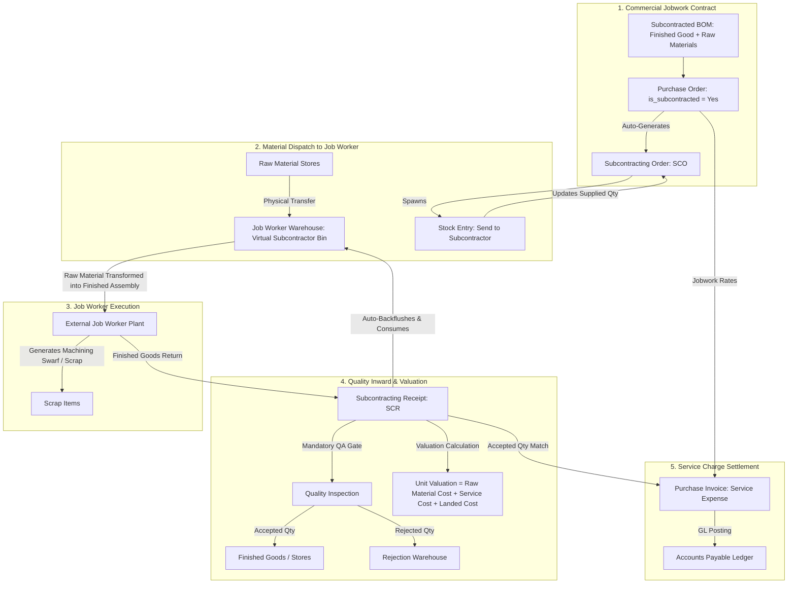

# ERPNext Subcontracting Module: Complete In-Depth Field & Operational Manual

> **Module Base Path:** `/desk/subcontracting`  
> **Environment:** ERPNext v14 / v15 & Frappe Framework with Sarathi AI Labs Industrial Foundation  
> **Target Audience:** Sourcing Managers, Subcontracting In-Charge, Quality Engineers, Production Planners, and Cost Accountants  
> **Format:** Pure Markdown (`.md`) Specification Manual  

---

## Master Table of Contents
1. [Architecture & Industrial Subcontracting Lifecycle](#1-architecture--industrial-subcontracting-lifecycle)
2. [Sidebar Master Navigation Map](#2-sidebar-master-navigation-map)
3. [Section 1: Subcontracting Workspace & Navigation Hub](#section-1-subcontracting-workspace--navigation-hub)
4. [Section 2: Subcontracting Order - SCO (`/desk/subcontracting-order`)](#section-2-subcontracting-order---sco-desksubcontracting-order)
   - [Tab 1: Order Details, Job Worker & Dimensions](#tab-1-sco-details-job-worker--dimensions)
   - [Tab 2: Subcontracted Items Table (`Subcontracting Order Item`)](#tab-2-sco-subcontracted-items-table)
   - [Tab 3: Service Items Table (`Subcontracting Order Service Item`)](#tab-3-sco-service-items-table)
   - [Tab 4: Raw Materials Supplied Table (`Subcontracting Order Supplied Item`)](#tab-4-sco-raw-materials-supplied-table)
   - [Tab 5: Address, Additional Costs & Other Info](#tab-5-sco-address-additional-costs--other-info)
5. [Section 3: Raw Material Delivery to Job Worker (`Stock Entry`)](#section-3-raw-material-delivery-to-job-worker-stock-entry)
   - [Material Transfer for Subcontracting](#material-transfer-for-subcontracting)
   - [Job Worker Warehouse Stock Ledger Accounting](#job-worker-warehouse-stock-ledger-accounting)
6. [Section 4: Subcontracting Receipt - SCR (`/desk/subcontracting-receipt`)](#section-4-subcontracting-receipt---scr-desksubcontracting-receipt)
   - [Tab 1: Receipt Details, Gate Inward & Warehouses](#tab-1-scr-receipt-details)
   - [Tab 2: Received Items Table (`Subcontracting Receipt Item`)](#tab-2-scr-received-items-table)
   - [Tab 3: Raw Materials Consumed Table (`Subcontracting Receipt Supplied Item`)](#tab-3-scr-raw-materials-consumed-table)
   - [Tab 4: Scrap, By-Products & Process Loss Accounting](#tab-4-scrap-by-products--process-loss-accounting)
   - [Tab 5: Landed Cost & Service Charge Valuation Math](#tab-5-landed-cost--service-charge-valuation-math)
7. [Section 5: Jobwork Invoicing & Settlement (`Purchase Invoice`)](#section-5-jobwork-invoicing--settlement-purchase-invoice)
   - [Service Charge 3-Way Match & Accounting Postings](#service-charge-3-way-match--accounting-postings)
8. [Section 6: Subcontracting Inward Order (Client Jobwork Execution)](#section-6-subcontracting-inward-order-client-jobwork-execution)
9. [Section 7: Master Data Prerequisites & BOM Configuration](#section-7-master-data-prerequisites--bom-configuration)
   - [Finished Good BOM Architecture with Service Items](#finished-good-bom-architecture-with-service-items)
   - [Job Worker Warehouse Configuration](#job-worker-warehouse-configuration)
10. [Section 8: Subcontracting Reports & Audit Analytics](#section-8-subcontracting-reports--audit-analytics)
    - [Subcontract Order Summary](#report-1-subcontract-order-summary)
    - [Subcontracted Item To Be Received](#report-2-subcontracted-item-to-be-received)
    - [Subcontracted Raw Materials To Be Transferred](#report-3-subcontracted-raw-materials-to-be-transferred)
11. [End-to-End Real-World Industrial Subcontracting Blueprint](#11-end-to-end-real-world-industrial-subcontracting-blueprint)

---

## 1. Architecture & Industrial Subcontracting Lifecycle

In discrete industrial manufacturing and machine building, specialized operations (such as 5-axis CNC machining, heat treatment, induction hardening, grinding, and surface coating) are frequently outsourced to external specialists (**Job Workers**).

In ERPNext v14 and v15, **Subcontracting** is decoupled into two coordinated streams:
1. **Commercial Purchase Order:** Contracts the jobwork service fee (labor/processing charge) with the vendor.
2. **Operational Subcontracting Order & Receipt:** Tracks physical raw material custody, consumed billets, scrap generation, and landed inventory valuation.



---

## 2. Sidebar Master Navigation Map

When navigating to the **Subcontracting** workspace (`/desk/subcontracting`), the left sidebar and workspace cards display the following operations:

| Section | Sidebar Item Label | Route / URL | Core Operational Role |
| :--- | :--- | :--- | :--- |
| **Outward Order** | **Purchase Order** | `/desk/purchase-order?is_subcontracted=Yes` | Commercial contract establishing unit service rates with the job worker. |
| **Outward Order** | **Subcontracting Order** | `/desk/subcontracting-order` | Operational manufacturing tracking document managing supplied raw materials and expected finished goods. |
| **Outward Order** | **Subcontracting Delivery** | `/desk/stock-entry?purpose=Send%20to%20Subcontractor` | Stock movement transferring company-owned raw materials to the job worker warehouse. |
| **Outward Order** | **Subcontracting Receipt** | `/desk/subcontracting-receipt` | Inward receiving document checking QA, recording scrap, and backflushing consumed raw materials. |
| **Inward Order** | **Sales Order** | `/desk/sales-order` | Contract when an external customer hires your plant to perform jobwork machining. |
| **Inward Order** | **Subcontracting Inward Order** | `/desk/subcontracting-inward-order` | Tracks receipt of customer-supplied raw materials to be processed in-house. |
| **Reports** | **Subcontract Order Summary** | `/desk/query-report/Subcontract%20Order%20Summary` | Cross-job status tracking ordered vs supplied vs received vs pending quantities. |
| **Reports** | **Subcontracted Item To Be Received** | `/desk/query-report/Subcontracted%20Item%20To%20Be%20Received` | Open finished goods delivery radar highlighting overdue items at job workers. |
| **Reports** | **Subcontracted Raw Materials To Be Transferred** | `/desk/query-report/Subcontracted%20Raw%20Materials%20To%20Be%20Transferred` | Shortage report identifying raw materials not yet dispatched to vendors. |

---

## Section 1: Subcontracting Workspace & Navigation Hub

### 1. Purpose of this Screen
The **Subcontracting Workspace** (`/desk/subcontracting`) consolidates metrics on materials lying outside plant premises at third-party vendor workshops, pending jobwork receipts, and open processing contracts.

### 2. Screen Layout & Component Structure
```
+---------------------------------------------------------------------------------------------------------------------------------+
| / Subcontracting                                                                                                               |
+---------------------------------------------------------------------------------------------------------------------------------+
| OPERATIONAL TILES:                                                                                                              |
| - Outward Subcontracting: Subcontracting Order, Subcontracting Receipt, Subcontracting Delivery (Stock Entry)                   |
| - Commercial Contracts: Purchase Order (Subcontracted), Purchase Invoice (Jobwork Charges)                                      |
| - Inward Subcontracting: Sales Order, Subcontracting Inward Order                                                               |
| - Audit Reports: Subcontract Order Summary, Subcontracted Item To Be Received, Raw Materials To Be Transferred                  |
+---------------------------------------------------------------------------------------------------------------------------------+
```

---

## Section 2: Subcontracting Order - SCO (`/desk/subcontracting-order`)

Navigating to **Subcontracting Order** opens the operational tracking list. Clicking **+ Add Subcontracting Order** opens the core execution document containing **5 specialized tabs**.

```
+---------------------------------------------------------------------------------------------------------------------------------+
| Subcontracting Order Form: [ Details ]  [ Address and Contact ]  [ Additional Costs ]  [ Other Info ]  [ Connections ]          |
+---------------------------------------------------------------------------------------------------------------------------------+
```

---

### Tab 1: SCO Details, Job Worker & Dimensions

```
+---------------------------------------------------------------------------------------------------------------------------------+
| TAB: Details                                                                                                                    |
+----------------------------------------------------------------+----------------------------------------------------------------+
| Series *: [ SC-ORD-.YYYY.-                                   v ]| Company *: [ SarathiAILabs                                   v ]|
| Subcontracting Purchase Order *: [ PUR-ORD-2026-00042        v ]| Date *: [ 2026-10-15                                          ]|
| Job Worker *: [ SUP-00142 - Precise CNC Works                v ]| Required By: [ 2026-11-05                                     ]|
| Job Worker Name: [ Precise CNC Works                          ]| Status: [ Open                                                v ]|
| Job Worker Warehouse *: [ Subcontractor Stores - PCW - SL    v ]| % Received: [ 0.00 %                                          ]|
| Job Worker Currency: [ INR ] (RO)                              | Set Target Warehouse: [ Finished Goods - SL                   v ]|
+----------------------------------------------------------------+----------------------------------------------------------------+
| SECTION: Accounting Dimensions                                                                                                  |
+----------------------------------------------------------------+----------------------------------------------------------------+
| Project: [ PROJ-0008                                         v ]| Cost Center: [ Industrial Projects - SL                      v ]|
+----------------------------------------------------------------+----------------------------------------------------------------+
```

#### Field-by-Field Detailed Breakdown:

| Field Label | Fieldname | Field Type | Mandatory / Default | Available Options / Fill Mode | Why Use This Field? | How to Use This Field? | Where Does It Connect / Impact? |
| :--- | :--- | :--- | :--- | :--- | :--- | :--- | :--- |
| **Series** | `naming_series` | `Select` | **Yes (Required)** | **Static Options:**<br>&bull; `SC-ORD-.YYYY.-` | Unique operational tracking identifier. | Select series from dropdown. | Generates primary key (e.g., `SC-ORD-2026-00018`). |
| **Purchase Order** | `purchase_order` | `Link` | **Yes (Required)** | **Dynamic Link:** Links to `Purchase Order` (where `is_subcontracted = 'Yes'`). | Establishes commercial origin and approved service rates. | Select the parent subcontract Purchase Order from dropdown. | Auto-populates Job Worker, Finished Goods Items, Service Items, and Supplied Raw Materials. |
| **Job Worker** | `supplier` | `Link` | **Yes (Required)** | **Dynamic Link:** Links to `Supplier` master. | External machining workshop or vendor performing the process. | Auto-fetched from Purchase Order. | Governs Job Worker Warehouse selection and communication. |
| **Job Worker Warehouse** | `supplier_warehouse` | `Link` | **Yes (Required)** | **Dynamic Link:** Links to `Warehouse` master (where `is_group = 0`). | Virtual inventory bin representing materials physically situated inside the job worker's factory. | Select warehouse dedicated to this specific vendor (e.g., `Subcontractor Stores - PCW - SL`). | Stock transferred via Stock Entry is debited to this warehouse; Subcontracting Receipt consumes stock from this warehouse. |
| **Date** | `transaction_date` | `Date` | **Yes (Required)** | Date picker (`YYYY-MM-DD`). | Date of order issuance. | Defaults to today's date. | Establishes operational baseline date. |
| **Required By** | `schedule_date` | `Date` | Read-only | Date picker. | Target date finished goods must be delivered back to the main plant. | Auto-fetched from Purchase Order. | Drives `Subcontracted Item To Be Received` report. |
| **Set Target Warehouse** | `set_warehouse` | `Link` | Optional | **Dynamic Link:** Links to `Warehouse` master. | Default receiving store for finished goods upon return. | Select central warehouse (e.g., `Stores - SL`, `Finished Goods - SL`). | Populates target warehouse across all line items in the items table. |
| **Project** | `project` | `Link` | Optional | **Dynamic Link:** Links to `Project` master. | Ties outsourced jobwork directly to customer machine delivery project. | Select target project (e.g., `PROJ-0008`). | Inherits into Subcontracting Receipt and Purchase Invoices. |
| **Cost Center** | `cost_center` | `Link` | Optional | **Dynamic Link:** Links to `Cost Center` master. | Financial cost dimension. | Select cost center. | Tags General Ledger expense entries. |
| **Status** | `status` | `Select` | Default: `Draft` (Read-only) | **Static Options:**<br>&bull; `Draft`<br>&bull; `Open`<br>&bull; `Partially Received`<br>&bull; `Completed`<br>&bull; `Closed`<br>&bull; `Cancelled` | Tracks execution state. | Managed by system as materials are transferred and received back. | Blocks further stock transfers once marked `Completed` or `Closed`. |

---

### Tab 2: SCO Subcontracted Items Table

Table `items` (`Subcontracting Order Item`) lists the finished goods assemblies to be produced by the job worker:

```
+---------------------------------------------------------------------------------------------------------------------------------+
| NESTED TABLE: Subcontracted Items (Finished Assemblies to Receive)                                                             |
+---------------------------------------------------------------------------------------------------------------------------------+
| No. | Item Code *             | Item Name (RO)               | Qty *   | Rate (Service) | Amount        | BOM *                     |
| 1   | [ ROBOT-ARM-MACHINED  ] | 5-Axis Machined Robot Arm    | 10 Nos  | ₹ 4,500.00     | ₹ 45,000.00   | [ BOM-ROBOT-ARM-001     v ]|
+---------------------------------------------------------------------------------------------------------------------------------+
```
- **`item_code` [Link to Item]:** The finished part to be received back from the vendor.
- **`qty` [Float]:** Total quantity ordered.
- **`rate` [Currency - Read-only]:** Service machining charge per unit (inherited from PO).
- **`bom` [Link to BOM]:** Bill of Materials defining the exact raw materials required to produce 1 unit of this finished part.

---

### Tab 3: SCO Service Items Table

Table `service_items` (`Subcontracting Order Service Item`) isolates the exact commercial labor lines from the Purchase Order:

```
+---------------------------------------------------------------------------------------------------------------------------------+
| NESTED TABLE: Service Items (Commercial Processing Charges)                                                                     |
+---------------------------------------------------------------------------------------------------------------------------------+
| No. | Service Item *          | Description                  | Qty *   | Rate *         | Amount *      | Purchase Order Item     |
| 1   | [ SRV-CNC-MILL-5AXIS  ] | 5-Axis CNC Precision Milling | 10 Nos  | ₹ 4,500.00     | ₹ 45,000.00   | PO-ITEM-00142           |
+---------------------------------------------------------------------------------------------------------------------------------+
```
- Decouples physical inventory parts from commercial services. The Service Item is invoiced in the Purchase Invoice, while the physical finished item enters warehouse inventory.

---

### Tab 4: SCO Raw Materials Supplied Table

Table `supplied_items` (`Subcontracting Order Supplied Item`) calculates the exact raw materials required based on the BOM:

```
+---------------------------------------------------------------------------------------------------------------------------------+
| NESTED TABLE: Raw Materials Supplied (Company-Owned Stock Provided to Vendor)                                                  |
+---------------------------------------------------------------------------------------------------------------------------------+
| Main Item Code        | Raw Material Item Code *  | Required Qty | Supplied Qty (RO) | Consumed Qty (RO) | Reserve Warehouse        |
| ROBOT-ARM-MACHINED    | RM-ALU-BLT-7075-80MM      | 120.00 Kg    | 120.00 Kg         | 0.00 Kg           | [ Stores - SL          v ]|
| ROBOT-ARM-MACHINED    | HDW-DOWEL-PIN-12X50       | 40.00 Nos    | 40.00 Nos         | 0.00 Nos          | [ Hardware Stores - SL v ]|
+---------------------------------------------------------------------------------------------------------------------------------+
```

#### Operational Mechanics of Supplied Items:
- **`required_qty`:** Calculated as $\text{Finished Good Qty} \times \text{BOM Item Quantity}$.
- **`supplied_qty`:** Cumulative quantity physically transferred from company stores to the Job Worker Warehouse via Stock Entries.
- **`consumed_qty`:** Cumulative quantity backflushed upon submitting Subcontracting Receipts.
- **`reserve_warehouse`:** Source warehouse from which raw stock will be drawn when creating the transfer entry.

---

## Section 3: Raw Material Delivery to Job Worker (`Stock Entry`)

Before the job worker can start manufacturing, the company must physically transfer the raw materials to their workshop.

```
+---------------------------------------------------------------------------------------------------------------------------------+
| Stock Entry Form: Transfer to Subcontractor                                                                                     |
+----------------------------------------------------------------+----------------------------------------------------------------+
| Series: [ MAT-STE-.YYYY.-                                    v ]| Stock Entry Purpose *: [ Send to Subcontractor               v ]|
| Subcontracting Order: [ SC-ORD-2026-00018                    v ]| Posting Date: [ 2026-10-16 ]     Posting Time: [ 10:00:00 ]     |
| Default Source Warehouse: [ Stores - SL                      v ]| Default Target Warehouse: [ Subcontractor Stores - PCW - SL v ]|
+----------------------------------------------------------------+----------------------------------------------------------------+
| NESTED TABLE: Items Transferred                                                                                                 |
+---------------------------------------------------------------------------------------------------------------------------------+
| Item Code *          | Source Warehouse *     | Target Warehouse (Job Worker) * | Transfer Qty * | Valuation Rate | Amount       |
| RM-ALU-BLT-7075-80MM | Stores - SL            | Subcontractor Stores - PCW - SL | 120.00 Kg      | ₹ 450.00       | ₹ 54,000.00  |
| HDW-DOWEL-PIN-12X50  | Hardware Stores - SL   | Subcontractor Stores - PCW - SL | 40.00 Nos      | ₹ 35.00        | ₹ 1,400.00   |
+---------------------------------------------------------------------------------------------------------------------------------+
```

### Stock Ledger & Balance Sheet Impact:
- **No Profit/Loss or Expense is incurred yet!**
- The material remains on the company balance sheet as inventory asset:
  - **Credit (Reduction):** Central Warehouse (`Stores - SL`)
  - **Debit (Addition):** Job Worker Warehouse (`Subcontractor Stores - PCW - SL`)
- Once submitted, ERPNext updates `supplied_qty` inside the parent Subcontracting Order from `0` to `120.00 Kg`.

---

## Section 4: Subcontracting Receipt - SCR (`/desk/subcontracting-receipt`)

When the job worker finishes machining and dispatches the completed components back to the main plant, the receiving inspector creates a **Subcontracting Receipt** (`/desk/subcontracting-receipt`).

```
+---------------------------------------------------------------------------------------------------------------------------------+
| Subcontracting Receipt Form: [ Details ]  [ Items ]  [ Raw Materials ]  [ Additional Costs ]  [ Other Info ]                    |
+---------------------------------------------------------------------------------------------------------------------------------+
```

---

### Tab 1: SCR Receipt Details

```
+----------------------------------------------------------------+----------------------------------------------------------------+
| Series *: [ SC-REC-.YYYY.-                                   v ]| Company *: [ SarathiAILabs                                   v ]|
| Subcontracting Order *: [ SC-ORD-2026-00018                  v ]| Posting Date *: [ 2026-10-28 ]  Posting Time *: [ 15:30:00 ]    |
| Job Worker *: [ SUP-00142 - Precise CNC Works                v ]| Supplier Delivery Note #: [ PCW/DC/26-114                    ]|
| Job Worker Warehouse *: [ Subcontractor Stores - PCW - SL    v ]| Status: [ Completed                                          v ]|
| Set Accepted Warehouse *: [ Finished Goods - SL              v ]| Set Rejected Warehouse *: [ Rejection Stores - SL            v ]|
+----------------------------------------------------------------+----------------------------------------------------------------+
```

---

### Tab 2: SCR Received Items Table

Clicking on a row in `items` (`Subcontracting Receipt Item`) opens the detailed receipt modal:

```
+---------------------------------------------------------------------------------------------------------------------------------+
| ROW EDIT MODAL: Subcontracting Receipt Item                                                                                     |
+----------------------------------------------------------------+----------------------------------------------------------------+
| Item Code *: [ ROBOT-ARM-MACHINED                            v ]| Item Name: [ 5-Axis Machined Robot Arm                        ]|
| Qty (As per BOM) *: [ 10.00 Nos                                ]| Accepted Qty *: [ 9.00 Nos                                    ]|
| Rejected Qty: [ 1.00 Nos                                       ]| Process Loss Qty: [ 0.00 Nos                                  ]|
| Accepted Warehouse *: [ Finished Goods - SL                  v ]| Rejected Warehouse: [ Rejection Stores - SL                  v ]|
| Quality Inspection: [ QA-INSP-2026-00084                     v ]| BOM: [ BOM-ROBOT-ARM-001                                     v ]|
+----------------------------------------------------------------+----------------------------------------------------------------+
| SECTION: Inventory Valuation Breakdown (Calculated by ERPNext)                                                                  |
+----------------------------------------------------------------+----------------------------------------------------------------+
| Raw Material Cost Per Qty: [ ₹ 5,540.00                        ]| Service Cost Per Qty *: [ ₹ 4,500.00                           ]|
| Additional Cost Per Qty: [ ₹ 250.00                            ]| Scrap / Secondary Item Deduction: [ - ₹ 150.00                 ]|
| Valuation Rate (Final Inventory Unit Cost): [ ₹ 10,140.00      ]| Total Amount: [ ₹ 91,260.00 (9 Accepted Nos)                   ]|
+----------------------------------------------------------------+----------------------------------------------------------------+
```

#### Detailed Valuation Formula:
$$\text{Valuation Rate} = \text{Raw Material Cost Per Qty} + \text{Service Cost Per Qty} + \text{Additional Cost Per Qty} - \text{Scrap Credit Per Qty}$$
$$\text{Valuation Rate} = ₹ 5,540.00 + ₹ 4,500.00 + ₹ 250.00 - ₹ 150.00 = ₹ 10,140.00 \text{ per unit}$$

---

### Tab 3: SCR Raw Materials Consumed Table

Table `supplied_items` (`Subcontracting Receipt Supplied Item`) automatically deducts the raw materials consumed from the Job Worker Warehouse:

```
+---------------------------------------------------------------------------------------------------------------------------------+
| NESTED TABLE: Raw Materials Consumed (Backflushed from Subcontractor Warehouse)                                                 |
+---------------------------------------------------------------------------------------------------------------------------------+
| Main Item Code        | Raw Material Item Code *  | Required Qty | Consumed Qty * | Valuation Rate | Amount Backflushed         |
| ROBOT-ARM-MACHINED    | RM-ALU-BLT-7075-80MM      | 120.00 Kg    | 120.00 Kg      | ₹ 450.00       | ₹ 54,000.00                |
| ROBOT-ARM-MACHINED    | HDW-DOWEL-PIN-12X50       | 40.00 Nos    | 40.00 Nos      | ₹ 35.00        | ₹ 1,400.00                 |
+---------------------------------------------------------------------------------------------------------------------------------+
```
- Submitting the Subcontracting Receipt automatically writes off 120 Kg of aluminum billet from `Subcontractor Stores - PCW - SL`, rolling that ₹ 55,400 value directly into the capital asset valuation of the finished machined robot arms entering `Finished Goods - SL`.

---

### Tab 4: Scrap, By-Products & Process Loss Accounting

In machining processes, raw billets are converted into chips, turnings, or off-cuts:
1. **Scrap Recovery:** If defined in the BOM, ERPNext adds a Scrap item row (e.g., `SCRAP-ALU-TURNINGS`, Qty: 25 Kg, Rate: ₹ 60/Kg = ₹ 1,500.00).
   - The scrap value is **credited** against the finished part cost and **debited** into *Scrap Stores - SL*.
2. **Process Loss:** If metal is lost as airborne dust or non-recoverable vaporization, `process_loss_qty` accounts for the material balance without creating scrap inventory.

---

## Section 5: Jobwork Invoicing & Settlement (`Purchase Invoice`)

Once the Subcontracting Receipt is submitted, the finance team books the vendor's processing invoice.

```
+---------------------------------------------------------------------------------------------------------------------------------+
| Purchase Invoice: Jobwork Machining Charges                                                                                     |
+----------------------------------------------------------------+----------------------------------------------------------------+
| Supplier: [ SUP-00142 - Precise CNC Works                    v ]| Bill No (Job Worker Invoice #): [ PCW/INV/26-0819             ]|
| Purchase Order: [ PUR-ORD-2026-00042                         v ]| Subcontracting Receipt: [ SC-REC-2026-00014                  v ]|
+----------------------------------------------------------------+----------------------------------------------------------------+
| NESTED TABLE: Service Line Items Billed                                                                                         |
+---------------------------------------------------------------------------------------------------------------------------------+
| Service Item Code     | Accepted Qty Billed | Quoted Service Rate | Net Amount  | Taxes (GST 18%) | Total Payable Invoice Amount |
| SRV-CNC-MILL-5AXIS    | 9.00 Nos (Accepted) | ₹ 4,500.00          | ₹ 40,500.00 | ₹ 7,290.00      | ₹ 47,790.00                  |
+---------------------------------------------------------------------------------------------------------------------------------+
```

### General Ledger Accounting Entries:
- **Debit:** Expenses Included In Valuation / Service Clearing Account: `₹ 40,500.00`
- **Debit:** Input GST Asset (CGST + SGST): `₹ 7,290.00`
- **Credit:** Accounts Payable (Precise CNC Works): `₹ 47,790.00`
*(Notice that raw material costs are NOT billed on this invoice, because the company already owned the raw materials!)*

---

## Section 6: Subcontracting Inward Order (Client Jobwork Execution)

When an external customer delivers raw materials to *your* plant for custom machining or coating:
1. **Commercial Contract:** Create a **Sales Order** charging the customer for service machining.
2. **Inward Material Receipt:** Record customer-supplied parts via **Stock Entry (Material Receipt)** into a designated customer-owned warehouse with **zero valuation**.
3. **Internal Assembly & Processing:** Issue a **Work Order** to machine the parts.
4. **Outward Dispatch:** Generate a **Delivery Note** returning finished components to the customer.
5. **Invoicing:** Issue a **Sales Invoice** billing solely for the machining labor and machine hour charges.

---

## Section 7: Master Data Prerequisites & BOM Configuration

### 1. Finished Good BOM Architecture with Service Items
To execute subcontracting smoothly, the engineering Bill of Materials must be structured correctly:
- Master Item: `ROBOT-ARM-MACHINED`
  - In Item Master: Check `Is Subcontracted = 1`.
  - Default BOM: `BOM-ROBOT-ARM-001`.
  - Subcontracted Service Item: `SRV-CNC-MILL-5AXIS` (Type: *Service*, Unit: *Nos*).
- BOM Table:
  - Row 1: `RM-ALU-BLT-7075-80MM` (Raw Material, Qty: 12 Kg per arm).
  - Row 2: `HDW-DOWEL-PIN-12X50` (Hardware, Qty: 4 Nos per arm).
  - Scrap Table: `SCRAP-ALU-TURNINGS` (Qty: 2.5 Kg per arm).

---

## Section 8: Subcontracting Reports & Audit Analytics

### Report 1: Subcontract Order Summary
- **Route:** `/desk/query-report/Subcontract%20Order%20Summary`
- **Filters:** `company`, `from_date`, `to_date`, `subcontracting_order`, `supplier`, `status`.
- **Columns:** `Subcontracting Order` | `Job Worker` | `Finished Item` | `Ordered Qty` | `Received Qty` | `Pending Qty` | `Raw Material Item` | `Required Qty` | `Supplied Qty` | `Consumed Qty`.
- **Business Value:** Master reconciliation audit verifying that job workers do not hold excess raw materials beyond what was consumed in returned assemblies.

### Report 2: Subcontracted Item To Be Received
- **Route:** `/desk/query-report/Subcontracted%20Item%20To%20Be%20Received`
- **Columns:** `Subcontracting Order` | `Job Worker` | `Required By Date` | `Item Code` | `Pending Qty` | `Days Overdue`.
- **Business Value:** Expediting tool identifying vendors causing assembly line delays.

### Report 3: Subcontracted Raw Materials To Be Transferred
- **Route:** `/desk/query-report/Subcontracted%20Raw%20Materials%20To%20Be%20Transferred`
- **Columns:** `Subcontracting Order` | `Raw Material Item` | `Required Qty` | `Supplied Qty` | `Pending Transfer Qty` | `Available Stock in Central Stores`.
- **Business Value:** Dispatch radar for central stores ensuring raw materials are promptly kitted and shipped to outside processors.

---

## 11. End-to-End Real-World Industrial Subcontracting Blueprint

### Blueprint: 5-Axis CNC Precision Machining of Robotic Tooling Arms

#### Jobwork Specifications:
- **Project Link:** `PROJ-0008` (EV Battery Line Phase 2)
- **Finished Assembly:** 10 Nos 5-Axis Machined Robot Arms (`ROBOT-ARM-MACHINED`)
- **Raw Material Supplied:** 120 Kg Aluminum Billet Grade 7075 (`RM-ALU-BLT-7075-80MM`) at ₹ 450/Kg
- **Outsourced Job Worker:** Precise CNC Works (`SUP-00142`)
- **Contracted Machining Rate:** ₹ 4,500.00 per unit + GST 18%

```mermaid
sequenceDiagram
    autonumber
    actor PE as Production Engineer
    actor PO as Purchase Officer
    actor WH as Stores In-Charge
    actor JW as Job Worker (Precise CNC)
    actor QA as Quality Inspector
    actor AC as Accounts Payable

    PE->>PO: Raises demand for 10 Nos ROBOT-ARM-MACHINED (Subcontracted)
    PO->>JW: Issues Subcontract Purchase Order PUR-ORD-2026-00042 (₹ 4,500/unit service)
    PO->>PO: Auto-generates Subcontracting Order SC-ORD-2026-00018
    WH->>WH: Creates Stock Entry 'Send to Subcontractor' for 120 Kg 7075 Aluminum Billets
    WH->>JW: Dispatches 120 Kg raw billets to Job Worker Warehouse (Subcontractor Stores - PCW)
    JW->>JW: Performs 5-Axis milling, boring, and surface grinding over 12 days
    JW->>WH: Delivers 10 finished arms + 25 Kg aluminum turnings scrap with delivery challan
    WH->>QA: Initiates Quality Inspection
    QA->>QA: CMM dimensional check: 9 Passed, 1 Rejected due to bore oversize
    WH->>WH: Submits Subcontracting Receipt SC-REC-2026-00014
    Note over WH: 9 Accepted arms enter Finished Goods - SL at ₹ 10,140/unit<br/>1 Rejected arm enters Rejection Stores - SL<br/>120 Kg billets backflushed from Subcontractor Stores - PCW
    JW->>AC: Invoices ₹ 47,790.00 for 9 accepted machined arms (incl. 18% GST)
    AC->>AC: 3-Way Match confirms 9 units accepted; posts Purchase Invoice ACC-PINV-2026-00052
    AC->>JW: Dispatches electronic bank settlement
```

#### Step-by-Step Execution Walkthrough:
1. **Contract Issuance:** Purchase Officer creates **Purchase Order** `PUR-ORD-2026-00042` with `is_subcontracted = 'Yes'`, adding Service Item `SRV-CNC-MILL-5AXIS` for 10 Nos at ₹ 4,500.00/unit.
2. **Operational Order Generation:** ERPNext auto-generates **Subcontracting Order** `SC-ORD-2026-00018`, linking BOM `BOM-ROBOT-ARM-001` and determining that 120 Kg of Grade 7075 aluminum billet is required.
3. **Material Dispatch:** Central stores executes **Stock Entry (Send to Subcontractor)** transferring 120 Kg of billets from *Stores - SL* to *Subcontractor Stores - PCW - SL*.
4. **Machining Execution:** Precise CNC Works machines the components over a 12-day window.
5. **Quality Gate & Receiving:** Parts arrive at plant. Quality Inspector tests on Coordinate Measuring Machine (CMM): 9 units pass tight $\pm 10\mu m$ tolerances; 1 unit is rejected.
6. **Receipt Submission & Backflushing:** Stores submits **Subcontracting Receipt** `SC-REC-2026-00014`:
   - 9 units enter *Finished Goods - SL* with valuation of ₹ 10,140.00 each ($\text{Raw Material} + \text{Machining} + \text{Freight} - \text{Scrap}$).
   - 1 unit enters *Rejection Stores - SL* for vendor return or scrap recovery.
   - 120 Kg of aluminum billet is automatically written off from *Subcontractor Stores - PCW - SL*.
7. **Service Invoicing:** Accounts Payable books vendor invoice for exactly 9 accepted units (₹ 40,500 + GST), concluding the subcontracting cycle with total financial and inventory precision.
