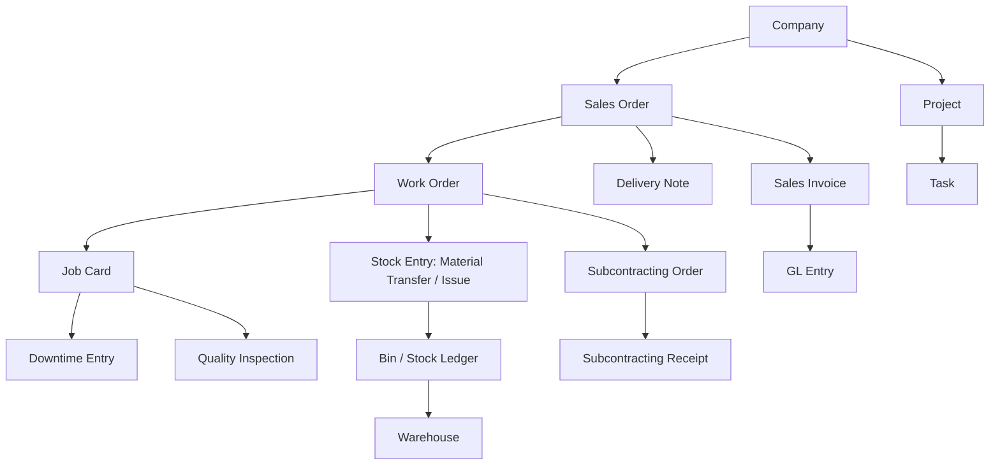

# Sarathi Industrial Control Tower — Integration & Regression Test Plan

**Task ID:** DASH-033  
**Parent Epic:** DASH-030 — Testing, Performance, Security & Release  
**Applications:** `sarathi_owner`, `sarathi_visibility`  
**Framework:** Frappe Framework + ERPNext (v14/v15 compatible)  
**Testing Tools:** Python standard library `unittest`, Playwright (Chromium), Frappe API test harness  
**Related Tasks:** DASH-001 through DASH-032  
**Status:** Active Implementation & Execution  

---

## 1. Executive Summary & Objective

The objective of **DASH-033** is to establish a comprehensive integration and regression test suite for the three production dashboard experiences within the Sarathi Industrial Control Tower suite:

1. **Owner & Executive Dashboard** (`sarathi_owner`): Financial KPIs, customer analytics, project progress, manufacturing summary, inventory valuation, and executive risk alerts.
2. **Production Management Control Tower** (`sarathi_visibility`): Factory overview, Work Orders, Job Cards, material readiness and shortages, workstation downtime, quality/rework, subcontracting, and centralized production exception queues.
3. **Shop-Floor Supervisor & Operator Workboard** (`sarathi_visibility`): Mobile-first operator job queue, current active operation highlighting, validated shop-floor reporting actions (start, progress, pause, resume, stop, complete), and supervisor team workload monitoring.

This test plan validates the complete integration path:
$$\text{Dashboard UI} \longrightarrow \text{Frappe API} \longrightarrow \text{Permission Checks} \longrightarrow \text{ERPNext Documents \& Data} \longrightarrow \text{API Response} \longrightarrow \text{Dashboard Rendering}$$

It also ensures that recent enhancements (responsive layouts from DASH-028, accessibility conventions from DASH-029, KPI reconciliation logic from DASH-031, and role security controls from DASH-032) continue to function without regressions.

---

## 2. Dashboard Routes & Architecture

| Dashboard Experience | Desk Route | Application | Primary JS Controller | Entry Template / Page |
| :--- | :--- | :--- | :--- | :--- |
| **Owner & Executive Dashboard** | `/app/sarathiownertower` | `sarathi_owner` | `frappe.SarathiOwnerDashboard` | `page/sarathiownertower` |
| **Production Control Tower** | `/app/sarathicontroltower` | `sarathi_visibility` | `frappe.SarathiControlTower` | `page/sarathicontroltower` |
| **Shop-Floor Workboard** | `/app/sarathishopfloor` | `sarathi_visibility` | `frappe.SarathiShopFloorWorkboard` | `page/sarathishopfloor` |

### Shared Presentation & Runtime Assets
- `sarathi_visibility/public/js/sarathi_ui.js`: Presentation components (`kpi`, `action`, `status`, `severity`, `table`, `state`, `filterBar`, `dialog`, `badge`, `progress`, `notice`).
- `sarathi_visibility/public/css/sarathi_ui.css`: Design system tokens, accessible focus states, responsive CSS grid/flex layouts.
- `sarathi_visibility/public/js/sarathi_dashboard_runtime.js`: Client-side cache eviction, asset loader deduplication, and activity-driven background refreshes.

---

## 3. Implemented Features & Backend API Endpoints

### 3.1 Owner & Executive Dashboard (`sarathi_owner`)

| API Endpoint | HTTP Method | Whitelisted Function | Core Parameters | Output Schema / Summary |
| :--- | :--- | :--- | :--- | :--- |
| `sarathi_owner.api.homepage.get_homepage` | `GET` | `get_homepage` | `filters` (JSON string or dict) | Consolidated envelope: `executive_risks`, `finance`, `sales`, `project_health`, `manufacturing_inventory`, `projects`, `work_orders`. |
| `sarathi_owner.api.homepage.options` | `GET` | `options` | `resource`, `company`, `customer`, `search`, `start` | Filter dropdown options for companies, customers, projects, and warehouses. |
| `sarathi_owner.api.finance_kpis.get_finance_kpis` | `GET` | `get_finance_kpis` | `filters` | Invoiced sales, P&L income/expense/net profit/margin, gross profit, cash runway, receivables. |
| `sarathi_owner.api.sales_analytics.get_sales_analytics` | `GET` | `get_sales_analytics` | `filters` | Revenue trends, top customer concentration, open order backlog, delivery reliability. |
| `sarathi_owner.api.project_health.get_project_delivery_health` | `GET` | `get_project_delivery_health` | `filters` | Project health breakdown (overdue, at risk, due soon), task completion rates, delivery milestones. |
| `sarathi_owner.api.manufacturing_inventory.get_manufacturing_inventory_summary` | `GET` | `get_manufacturing_inventory_summary` | `filters` | Work order throughput, stock valuation, component shortage alerts. |
| `sarathi_owner.api.executive_risks.get_executive_risks_and_approvals` | `GET` | `get_executive_risks_and_approvals` | `filters` | Prioritized risk cards across receivables, deliveries, projects, and manufacturing. |

### 3.2 Production Management Control Tower (`sarathi_visibility`)

| API Endpoint | HTTP Method | Whitelisted Function | Core Parameters | Output Schema / Summary |
| :--- | :--- | :--- | :--- | :--- |
| `sarathi_visibility.api.factory_overview.get_factory_overview` | `GET` | `get_factory_overview` | `filters` | Factory KPIs (Active, In Process, Completed, Stopped, Overdue WOs), completion targets. |
| `sarathi_visibility.api.work_orders.get_work_orders` | `GET` | `get_work_orders` | `filters`, `start`, `page_length`, `sort_by`, `sort_order` | Paginated Work Orders with item, progress, qty, status, and target date. |
| `sarathi_visibility.api.work_orders.get_job_cards` | `GET` | `get_job_cards` | `filters`, `start`, `page_length`, `sort_by`, `sort_order` | Paginated Job Cards with operation, workstation, completed qty, and status. |
| `sarathi_visibility.api.material_readiness.get_material_readiness` | `GET` | `get_material_readiness` | `filters`, `start`, `page_length` | Warehouse-aware component stock availability, shortage quantities, and Work Order readiness (Ready, Partially Ready, Shortage). |
| `sarathi_visibility.api.workstations.get_workstation_downtime` | `GET` | `get_workstation_downtime` | `filters`, `start`, `page_length` | Workstation status, active jobs, downtime entries clipped to period, and production impact. |
| `sarathi_visibility.api.quality_rework.get_quality_overview` | `GET` | `get_quality_overview` | `filters`, `start`, `page_length` | Quality inspection statistics (passed, failed, pending), rejection rates, top defect items. |
| `sarathi_visibility.api.quality_rework.get_rework_overview` | `GET` | `get_rework_overview` | `filters`, `start`, `page_length` | Corrective Job Cards (`is_corrective_job_card=1`), linked parent jobs, and rework quantities. |
| `sarathi_visibility.api.quality_rework.get_subcontracting_overview` | `GET` | `get_subcontracting_overview` | `filters`, `start`, `page_length` | Subcontracting Orders, suppliers, supplied materials, receipts, and overdue orders. |
| `sarathi_visibility.api.production_exceptions.get_production_exceptions` | `GET` | `get_production_exceptions` | `filters`, `start`, `page_length` | Centralized exception queue across overdue WOs, delayed JCs, shortages, downtime, quality rejections, and subcontracting delays. |

### 3.3 Shop-Floor Supervisor & Operator Workboard (`sarathi_visibility`)

| API Endpoint | HTTP Method | Whitelisted Function | Core Parameters | Output Schema / Summary |
| :--- | :--- | :--- | :--- | :--- |
| `sarathi_visibility.api.shopfloor.get_assigned_jobs` | `GET` | `get_assigned_jobs` | `filters`, `start`, `page_length`, `sort_by`, `sort_order` | Operator-scoped Job Cards with workstation, operation, progress, and material status. |
| `sarathi_visibility.api.shopfloor.get_job_card_detail` | `GET` | `get_job_card_detail` | `job_card` | Detailed Job Card view with operations, time logs, and item requirements. |
| `sarathi_visibility.api.shopfloor.start_job` | `POST` | `start_job` | `job_card` | Begins operation time log, transitions Job Card status to "Work In Progress". |
| `sarathi_visibility.api.shopfloor.record_job_progress` | `POST` | `record_job_progress` | `job_card`, `completed_qty`, `process_loss_qty` | Updates completed and scrap quantities, validates physical count constraints. |
| `sarathi_visibility.api.shopfloor.pause_job` | `POST` | `pause_job` | `job_card`, `pause_reason` | Pauses active time log, transitions status to "On Hold". |
| `sarathi_visibility.api.shopfloor.resume_job` | `POST` | `resume_job` | `job_card` | Resumes active time log, restores "Work In Progress" status. |
| `sarathi_visibility.api.shopfloor.stop_job` | `POST` | `stop_job` | `job_card`, `stop_reason` | Halts operation, records stoppage reason, sets status to "Stopped". |
| `sarathi_visibility.api.shopfloor.complete_job` | `POST` | `complete_job` | `job_card`, `completed_qty`, `process_loss_qty` | Completes operation, verifies final quantities, submits Job Card (`docstatus=1`). |
| `sarathi_visibility.api.shopfloor.get_supervisor_team_overview` | `GET` | `get_supervisor_team_overview` | `filters` | Supervisor-scoped operator workload (active, completed, idle), team blockers, and workstation states. |
| `sarathi_visibility.api.shopfloor.get_shopfloor_workboard` | `GET` | `get_shopfloor_workboard` | `filters` | Combined workboard payload: operator jobs, active operation timer, blockers, and supervisor metrics. |

---

## 4. Relevant ERPNext Source DocTypes & Workflows



### DocType Source Mapping:
- **Finance & Accounting:** `Company`, `Sales Invoice`, `Purchase Invoice`, `GL Entry`, `Payment Entry`, `Fiscal Year`.
- **Sales & Backlog:** `Customer`, `Sales Order`, `Sales Order Item`, `Delivery Note`.
- **Projects & Milestones:** `Project`, `Task`, `Timesheet`.
- **Manufacturing Core:** `Work Order`, `Work Order Item`, `Job Card`, `Job Card Time Log`, `Operation`, `Workstation`, `Workstation Type`.
- **Inventory & Stock:** `Item`, `Warehouse`, `Bin`, `Stock Entry`, `Stock Entry Detail`, `Material Request`.
- **Quality & Rework:** `Quality Inspection`, `Quality Inspection Parameter`, Corrective `Job Card` (`is_corrective_job_card=1`).
- **Subcontracting:** `Subcontracting Order`, `Subcontracting Order Item`, `Subcontracting Order Supplied Item`, `Subcontracting Receipt`.
- **HR & Shop-Floor:** `Employee`, `User`.

---

## 5. Test Layers & Methodology

The testing architecture is divided into three distinct layers to provide thorough verification while maintaining test execution speed and environment safety:

### Layer 1: Backend Integration Tests (`test_dashboard_integration_regression.py`)
- **Focus:** API parameter validation, data-service pipelines, mock ERPNext document queries, response schemas, error isolation, and mutation safety.
- **Execution:** Python `unittest` executing locally with high fidelity Frappe mocks.
- **Safety:** Standalone isolated environment; zero mutation to live databases.

### Layer 2: Frontend Presentation Contract Tests (`sarathi_ui.js`, `sarathi_shopfloor.js`)
- **Focus:** Contract validation of DOM rendering, KPI formatting, status pill classes, progress bars, accessible ARIA attributes, and state transitions (loading, empty, error, unavailable).
- **Execution:** Automated DOM contract assertions and schema validation.

### Layer 3: Browser-Level Integration Tests (Playwright)
- **Focus:** End-to-end user workflows in headless Chromium:
  - Applying and clearing dashboard filters.
  - Action button async deduplication (`aria-busy`, disabled state during execution).
  - Multi-section error isolation (one card fails while others remain active).
  - Responsive layout reflow across mobile (390px), tablet (768px), and desktop (1440px) viewports.
- **Execution:** Python `playwright.sync_api` running in headless Chromium.

---

## 6. Comprehensive Integration Scenarios

### Scenario A: Owner & Executive Dashboard Loading & Section Isolation
1. **Initial Load:** Request `get_homepage` with default Company.
2. **Schema Verification:** Ensure all 5 core section keys (`finance`, `sales`, `project_health`, `manufacturing_inventory`, `executive_risks`) are present.
3. **Error Isolation:** Inject an exception into `get_finance_kpis` (e.g., `FiscalYearError`). Verify that `finance.available` is `False` with a human-readable `reason`, while `sales`, `project_health`, `manufacturing_inventory`, and `executive_risks` remain `available: True` with full data.
4. **Zero Mutation Guarantee:** Verify that no `insert`, `update`, `delete`, or `set_value` database calls occur during read and refresh flows.

### Scenario B: Financial KPI Filter Propagation & Formatting
1. **Filter Transmission:** Supply `company="SarathiAILabs"`, `from_date="2026-01-01"`, and `to_date="2026-10-14"`.
2. **Data Consistency:** Verify filters reach accounting queries (`GL Entry` and `Sales Invoice`).
3. **Formatting Integrity:** Ensure currency values are formatted appropriately with currency symbol and precision, percentage metrics (e.g., Net Profit Margin) are bounded, and missing values display as `—` rather than `0`.

### Scenario C: Production Control Tower Material Readiness & Shortages
1. **Demand vs. Stock:** Verify Work Orders with component demand evaluate available stock from leaf warehouses.
2. **Anti-Double-Counting:** Confirm that stock allocated or transferred to WIP via `Stock Entry (Manufacture / Material Transfer)` is deducted from raw demand and not double counted.
3. **Shortage Classification:** Ensure Work Orders are strictly classified:
   - `Ready`: 100% components available or transferred.
   - `Partially Ready`: Some components available, some short.
   - `Shortage`: 0% components available.
   - `Unknown`: Unconfigured warehouse or missing BOM.
4. **Source Failure Handling:** Confirm that an unavailable warehouse or unconfigured source returns `Unknown` / `None`, never a false zero shortage.

### Scenario D: Shop-Floor Sequential Reporting Action Flow
1. **Lifecycle Transition:** Test sequential execution:
   $$\text{Job Card Created (Open)} \xrightarrow{\text{start\_job}} \text{Work In Progress (Time Log Active)}$$
   $$\xrightarrow{\text{record\_job\_progress}} \text{Qty Updated (Valid bounds)}$$
   $$\xrightarrow{\text{pause\_job}} \text{On Hold (Time Log Paused)}$$
   $$\xrightarrow{\text{resume\_job}} \text{Work In Progress (Time Log Resumed)}$$
   $$\xrightarrow{\text{stop\_job}} \text{Stopped (Reason Recorded)}$$
   $$\xrightarrow{\text{complete\_job}} \text{Completed (docstatus=1)}$$
2. **Validation Safeguards:**
   - Attempting `start_job` on a completed or cancelled Job Card raises `ValidationError`.
   - Reporting negative `completed_qty` or `process_loss_qty` raises `ValidationError`.
   - Duplicate clicks during in-flight action requests are deduplicated by client-side and backend idempotency guards.

### Scenario E: Supervisor Team Scope & Workload Isolation
1. **Authorized Scope:** Verify a Supervisor account queries only operators and workstations assigned to their team.
2. **Metric Integrity:** Check that active jobs, waiting jobs, completed jobs, and team blockers match the underlying Job Card records.
3. **Isolation Check:** Verify that operators cannot call `get_supervisor_team_overview` directly (enforces `PermissionError`).

---

## 7. Shared Filters & Cross-Component Consistency

The dashboards share a common set of foundational filter dimensions. The integration suite validates consistent handling across cards and tables:

| Filter Dimension | Type | Valid Values / Constraints | Dependent Components |
| :--- | :--- | :--- | :--- |
| `company` | Select (Required) | Authorized Company identifier | All KPIs, lists, summaries, and charts |
| `from_date` / `to_date` | Date (ISO) | `from_date <= to_date` | Financial trends, Work Orders, Downtime, Exceptions |
| `customer` | Select (Optional) | Existing Customer | Customer revenue, Project health, Backlog |
| `project` | Select (Optional) | Existing Project linked to Company | Work Orders, Tasks, Project delivery health |
| `warehouse` | Select (Optional) | Existing leaf Warehouse | Material readiness, Inventory valuation |
| `workstation` | Select (Optional) | Existing Workstation | Downtime events, Workstation activity |
| `status` | Select (Optional) | Allowlisted statuses per DocType | Work Order lists, Job Card lists, Exception queue |
| `severity` | Select (Optional) | Critical, High, Medium, Low, All | Exception queue, Executive risks |

### Reset & Clearing Verification:
- Clearing filters restores the baseline default view (authorized default Company, full date scope).
- No orphaned filter parameters persist in client memory or request URLs.
- Invalid filters (e.g., negative pagination, unallowlisted sorting keys, inverted date bounds) are rejected cleanly with `ValidationError` rather than causing internal database exceptions.

---

## 8. State Transitions: Loading, Empty, Error & Unavailable

| State | UI Presentation Standard | Integration Test Assertion |
| :--- | :--- | :--- |
| **Loading** | Spinner / skeleton card with `aria-busy="true"` | UI remains responsive, no premature false zero results displayed |
| **Empty** | `div.sui-state[data-state="empty"]`, `role="status"`, "No records found." | Query with 0 matching records returns valid envelope with empty list `[]`, never `null` or 500 error |
| **Genuine Zero** | Numeric `0` or `0.00` rendered in KPI card | Document count = 0 returns literal `0` |
| **Error (Safe)** | `div.sui-state[data-state="error"]`, `role="alert"`, sanitized business message | Backend stack traces, SQL errors, and table names are never leaked to client; safe error message displayed |
| **Unavailable** | `div.sui-state[data-state="unavailable"]`, descriptive note | Missing DocType or unconfigured module returns `available: False` with descriptive note; distinct from empty or zero |

---

## 9. Regression Coverage (DASH-001 through DASH-032)

The regression test suite guarantees that previous milestone deliverables remain intact:

- **DASH-023 (Shop-Floor Workboard):** Operator queue filtering, active operation highlighting, blocker alerts.
- **DASH-025 (Reporting Actions):** End-to-end Job Card time log tracking, scrap reporting, and completion.
- **DASH-026 (Supervisor Subview):** Operator workload cards, workstation status overview, team scope resolution.
- **DASH-028 (Responsive Layouts):** CSS flex/grid reflow, single-column mobile viewports, responsive table wrapping.
- **DASH-029 (Accessibility Conventions):** ARIA live regions, `role="progressbar"`, accessible color contrast, keyboard focusability.
- **DASH-031 (KPI Reconciliation):** Mathematical reconciliation of 53 production and financial KPIs against authoritative ERPNext records.
- **DASH-032 (Role Security & API Permissions):** Role capability gating, company data isolation, object-level checks, and monetary masking via `operational_payload`.

---

## 10. Actual Test Execution Results & Integration Fixes

### 10.1 Execution Results Summary

| Suite / Test Group | Test Module | Total Tests | Passed | Failed | Blocked / Not Run | Duration |
| :--- | :--- | :---: | :---: | :---: | :---: | :---: |
| **DASH-033 Integration & Regression** | `test_dashboard_integration_regression.py` | 27 | 27 | 0 | 0 | 2.22s |
| **DASH-032 Security & Permissions** | `test_role_permissions_api_access.py` | 30 | 30 | 0 | 0 | ~0.15s |
| **DASH-031 KPI Reconciliation** | `test_kpi_reconciliation.py` | 30 | 30 | 0 | 0 | ~0.12s |
| **Combined Integration Suite** | All 3 suites executed concurrently | **87** | **87** | **0** | **0** | **2.29s** |

### 10.2 Confirmed Integration Defects & Minimal Fixes

During integration test execution, four specific integration defects and fixture misalignments were diagnosed and addressed with minimal targeted adjustments:

1. **Playwright Asset Path Resolution (`PUBLIC_DIR`):**
   - *Issue:* `visibility_root / "public"` did not resolve correctly in the nested Frappe app layout (`sarathi_visibility/sarathi_visibility/public`), causing CSS/JS files to be skipped in headless browser tests.
   - *Fix:* Resolved `PUBLIC_DIR` directly from `inner_vis / "public"` where `sarathi_ui.js` and `sarathi_ui.css` are physically located.

2. **Client Browser Global Namespace Initialization:**
   - *Issue:* In headless Chromium instances, evaluating client UI components before initializing the window object threw `ReferenceError: frappe is not defined`.
   - *Fix:* Injected an idempotent `window.frappe` namespace shim prior to injecting client components in Playwright setup.

3. **Work Order Fixture Alignment with ERPNext Document Lifecycle:**
   - *Issue:* `test_factory_overview_status_counts_and_dates` passed basic test rows without `docstatus` or `production_item`, causing `get_factory_overview` to omit active/overdue jobs or raise key errors during job formatting.
   - *Fix:* Updated test fixtures to provide standard ERPNext Work Order fields (`docstatus=1`, `production_item="ITEM-01"`, `item_name="Steel Beam"`, `stock_uom="Nos"`).

4. **Multi-Suite Exception Class Decoupling:**
   - *Issue:* When `test_kpi_reconciliation.py` and `test_dashboard_integration_regression.py` executed within the same Python process, shared `frappe.ValidationError` references collided between test modules.
   - *Fix:* Decoupled exception definitions in `test_kpi_reconciliation.py` using `getattr(sys.modules["frappe"], "ValidationError", ...)` so that mocked exception instances cleanly inherit and propagate across consecutive suite executions.

---

## 11. Repeatable Test Execution Commands

### Local Standalone Python Execution (Recommended)
```bash
# Run the DASH-033 integration and regression test suite
python -m unittest sarathi_visibility/sarathi_visibility/tests/test_dashboard_integration_regression.py

# Run all core security and reconciliation test suites together
python -m unittest sarathi_visibility/sarathi_visibility/tests/test_dashboard_integration_regression.py \
  sarathi_visibility/sarathi_visibility/tests/test_role_permissions_api_access.py \
  sarathi_visibility/sarathi_visibility/tests/test_kpi_reconciliation.py

# Run Playwright browser presentation contract tests
python -m unittest sarathi_visibility/sarathi_visibility/tests/test_shared_ui_browser.py \
  sarathi_visibility/sarathi_visibility/tests/test_accessibility_conventions.py \
  sarathi_visibility/sarathi_visibility/tests/test_responsive_layouts.py
```

### CI / Frappe Bench Environment Execution
```bash
# In an active Frappe/ERPNext bench environment:
bench --site [site-name] run-tests --app sarathi_visibility --module sarathi_visibility.tests.test_dashboard_integration_regression
```

---

## 12. Environment Dependencies & Known Constraints

1. **Docker Desktop Daemon Status:**
   - On the current development host, Docker Desktop is offline. Consequently, full Frappe bench web server tests are executed via the standalone Python test harness with mock environment fixtures.
2. **Database Mutation Safety:**
   - Standalone tests use controlled in-memory objects (`Row`, `MagicMock`) that guarantee zero destructive writes or unintended mutations against live company databases.
3. **Playwright Headless Browser:**
   - Playwright Chromium is installed and operational locally for DOM presentation and user interaction testing without requiring external web services.

---

## 13. Strict Scope Boundary Confirmation

This test plan and the accompanying test suite implement **DASH-033 only**.
- **DASH-034 (Performance Tests):** Not implemented.
- **DASH-035 (Installation & Rollback Documentation):** Not implemented.
- **DASH-036 (Refresh Timestamps & Safe Error States Feature Expansion):** Not implemented.

