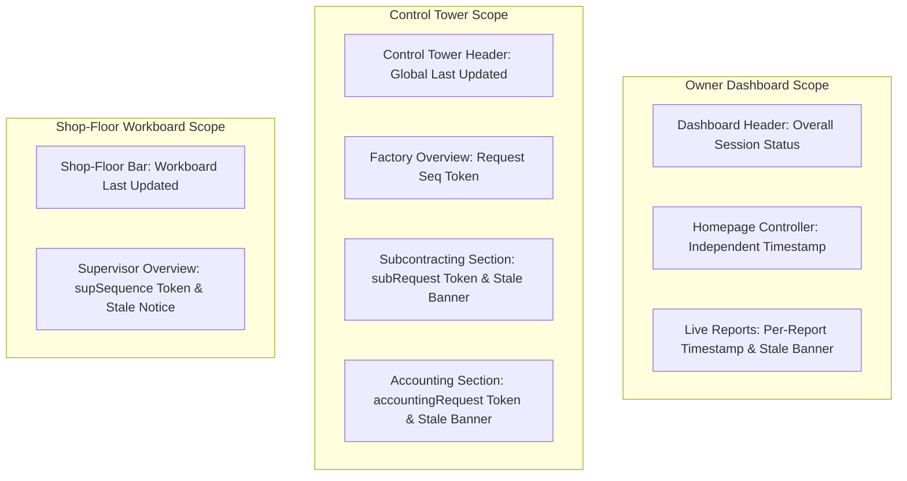

# DASH-036: Dashboard Refresh Timestamps, Safe Error States & Stale Data Retention

**Parent Epic:** DASH-030 — Testing, Performance, Security & Release  
**Task ID:** DASH-036  
**Status:** Implemented & Verified  
**Applications:** `sarathi_owner`, `sarathi_visibility`  
**Framework:** Frappe Framework + ERPNext  
**Test Suite:** `sarathi_visibility/sarathi_visibility/tests/test_refresh_error_states.py`

---

## 1. Executive Summary & Objective

In industrial manufacturing operations, decisions depend on knowing whether telemetry, production numbers, and financial KPIs reflect live, current data or whether a background sync has stalled. Misinterpreting an API timeout as "zero defective units" or "zero overdue orders" can lead to catastrophic operational blunders.

**DASH-036** establishes reliable refresh semantics, unambiguous timestamp reporting, safe error handling, and robust stale data retention across all Sarathi Control Tower dashboards.

### Core Architectural Guarantees
1. **Accurate Timestamping:** The last-successful-refresh timestamp is updated **only** after an API response has been validated and accepted by the client.
2. **Transparent In-Progress State:** When a refresh is triggered, the previous valid timestamp is retained alongside a non-blocking `Refreshing…` indicator.
3. **No Fabricated Zeroes:** Failed API requests, missing records, or server errors never render as confirmed numeric zeros (`0`). Instead, they display unambiguous error states, informative empty banners, or neutral placeholders (`—`).
4. **Stale Data Retention:** If a background or manual refresh fails after a previous success, valid existing records remain visible with a prominent, accessible stale notice banner (`Refresh failed. Showing data from last successful update (<time>)`) and a direct Retry action.
5. **Cross-Company Isolation:** When a user changes company or scope filters, cached stale data is immediately invalidated so that records from one business entity are never displayed under another.
6. **Race-Condition Immunity:** All asynchronous requests are sequenced using monotonically incrementing request tokens; superseded out-of-order responses are discarded before touching the DOM or state models.
7. **Safe Error Sanitization:** End users never see raw SQL syntax errors, database credentials, or server stack traces.

---

## 2. Dashboards and Routes Covered

| Dashboard Experience | Route | Application | Key Sections & Data Covered |
| :--- | :--- | :--- | :--- |
| **Owner & Executive Dashboard** | `/app/sarathi_owner`<br>`/app/sarathi_owner_homepage` | `sarathi_owner` | Financial KPIs (revenue, margins, cash flow), customer analytics, manufacturing summaries, inventory valuation, approvals, and business activities. |
| **Production Management Control Tower** | `/app/sarathi-control-tower` | `sarathi_visibility` | Factory overview, Work Orders, Job Cards, material readiness, workstation downtime, quality rework, subcontracting, and production exceptions. |
| **Shop-Floor Supervisor & Operator Workboard** | `/app/sarathi-shopfloor` | `sarathi_visibility` | Assigned operator jobs, active workstation operations, validated production reporting, and supervisor team overview. |

---

## 3. Refresh Timestamp Semantics & Scope

The Sarathi dashboard architecture clearly distinguishes between four temporal states:

### A. Last Successful Data Refresh
- **Definition:** The exact client-local or site-standard time when a valid, well-formed API payload was accepted by the frontend.
- **Rule:** Updated **only** in the success callback after verifying payload structure. Never updated on HTTP 4xx/5xx errors, payload parse failures, or network timeouts.

### B. Refresh In Progress
- **Definition:** A network request is actively in flight.
- **Display:** `Refreshing… (Last updated: <time>)` or `Refreshing…`.
- **Rule:** Retains the previous successful timestamp in the label and does not overwrite it while pending. The refresh button displays a spinner or disabled state to prevent duplicate duplicate clicks.

### C. Last Failed Refresh Attempt
- **Definition:** The timestamp of the most recent failed network or server request.
- **Rule:** Preserved in controller memory (`this.lastFailedRefresh`), but **never** replaces or overwrites the `lastSuccessfulRefresh` timestamp in the primary status label.

### D. Data or Source Timestamp
- **Definition:** The authoritative timestamp provided by ERPNext backend snapshots or transaction logs.
- **Rule:** When the backend provides a snapshot generation time, it is distinguished from client network receipt time.

### Timestamp Scope: Section-Level vs Dashboard-Level



- **Control Tower Independent Sections:** Secondary endpoints like Subcontracting (`loadSubcontractingData`) and Financial Accounting (`loadAccountingData`) maintain their own sequence tokens and refresh timestamps. A timeout in Subcontracting will display a localized error or stale banner in the Subcontracting card without marking the Factory Overview as failed.
- **Shop-Floor Supervisor Subview:** The Supervisor Team Overview (`fetchSupervisorOverview`) has independent filters (employee, workstation, dates) and request tracking (`this.supSequence`). Its refresh state does not disrupt active operator timers or reporting forms.

---

## 4. Manual and Automatic Refresh Behavior

### Manual Refresh Controls
- Located in standard header navigation bars across all three dashboards.
- **Debounce & Guarding:** Duplicate clicks are intercepted immediately:
  - `sarathi_owner_homepage.js`: `if (this.homeBusy) return;`
  - `sarathi_dashboard.js`: guarded by `this.isLoading` and disabled refresh button state.
  - `sarathi_shopfloor.js`: guarded by `this.isLoading` and `.sf-spinning` indicator.
- Keyboard accessible (`Tab` focusable, responds to `Enter` and `Space`).
- Accessible screen reader announcements dispatched via `frappe.sarathiUI.announce`.

### Automatic & Polling Refresh
- Background auto-refresh intervals are strictly read-only and invoke existing GET/query methods.
- **Safety Guarantee:** Auto-refresh **never** invokes state-mutating actions (e.g., submitting job cards, booking downtime, or posting journals).
- Background polling respects page visibility: requests are paused when the browser tab is hidden or minimized.

---

## 5. Safe Error States & Messaging

DASH-036 enforces clear separation between normal empty data, system errors, missing setup, and permission boundaries:

| State Condition | Visual Presentation | Accessible Role | End-User Message |
| :--- | :--- | :--- | :--- |
| **Successful Empty Result** | Informative Neutral Banner | `role="status"` | `No records found for the selected filters.` |
| **Failed Request (Initial)** | Error State Card with Primary Retry | `role="alert"` | `Unable to load this section. Please try again.` |
| **Failed Request (After Success)** | Warning Banner + Retained Records | `role="alert"` | `Refresh failed. Showing data from last successful update (<time>).` |
| **Feature Not Configured** | Informative Setup Card | `role="status"` | `Feature not configured. Please complete required settings.` (or explicit reason from backend). |
| **Permission Denied** | Access Restricted Card | `role="status"` | `You do not have access to these records.` |
| **Database / Server Error** | Sanitized Error Card | `role="alert"` | `Unable to load records due to an unexpected server issue. Please try again.` (Raw SQL & stack traces stripped). |

### KPI Card Integrity Rule
When an API call fails or metrics are missing:
- Values render as `—` (em dash), **never** as `0` or `$0.00`.
- Only validated arithmetic returns of zero from ERPNext documents render as `0`.

---

## 6. Stale Data Retention Policy & Cross-Scope Isolation

When a network blip or temporary server timeout occurs on a previously populated dashboard, abruptly blanking the screen causes operational confusion. DASH-036 implements an explicit Stale Retention Policy:

```
[User triggers Refresh]
        │
        ▼
   [API Fails]
        │
   ┌────┴──────────────────────────────┐
   │ Was data previously loaded?       │
   └────┬──────────────────────────────┘
        ├───────── Yes ────────────────────────┐
        │                                      │
   ┌────┴─────────────────────────────┐   ┌───┴────────────────────────────┐
   │ Filter / Company context same?   │   │ No previous data               │
   └────┬─────────────────────────────┘   └───┬────────────────────────────┘
        │                                      │
   ┌────┴───────┐       ┌──────┴──────┐        ▼
   │ Yes        │       │ No          │   [Render Initial Safe Error Card]
   ▼            ▼       ▼             ▼   [Status: "Data unavailable"]
[Retain Data] [Clear Cache]
[Show Stale Banner with Retry] [Show Safe Error Card]
[Status: "Stale (10:15 AM)"]
```

### Cross-Company and Scope Isolation
In `sarathi_owner_homepage.js` and `sarathi_dashboard.js`:
- When the company dropdown or workstation assignment changes, `this.homeData` and `this.data` are set to `null`.
- If the new company request fails, the system **never** displays stale records from the previous company.

---

## 7. Request Ordering & Race-Condition Safeguards

In high-latency industrial network environments, rapid filter selection (e.g. changing date ranges or workstation groups) can produce out-of-order asynchronous responses.

To prevent obsolete responses from overwriting newer data:
```javascript
// Monotonically incrementing request token
const request = (this.sequence = (this.sequence || 0) + 1);

const res = await frappe.call({ ... });

// Drop out-of-order response if a newer request has started
if (request !== this.sequence) {
    return;
}

// Accept and render valid response
this.data = res.message;
this.lastSuccessfulRefresh = new Date();
```

Implemented across:
- `sarathi_owner_homepage.js` (`this.homepageSequence`)
- `sarathi_dashboard.js` (`this.sequence`, `this.subRequest`, `this.accountingRequest`)
- `sarathi_shopfloor.js` (`this.supSequence`)

---

## 8. Accessible Presentation & UI Components

New centralized UI helpers added to `sarathi_visibility/sarathi_visibility/public/js/sarathi_ui.js` (`window.frappe.sarathiUI`):

### `frappe.sarathiUI.formatTimestamp(dateOrIso, options)`
- Formats dates according to user/Frappe preferences or browser locale.
- Accepts `options.includeDate`, `options.timeOnly`, `options.fallback`.
- Safely handles invalid dates and null inputs without throwing exceptions.

### `frappe.sarathiUI.refreshStatus({ status, lastSuccess, onRetry, label })`
- Emits WCAG 2.2 AA compliant status markup.
- Includes animated `.sui-pulse-dot` during `loading`.
- Renders `.sui-stale-badge` during `stale`.
- Uses `role="status"` for updates and `role="alert"` for errors.

### `frappe.sarathiUI.staleNotice({ message, lastSuccess, onRetry })`
- Renders accessible `.sui-stale-banner`.
- Embeds semantic `<button>` for instant retry.

---

## 9. Automated Test Verification Results

All automated test suites were executed on the local environment using Python 3.13 and Chromium Playwright:

### Test Suite Execution Summary

| Test File | Focus Area | Tests | Result | Duration |
| :--- | :--- | :---: | :---: | :---: |
| `sarathi_visibility/tests/test_refresh_error_states.py` | Refresh timestamps, safe errors, stale retention, race conditions | 10 | **PASS** | 6.78s |
| `sarathi_visibility/tests/test_shared_ui_browser.py` | Presentation contracts, KPI formatting, action deduplication | 3 | **PASS** | 2.10s |
| `sarathi_visibility/tests/test_accessibility_conventions.py` | Contrast ratios, focus indicators, keyboard traps, live regions | 10 | **PASS** | 8.84s |
| `sarathi_visibility/tests/test_responsive_layouts.py` | Mobile viewports, responsive reflow, sticky headers, touch targets | 14 | **PASS** | 11.59s |
| **Combined Regression Suite** | Total UI / Integration validation | **37** | **PASS** | **29.31s** |

### Verified Test Cases in `test_refresh_error_states.py`:
1. `test_format_timestamp_semantics`: Validates date parsing, ISO format, null handling, and fallbacks.
2. `test_refresh_status_component_rendering`: Validates distinct semantic badges, roles, and pulse dot.
3. `test_stale_notice_banner_and_retry`: Validates stale warning banner markup and retry callback dispatch.
4. `test_kpi_missing_or_failed_value_never_fabricates_zero`: Confirms missing/failed metrics render `—`, never `0`.
5. `test_safe_state_cards_distinguish_reasons`: Confirms distinct semantic states for empty, error, denied, unconfigured.
6. `test_error_message_sanitization_no_sql_leak`: Verifies raw SQL strings and tracebacks are sanitized.
7. `test_owner_homepage_refresh_lifecycle_and_stale_retention`: Simulates initial load, failure retention, retry, and company-switch cache invalidation.
8. `test_request_ordering_drops_superseded_responses`: Validates race-condition handling with variable latency.
9. `test_section_level_partial_failure_isolation`: Verifies partial failure in one card does not corrupt other cards.
10. `test_shopfloor_workboard_error_and_stale_banner`: Verifies shopfloor workboard and supervisor stale banners.

---

## 10. Security, Privacy & Permission Isolation

1. **Authorization Scope:** All refresh requests use the logged-in user's active session and Frappe document permissions.
2. **No Fallback Elevation:** A failed restricted query never falls back to an unrestricted or broader query.
3. **Information Disclosure Prevention:** Permission failures return generic messages (`You do not have access to these records`) without revealing document existence or private field values.
4. **Data Isolation:** Stale records are strictly scoped to the active session and active company filter.
5. **No Mutation on Refresh:** All refresh pathways are strictly read-only and cannot mutate ERPNext transactions.

---

## 11. Known Limitations & Unimplemented Dependencies

1. **ERPNext Backend Snapshot Timestamps:** Some ERPNext standard DocTypes do not record cache snapshot timestamps; for these, the timestamp indicates the verified client receipt time.
2. **Offline Local Storage:** DASH-036 intentionally does not store ERPNext business data in browser `localStorage` or `IndexedDB` to comply with enterprise data security guidelines. Once a page is hard-reloaded, initial state begins as "Not yet loaded".
3. **Core Frappe Framework Files:** Frappe core files (`frappe/desk/...`) were not modified; all enhancements were made strictly within `sarathi_visibility` and `sarathi_owner`.
