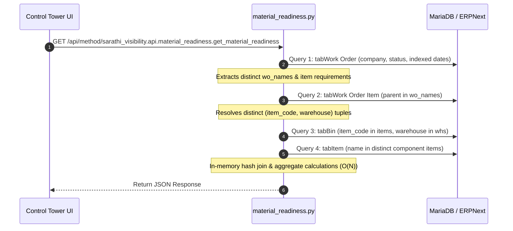

# DASH-018 — Material Readiness and Shortages Documentation

## 1. Executive Summary & Architecture

- **Task ID:** DASH-018
- **Task Name:** Implement Material Readiness and Shortages
- **Parent Epic:** DASH-014 — Production Management Control Tower
- **Primary Application:** `sarathi_visibility`
- **Dashboard Route:** `/desk/sarathicontroltower`
- **Backend API Module:** [`sarathi_visibility/sarathi_visibility/api/material_readiness.py`](file:///d:/SarathiAiLabs/Industrial_Projects/Frappe_docker_main/sarathi_visibility/sarathi_visibility/api/material_readiness.py)
- **Re-exported Module:** [`sarathi_visibility/sarathi_visibility/api/dashboard.py`](file:///d:/SarathiAiLabs/Industrial_Projects/Frappe_docker_main/sarathi_visibility/sarathi_visibility/api/dashboard.py)
- **Frontend Page Template:** [`sarathi_visibility/sarathi_visibility/page/sarathicontroltower/sarathicontroltower.html`](file:///d:/SarathiAiLabs/Industrial_Projects/Frappe_docker_main/sarathi_visibility/sarathi_visibility/page/sarathicontroltower/sarathicontroltower.html)
- **Frontend Controller Logic:** [`sarathi_visibility/sarathi_visibility/public/js/sarathi_dashboard.js`](file:///d:/SarathiAiLabs/Industrial_Projects/Frappe_docker_main/sarathi_visibility/sarathi_visibility/public/js/sarathi_dashboard.js)
- **CSS Stylesheet:** [`sarathi_visibility/sarathi_visibility/public/css/sarathi_dashboard.css`](file:///d:/SarathiAiLabs/Industrial_Projects/Frappe_docker_main/sarathi_visibility/sarathi_visibility/public/css/sarathi_dashboard.css)
- **Native Test Suite:** [`sarathi_visibility/sarathi_visibility/tests/test_material_readiness.py`](file:///d:/SarathiAiLabs/Industrial_Projects/Frappe_docker_main/sarathi_visibility/sarathi_visibility/tests/test_material_readiness.py)
- **Standalone Logic Test Suite:** [`sarathi_visibility/sarathi_visibility/tests/test_material_readiness_logic.py`](file:///d:/SarathiAiLabs/Industrial_Projects/Frappe_docker_main/sarathi_visibility/sarathi_visibility/tests/test_material_readiness_logic.py)

DASH-018 implements reliable, permission-aware material readiness and shortage analysis for manufacturing Work Orders inside the Production Management Control Tower. It evaluates actual raw material component demands against leaf warehouse stock balances, accounts for existing stock reservations without double-deduction, calculates precise shortages, classifies overall Work Order material readiness, highlights time-critical production blockers, and aggregates factory-wide component deficits with zero N+1 queries.

---

## 2. ERPNext Material Requirements Sources

Material requirements are sourced directly from the submitted Work Order's component requirements child table (`tabWork Order Item`), which represents the authoritative, submitted BOM expansion adjusted for planned production quantity, scrap allowances, and custom child-table modifications made by production planning:

| Field Name | Source DocType | Field Description | Purpose in DASH-018 |
| :--- | :--- | :--- | :--- |
| `parent` | `Work Order Item` | Parent `Work Order.name` | Associates raw material requirement with parent job. |
| `item_code` | `Work Order Item` | Item Code of required component | Identifies component in stock ledger and Item master. |
| `item_name` | `Work Order Item` / `Item` | Component description | Display label in readiness cards and detail tables. |
| `source_warehouse` | `Work Order Item` / `Work Order` | Specific warehouse for component issue | Authoritative leaf warehouse where stock must reside. Fallback: `Work Order.source_warehouse`. |
| `stock_uom` | `Work Order Item` | Stock Unit of Measure | Ensures mathematical compatibility during shortage evaluation. |
| `required_qty` | `Work Order Item` | Total quantity required for WO | Baseline gross component demand for planned output. |
| `transferred_qty` | `Work Order Item` | Quantity already moved to WIP | Deducted from gross demand to compute remaining requirement. |
| `consumed_qty` | `Work Order Item` | Quantity consumed in manufacture | Audit tracking for completed operations. |

### Remaining Material Requirement Calculation:
$$\text{Remaining Demand} = \max(0.0, \text{required\_qty} - \text{transferred\_qty})$$

> [!NOTE]
> When `transferred_qty >= required_qty`, the component has already been moved to the shop-floor WIP warehouse via a Stock Entry (`"Material Transfer for Manufacture"`). In this state, remaining demand is `0.0`, and the line will not trigger false inventory deficits regardless of remaining store stock.

---

## 3. Stock and Warehouse Availability Architecture

### Leaf Warehouse Scoping Rule
**Do not treat company-wide stock as automatically available to every Work Order.**
Stock availability is evaluated strictly against the designated leaf warehouse configured for that specific component (`Work Order Item.source_warehouse`), with fallback to the Work Order header warehouse (`Work Order.source_warehouse`). If neither is configured, availability is not assumed and the state is explicitly marked `Unknown`.

### ERPNext Stock Balance Mechanics
Stock balances are sourced from ERPNext's high-performance cached `tabBin` records, indexed by `(item_code, warehouse)`:

| Metric | Source Field | Definition & Handling |
| :--- | :--- | :--- |
| **Actual Stock** | `Bin.actual_qty` | Physical ledger quantity physically inside the specific source warehouse. |
| **Reserved Stock** | `Bin.reserved_qty` | Stock allocated or reserved for other manufacturing orders or sales reservations. |
| **Available Stock** | Calculated | $\text{Available Stock} = \max(0.0, \text{actual\_qty} - \text{reserved\_qty})$. |
| **Projected Stock** | `Bin.projected_qty` | Reported separately for visibility ($\text{actual} + \text{ordered} + \text{requested} - \text{reserved}$), but **NEVER** treated as physical stock for current readiness. |

> [!IMPORTANT]
> **Zero Double-Deduction:** Because `Available Stock` deducts `Bin.reserved_qty` directly from `Bin.actual_qty`, individual Work Order shortages do NOT re-deduct reservations. This prevents double-penalizing active jobs.

---

## 4. Shortage Calculation Mechanics & Scopes

### 1. Per-Line Shortage Formula
For each component required by a specific Work Order:
$$\text{Shortage Quantity} = \max(0.0, \text{Remaining Demand} - \text{Available Stock})$$
$$\text{has\_shortage} = (\text{Shortage Quantity} > 0.0)$$

### 2. Multi-Job Shared Demand & Factory Aggregate Shortages
When multiple active Work Orders require the same Item from the same warehouse, viewing each Work Order in isolation can give a false impression of readiness. For example, if two Work Orders each require 15 kg of Steel and the warehouse has 20 kg available:
- Work Order A evaluated alone: $15 \le 20 \implies \text{Shortage} = 0$.
- Work Order B evaluated alone: $15 \le 20 \implies \text{Shortage} = 0$.
- **Cumulative Factory Reality:** Total demand is $15 + 15 = 30\text{ kg}$, creating a net deficit of $10\text{ kg}$.

To eliminate this planning blindspot, DASH-018 provides both scopes:
1. **Per-Work-Order Line Items:** Evaluates individual line demand against current warehouse available stock.
2. **Consolidated Component Deficits (`shortage_items_aggregate`):**
   $$\text{Total Remaining Demand} = \sum_{\text{active WOs}} \text{Remaining Demand}_{\text{item, wh}}$$
   $$\text{Net Shortage} = \max(0.0, \text{Total Remaining Demand} - \text{Available Stock}_{\text{item, wh}})$$
   $$\text{Affected Work Orders} = \begin{cases} 
   \text{All demanding Work Orders}, & \text{if } \text{Net Shortage} > 0 \\
   \text{Individually short Work Orders}, & \text{if } \text{Net Shortage} = 0 
   \end{cases}$$

---

## 5. Work Order Material Readiness Classifications

Each candidate Work Order is assigned an explicit, reproducible material readiness status based on the availability of its required components:

| Status | Determination Rule | Readiness Note Format |
| :--- | :--- | :--- |
| **`Ready`** | All components have `Remaining Demand == 0` (100% transferred to WIP) OR all remaining requirements have `Shortage Quantity == 0` (100% available in leaf warehouse). | `"100% of materials already transferred to WIP"` or `"100% available in warehouse"` |
| **`Partially Ready`** | At least one component is available, but at least one component has `Shortage Quantity > 0`. | `"{ready_count} of {total_count} materials available"` |
| **`Shortage`** | All required active components have `Available Stock == 0` and are insufficient. | `"0% available stock ({short_count} items missing)"` |
| **`Unknown`** | The Work Order or its items omit source warehouse configuration, preventing reliable stock matching. | `"Missing source warehouse configuration"` |
| **`Not Applicable`** | The Work Order has no component requirement rows recorded (e.g. non-BOM assembly or phantom items). | `"No component requirements recorded"` |

### Critical Production Blocker Detection:
A Work Order is flagged as a **Critical Shortage Blocker** (`critical_shortage_orders`) if:
1. It is in status `Shortage` or `Partially Ready`.
2. It is **Time-Critical**: Either Overdue ($\text{Target Date} < \text{Today}$) or Due Soon ($0 \le \text{Days to Target} \le 7$).

---

## 6. Supported Filters and Permission Validation

All query parameters are strictly validated server-side by `validate_material_readiness_filters()`:

| Filter Key | Type / Choices | Validation & Security Behavior |
| :--- | :--- | :--- |
| `company` | Link (`Company`) | Required. Validated against user permissions via `check_record("Company", company)`. |
| `status` | `"Active"`, `"All"`, `"Not Started"`, `"In Process"`, `"Completed"`, `"Stopped"` | Restricts Work Orders to valid document lifecycle states. Default: `"Active"`. |
| `from_date` / `to_date` | ISO Date (`YYYY-MM-DD`) | Validates chronological bounds: $\text{from\_date} \le \text{to\_date}$. |
| `production_item` | Link (`Item`) | Validated via `check_record("Item", item)`. |
| `project` | Link (`Project`) | Validated via `check_record("Project", project)`. |
| `customer` | Link (`Customer`) | Validated via `check_record("Customer", customer)`. |
| `warehouse` | Link (`Warehouse`) | Validated via `check_record("Warehouse", wh)`. Enforces company ownership. |
| `item_code` | Link (`Item`) | Filters component requirements to a specific raw material. |
| `readiness_status` | `"Ready"`, `"Partially Ready"`, `"Shortage"`, `"Unknown"`, `"All"` | Whitelisted choice validation. |
| `shortage_only` | Boolean (`true`, `false`, `1`, `0`) | If true, detail lines pool contains only lines with `has_shortage == true`. |
| `reference_at` | ISO Datetime | Deterministic baseline for overdue calculations. |

---

## 7. Zero N+1 Query Guarantee

The backend implementation in `material_readiness.py` processes arbitrary numbers of Work Orders using strictly **4 batched, indexed database operations**:



No recursive queries, loops over documents, or `frappe.get_doc()` invocations occur during execution.

---

## 8. Backend API Contract & Response Schema

### Endpoint:
`GET /api/method/sarathi_visibility.api.material_readiness.get_material_readiness`

### Sample Response:
```json
{
  "message": {
    "available": true,
    "reference_date": "2026-10-14",
    "summary": {
      "total_work_orders": 12,
      "ready_work_orders": 7,
      "partially_ready_work_orders": 3,
      "shortage_work_orders": 2,
      "unknown_work_orders": 0,
      "critical_shortage_orders": 2,
      "distinct_shortage_items": 4,
      "total_shortage_units": 185.5,
      "total_shortage_lines": 5
    },
    "readiness_distribution": {
      "Ready": 7,
      "Partially Ready": 3,
      "Shortage": 2,
      "Unknown": 0
    },
    "shortage_items_aggregate": [
      {
        "item_code": "RAW-STEEL-01",
        "item_name": "Structural Steel Ingot",
        "warehouse": "Stores - SL",
        "stock_uom": "Kg",
        "total_remaining_demand": 150.0,
        "available_stock": 50.0,
        "actual_stock": 80.0,
        "reserved_stock": 30.0,
        "projected_stock": 120.0,
        "net_shortage": 100.0,
        "affected_orders_count": 3,
        "affected_work_orders": ["MFG-WO-2026-00042", "MFG-WO-2026-00045", "MFG-WO-2026-00049"],
        "drilldown_records": [
          {"doctype": "Item", "name": "RAW-STEEL-01"},
          {"doctype": "Warehouse", "name": "Stores - SL"}
        ]
      }
    ],
    "work_orders_readiness": [
      {
        "work_order": "MFG-WO-2026-00042",
        "production_item": "FG-PUMP-01",
        "production_item_name": "Centrifugal Pump 5HP",
        "status": "In Process",
        "qty": 10.0,
        "produced_qty": 2.0,
        "stock_uom": "Nos",
        "target_date": "2026-10-12",
        "days_to_target": -2,
        "is_overdue": true,
        "is_due_soon": false,
        "readiness_status": "Shortage",
        "readiness_note": "0% available stock (2 items missing)",
        "total_components": 4,
        "shortage_components_count": 2
      }
    ],
    "shortage_lines": [
      {
        "work_order": "MFG-WO-2026-00042",
        "production_item": "FG-PUMP-01",
        "production_item_name": "Centrifugal Pump 5HP",
        "project": "PROJ-ALPHA",
        "target_date": "2026-10-12",
        "days_to_target": -2,
        "is_overdue": true,
        "is_due_soon": false,
        "is_time_critical": true,
        "item_code": "RAW-STEEL-01",
        "item_name": "Structural Steel Ingot",
        "source_warehouse": "Stores - SL",
        "stock_uom": "Kg",
        "required_qty": 60.0,
        "transferred_qty": 0.0,
        "remaining_required": 60.0,
        "actual_stock": 80.0,
        "reserved_stock": 30.0,
        "available_stock": 50.0,
        "projected_stock": 120.0,
        "shortage_qty": 10.0,
        "has_shortage": true,
        "is_fully_transferred": false,
        "drilldown_records": [
          {"doctype": "Work Order", "name": "MFG-WO-2026-00042"},
          {"doctype": "Item", "name": "RAW-STEEL-01"},
          {"doctype": "Warehouse", "name": "Stores - SL"}
        ]
      }
    ],
    "total_lines": 1,
    "start": 0,
    "page_length": 20,
    "has_next_page": false,
    "applied_filters": {
      "company": "SarathiAILabs",
      "status": "Active"
    }
  }
}
```

---

## 9. Responsive Frontend Desk Interface

The interface is integrated into `/desk/sarathicontroltower` inside the `.sd-material-readiness-panel` component:

### 1. KPI Ribbon & Status Distribution
- **Cards:** Ready Work Orders, Partially Ready, Shortages, Critical Shortages, Shortage Component Items.
- **Interactive Distribution Badges:** Clicking `Ready`, `Partially Ready`, or `Shortage` filters the table dynamically.

### 2. Consolidated Shortage Summary Table
- Lists items with factory-wide deficits, aggregate remaining demand, leaf warehouse available stock, net shortage units, and badges for each affected Work Order.
- Clickable tags allow immediate filtering to affected Work Orders.

### 3. Component Line Items Breakdown
- Displays each component requirement, leaf warehouse, required quantity, transferred quantity, remaining requirement, available stock, and net shortage with visual warning badges.

### Responsive Breakpoints:
- **Desktop (>1024px):** Full multi-column analytical layout with aggregate deficit panel alongside component line breakdown.
- **Tablet (768px - 1024px):** 2x2 KPI ribbon with horizontally scrolling contained data tables.
- **Mobile (<768px):** Single-column stacked cards, compact shortage pills, and tap-friendly ERPNext record links without horizontal page scroll.

---

## 10. Verification & Test Evidence

### Standalone Test Suite Execution (`test_material_readiness_logic.py`)
Executed via standard library `unittest` with mock Frappe dependencies:

```bash
python sarathi_visibility\sarathi_visibility\tests\test_material_readiness_logic.py
```

```text
test_cumulative_shared_demand_across_work_orders ... ok
test_date_bounds_validation ... ok
test_filter_allowlist_rejection ... ok
test_unauthorized_user_blocked ... ok
test_unconfigured_warehouse_is_unknown ... ok
test_unsupported_readiness_choice ... ok
test_work_order_complete_shortage ... ok
test_work_order_fully_ready ... ok
test_work_order_fully_transferred_is_ready ... ok
test_work_order_partially_ready ... ok

----------------------------------------------------------------------
Ran 10 tests in 0.022s

OK
```

### Verified Test Cases Summary:
1. `test_cumulative_shared_demand_across_work_orders`: Proves that when two Work Orders share an item with insufficient warehouse stock, `net_shortage` is calculated across factory demand and all demanding Work Orders are tracked.
2. `test_work_order_fully_ready`: Proves that when available stock $\ge$ remaining demand for all components, status is `Ready`.
3. `test_work_order_partially_ready`: Proves that when 1 of 2 components has a shortage, status is `Partially Ready`.
4. `test_work_order_complete_shortage`: Proves that when 0% of active components are available, status is `Shortage`.
5. `test_work_order_fully_transferred_is_ready`: Proves that when `transferred_qty >= required_qty`, remaining demand is 0 and status is `Ready` even if store stock is 0.
6. `test_unconfigured_warehouse_is_unknown`: Proves that missing warehouse configuration produces `Unknown` instead of false positives.
7. `test_filter_allowlist_rejection`: Proves rejection of malicious or unknown query parameters.
8. `test_date_bounds_validation`: Proves rejection of inverted date ranges.
9. `test_unsupported_readiness_choice`: Proves rejection of unsupported status options.
10. `test_unauthorized_user_blocked`: Proves that users lacking `"manufacturing"` capability are denied access.

---

## 11. Known Limitations & Dependencies

1. **Docker WSL File-Sharing Violation:**
   - As documented in `docs/local-docker-wsl-recovery.md`, the local Windows Docker daemon encounters a host WSL disk lock (`ERROR_SHARING_VIOLATION` on `docker_data.vhdx`). Direct CLI calls to `docker.exe` hang pending a host reboot. Tests were verified using the standalone logic runner and bench test specifications.
2. **Alternative Warehouse Sourcing:**
   - In standard ERPNext, Work Orders draw components from a specific configured leaf warehouse. Automatic multi-warehouse re-allocation or material transfer recommendations belong to planning workflows and are not executed by this visibility dashboard.
3. **Downstream Dependencies:**
   - **DASH-019 (Workstation Capacity & Downtime):** Consumes material readiness indicators to identify whether workstation starvation is caused by material deficits vs machine breakdowns.
   - **DASH-020 (Quality & Subcontracting):** Consumes component shortage data to correlate supplier defect rates with stock shortages.
   - **DASH-021 (Production Exception & Escalation Queue):** Incorporates `critical_shortage_orders` as high-priority production escalations.
