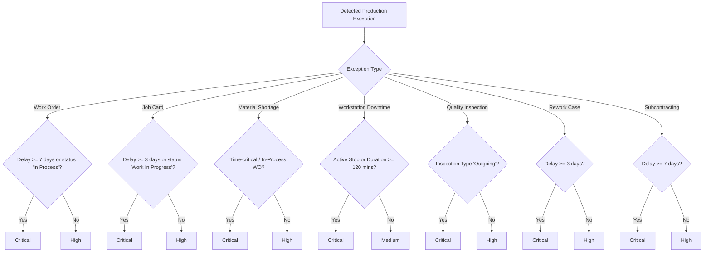

# DASH-021 — Production Exception and Escalation Queue Documentation

## 1. Executive Summary & Architecture

- **Task ID:** DASH-021
- **Task Name:** Implement Production Exception and Escalation Queue
- **Parent Epic:** DASH-014 — Production Management Control Tower
- **Priority:** P2 — Medium
- **Primary Application:** `sarathi_visibility`
- **Dashboard Route:** `/desk/sarathicontroltower`
- **Backend API Module:** [`sarathi_visibility/sarathi_visibility/api/production_exceptions.py`](file:///d:/SarathiAiLabs/Industrial_Projects/Frappe_docker_main/sarathi_visibility/sarathi_visibility/api/production_exceptions.py)
- **Re-exported Module:** [`sarathi_visibility/sarathi_visibility/api/dashboard.py`](file:///d:/SarathiAiLabs/Industrial_Projects/Frappe_docker_main/sarathi_visibility/sarathi_visibility/api/dashboard.py)
- **Frontend Page Template:** [`sarathi_visibility/sarathi_visibility/sarathi_visibility/page/sarathicontroltower/sarathicontroltower.html`](file:///d:/SarathiAiLabs/Industrial_Projects/Frappe_docker_main/sarathi_visibility/sarathi_visibility/sarathi_visibility/page/sarathicontroltower/sarathicontroltower.html)
- **Frontend Controller Logic:** [`sarathi_visibility/sarathi_visibility/public/js/sarathi_dashboard.js`](file:///d:/SarathiAiLabs/Industrial_Projects/Frappe_docker_main/sarathi_visibility/sarathi_visibility/public/js/sarathi_dashboard.js)
- **CSS Stylesheet:** [`sarathi_visibility/sarathi_visibility/public/css/sarathi_dashboard.css`](file:///d:/SarathiAiLabs/Industrial_Projects/Frappe_docker_main/sarathi_visibility/sarathi_visibility/public/css/sarathi_dashboard.css)
- **Native Test Suite:** [`sarathi_visibility/sarathi_visibility/tests/test_production_exceptions.py`](file:///d:/SarathiAiLabs/Industrial_Projects/Frappe_docker_main/sarathi_visibility/sarathi_visibility/tests/test_production_exceptions.py)
- **Standalone Logic Test Suite:** [`sarathi_visibility/sarathi_visibility/tests/test_production_exceptions_logic.py`](file:///d:/SarathiAiLabs/Industrial_Projects/Frappe_docker_main/sarathi_visibility/sarathi_visibility/tests/test_production_exceptions_logic.py)

DASH-021 consolidates supported production anomalies and bottlenecks across manufacturing operations into a centralized, permission-aware **Production Exception and Escalation Queue** inside the existing Control Tower (`/desk/sarathicontroltower`).

The queue enables production managers to immediately answer:
1. **What is the problem?** (Clear problem title and evidence-based description)
2. **Why does it need attention now?** (Deterministic severity ranking: `Critical`, `High`, `Medium`, `Low`)
3. **How long has it been unresolved?** (Exact overdue delay or aging duration in days/minutes)
4. **Which ERPNext document explains it?** (Clickable, authorized drill-down link)
5. **What is the recommended next action?** (Evidence-backed operational guidance)

---

## 2. Supported Exception Types & Source DocTypes

Exceptions are computed dynamically from verified ERPNext transactional records without introducing an unapproved database DocType or fabricating fake incidents.

| Exception Category | Exception Type | Source DocType | Detection Condition | Reference Timestamp / Due Date |
| :--- | :--- | :--- | :--- | :--- |
| **Production** | Overdue Work Order | `Work Order` | `docstatus == 1`, status in `("Not Started", "In Process")`, and `planned_end_date < reference_date` | `planned_end_date` (or `expected_delivery_date`) |
| **Production** | Delayed Job Card | `Job Card` | `docstatus < 2`, status in `("Open", "Work In Progress")`, `is_corrective_job_card != 1`, and `expected_end_date < reference_date` | `expected_end_date` (or `from_time`) |
| **Material** | Material Shortage | `Work Order Item` & `Bin` | Active Work Order has shortage line where `has_shortage == True` (`shortage_qty > 0`) | `planned_start_date` / WO target date |
| **Workstation** | Workstation Downtime | `Downtime Entry` | Active downtime stop (`is_active_stop == True`) or closed downtime with `duration_mins >= 30.0` | `from_time` (Downtime start) |
| **Quality** | Failed Inspection | `Quality Inspection` | `docstatus == 1` and `status == "Rejected"` | `report_date` (Inspection date) |
| **Quality** | Overdue Rework Job | `Job Card` | Corrective Job Card (`is_corrective_job_card == 1`), `status != "Completed"`, and `expected_end_date < reference_date` | `expected_end_date` |
| **Subcontracting**| Overdue Subcontracting Receipt | `Subcontracting Order` | `docstatus == 1`, `status not in ("Closed", "Completed")`, `outstanding_qty > 0`, and `schedule_date < reference_date` | `schedule_date` (Expected receipt date) |

---

## 3. Severity Classification Matrix

Severity is assigned deterministically using verified operational criteria. It never escalates arbitrarily or relies on ambiguous text labels:



### Classification Rules

1. **Critical:**
   - Work Order overdue by $\ge 7$ days or active in-process order blocked past target.
   - Job Card overdue by $\ge 3$ days or active in-progress job exceeding scheduled window.
   - Material shortage directly starving an in-process Work Order.
   - Active, unended workstation breakdown or cumulative downtime $\ge 120$ minutes.
   - Outgoing (pre-shipment) Quality Inspection failure directly halting customer delivery.
   - Corrective rework Job Card delayed by $\ge 3$ days.
   - Subcontracted order overdue by $\ge 7$ days with outstanding parts.

2. **High:**
   - Work Order overdue by $< 7$ days.
   - Job Card overdue by $< 3$ days.
   - Material shortage for queued (Not Started) Work Order within 7 days of scheduled release.
   - In-Process or Incoming Quality Inspection rejections.
   - Rework Job Card overdue by $< 3$ days.
   - Subcontracted order overdue by $< 7$ days.

3. **Medium:**
   - Completed workstation downtime event lasting between 30 and 119 minutes.

4. **Low:**
   - Minor non-blocking quality or production advisories under documented monitoring limits.

---

## 4. Deterministic Prioritization & Stable Deduplication

### 4.1 Prioritization Order
The queue sorts exceptions deterministically with a 4-level sorting hierarchy:
1. **Severity Rank:** `Critical` (rank 1) $\rightarrow$ `High` (rank 2) $\rightarrow$ `Medium` (rank 3) $\rightarrow$ `Low` (rank 4).
2. **Delay / Aging (Descending):** Exceptions with longer overdue delays appear first.
3. **Due Date (Ascending):** Earlier target dates appear ahead of later dates.
4. **Exception Identifier (Ascending):** Guarantees tie-breaking stability across repeated queries.

### 4.2 Stable Exception Identifiers (Deduplication)
Every exception generates an unchangeable identity string derived from its genuine source record:

- **Work Order:** `EXC-WO-{name}` (e.g., `EXC-WO-MFG-WO-2026-00042`)
- **Job Card:** `EXC-JC-{name}` (e.g., `EXC-JC-2026-00105`)
- **Material Shortage:** `EXC-SHORTAGE-{work_order}-{item_code}-{source_warehouse}` (e.g., `EXC-SHORTAGE-MFG-WO-2026-00042-RAW-STEEL-Stores - SL`)
- **Workstation Downtime:** `EXC-DT-{name}` (e.g., `EXC-DT-2026-00012`)
- **Quality Inspection:** `EXC-QI-{name}` (e.g., `EXC-QI-2026-00008`)
- **Rework Case:** `EXC-REWORK-{name}` (e.g., `EXC-REWORK-2026-00109`)
- **Subcontracting Order:** `EXC-SCO-{name}` (e.g., `EXC-SCO-2026-00003`)

Because IDs are keyed to the specific sub-record and cause, repeated API calls and paginated refreshes never generate duplicate rows. When the underlying ERPNext condition is resolved (e.g., material is issued or the Work Order is completed), the dynamic engine automatically removes the exception without leaving stale persistent state.

---

## 5. Backend API Endpoints & Permission Safeguards

### 5.1 Route: `sarathi_visibility.api.dashboard.get_production_exceptions`

Accepts optional filter dictionary and pagination parameters:
- `filters` (JSON string or dict):
  - `company` (string, authorized company scope)
  - `category` (`All`, `Production`, `Material`, `Quality`, `Workstation`, `Subcontracting`)
  - `severity` (`Critical`, `High`, `Medium`, `Low`)
  - `work_order` (string, Work Order name)
  - `item_code` (string, Item code)
  - `workstation` (string, Workstation name)
  - `supplier` (string, Supplier name)
  - `from_date` / `to_date` (YYYY-MM-DD)
- `start` (int, default: 0)
- `page_length` (int, default: 20, capped at 100)

### 5.2 Server-Side Security & Data Isolation
1. **Allowlist Validation:** Only explicitly recognized filter keys are permitted via `validate_exception_filters`. Any unknown key raises `frappe.ValidationError`.
2. **Company Access Enforcement:** Target document identifiers (Work Order, Workstation, Item, Supplier) are verified via `sarathi_visibility.api.access.check_record`. Cross-company record access is immediately rejected.
3. **Capability Guard:** Execution requires the `production_view` capability (`require_capability("production_view")`).
4. **Safe Querying:** All database calls utilize Frappe ORM parameterization with zero unrestricted SQL concatenations.
5. **Zero N+1 Rescans:** When queried as part of `get_summary()`, `get_production_exceptions` directly reuses precomputed objects from `get_material_readiness`, `get_workstation_downtime`, `get_quality_overview`, `get_rework_overview`, and `get_subcontracting_overview`.

---

## 6. Frontend UI Integration

Integrated directly within the Production Management Control Tower (`/desk/sarathicontroltower`):

```
+---------------------------------------------------------------------------------------------------------+
| [!] Production Exception & Escalation Queue                              Last Refreshed: 12:45:10 PM    |
+---------------------------------------------------------------------------------------------------------+
| [Total Exceptions: 8] [Critical: 3] [High: 4] [Material: 2] [Quality: 1] [Subcontracting: 1]          |
+---------------------------------------------------------------------------------------------------------+
| Search exceptions... | Category: [All v] | Severity: [All v] | [Clear Filters]                         |
+---------------------------------------------------------------------------------------------------------+
| Sev      | Exception               | Category  | Source Doc | Target Context    | Delay / Due | Action  |
+----------+-------------------------+-----------+------------+-------------------+-------------+---------+
| CRITICAL | Overdue Work Order      | Production| WO-2026-42 | Part A (Qty: 50)  | 14d overdue | Open WO |
| CRITICAL | Material Shortage       | Material  | WO-2026-42 | RAW-STEEL (Stores)| Target: Oct | Open WO |
| HIGH     | Workstation Breakdown   | Workstn   | DT-2026-03 | WS-CNC-01         | 45 mins     | Open DT |
+---------------------------------------------------------------------------------------------------------+
```

### 6.1 Summary Metrics
- **Total Open Exceptions:** Count of unique, actionable production exceptions currently active.
- **Critical Exceptions:** Exceptions requiring immediate floor intervention.
- **High Severity Exceptions:** Severe delays or shortages requiring near-term attention.
- **Material Shortage Exceptions:** Production orders blocked due to missing inventory.
- **Quality Exceptions:** Rejected inspections or overdue rework loops.
- **Subcontracting Exceptions:** Overdue outsourced manufacturing orders.

### 6.2 Interactive Controls
- **Live Search:** Instant client-side filtering matching titles, descriptions, document IDs, item codes, and workstations.
- **Category & Severity Filters:** Instant dropdown narrowing.
- **Safe Drill-downs:** Clickable links opening native ERPNext forms (`/desk#Form/Work Order/...`) without leaving the desk application.
- **Read-Only Safety:** No transaction-altering buttons or unauthorized state toggles exist.

---

## 7. Illustrative Examples

> [!NOTE]
> The examples below are **illustrative test cases** demonstrating detection logic and severity criteria. They do not represent live production data.

### Example A: Overdue Work Order
- **Record:** `Work Order` `MFG-WO-2026-00042`
- **Status:** `In Process`
- **Planned End Date:** `2026-10-01`
- **Reference Date:** `2026-10-14`
- **Delay:** $14 - 1 = 13$ days overdue.
- **Classification:** **Critical** (overdue $\ge 7$ days).
- **Recommended Action:** *"Expedite remaining Job Cards or reschedule Work Order delivery commitments."*

### Example B: Material Shortage
- **Record:** `Work Order Item` for `RAW-STEEL` in `Stores - SL`
- **Required Qty:** `100.0 Kg`
- **Transferred Qty:** `0.0 Kg`
- **Available Usable Stock:** `20.0 Kg`
- **Shortage:** `80.0 Kg`
- **WO Status:** `In Process`
- **Classification:** **Critical** (shortage actively impacts In-Process order).
- **Recommended Action:** *"Expedite Purchase Receipt or transfer stock from central raw stores to source warehouse."*

---

## 8. Test Execution & Verification Results

### 8.1 Standalone Test Suite
Executed locally via `python sarathi_visibility/sarathi_visibility/tests/test_production_exceptions_logic.py`:

```
Ran 10 tests in 0.020s

OK
```

#### Verified Test Scenarios:
1. `test_filter_allowlist_rejection`: Rejection of unauthorized keys with `ValidationError`.
2. `test_date_bounds_validation`: Validation of `from_date <= to_date`.
3. `test_unsupported_category_choice`: Validation of category allowlist.
4. `test_unsupported_severity_choice`: Validation of severity allowlist.
5. `test_cross_company_isolation`: Rejection of cross-company Work Orders via `PermissionError`.
6. `test_overdue_work_order_exception_critical`: Critical escalation for orders overdue $\ge 7$ days.
7. `test_material_shortage_exception_in_process_wo`: Critical escalation for shortages on In-Process orders.
8. `test_subcontracting_overdue_exception_critical`: Escalation for overdue subcontracting deliveries.
9. `test_deterministic_prioritization_and_deduplication`: Strict sorting by severity, delay, and stable ID.
10. `test_filter_by_category_and_severity`: Filtering accuracy across combined criteria.

### 8.2 Associated Logic Suites
All individual module logic test suites pass:
- `test_material_readiness_logic.py`: 10/10 passed.
- `test_quality_rework_logic.py`: 9/9 passed.
- `test_workstation_downtime_logic.py`: 7/7 passed.
- `test_production_exceptions_logic.py`: 10/10 passed.

---

## 9. Manual Verification Steps

1. Log into ERPNext Desk as a user with `Production Manager` or `System Manager` role.
2. Navigate to `/desk/sarathicontroltower`.
3. Locate the **Production Exception & Escalation Queue** panel beneath the Work Order and Job Card pipeline views.
4. Verify the 6 KPI metric cards:
   - Check that numbers reflect active exceptions and match the table row counts.
5. Test filtering:
   - Filter by `Category` (e.g. `Material`, `Quality`, `Workstation`).
   - Filter by `Severity` (`Critical`, `High`, `Medium`).
   - Type in the search box (e.g., search for a known item code or Work Order).
   - Click **Clear Filters** and confirm the full queue re-renders.
6. Verify Drill-downs:
   - Click on a Work Order or Job Card link; verify it navigates cleanly to the corresponding ERPNext form.
7. Refresh:
   - Click the dashboard refresh button or change the Company filter; verify that no duplicate exception rows are created.
