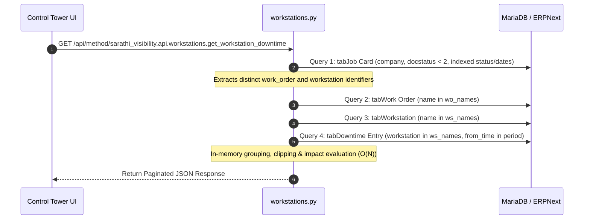

# DASH-019 — Workstation and Downtime Views Documentation

## 1. Executive Summary & Architecture

- **Task ID:** DASH-019
- **Task Name:** Build Workstation and Downtime Views
- **Parent Epic:** DASH-014 — Production Management Control Tower
- **Primary Application:** `sarathi_visibility`
- **Dashboard Route:** `/desk/sarathicontroltower`
- **Backend API Module:** [`sarathi_visibility/sarathi_visibility/api/workstations.py`](file:///d:/SarathiAiLabs/Industrial_Projects/Frappe_docker_main/sarathi_visibility/sarathi_visibility/api/workstations.py)
- **Re-exported Module:** [`sarathi_visibility/sarathi_visibility/api/dashboard.py`](file:///d:/SarathiAiLabs/Industrial_Projects/Frappe_docker_main/sarathi_visibility/sarathi_visibility/api/dashboard.py)
- **Frontend Page Template:** [`sarathi_visibility/sarathi_visibility/sarathi_visibility/page/sarathicontroltower/sarathicontroltower.html`](file:///d:/SarathiAiLabs/Industrial_Projects/Frappe_docker_main/sarathi_visibility/sarathi_visibility/sarathi_visibility/page/sarathicontroltower/sarathicontroltower.html)
- **Frontend Controller Logic:** [`sarathi_visibility/sarathi_visibility/public/js/sarathi_dashboard.js`](file:///d:/SarathiAiLabs/Industrial_Projects/Frappe_docker_main/sarathi_visibility/sarathi_visibility/public/js/sarathi_dashboard.js)
- **CSS Stylesheet:** [`sarathi_visibility/sarathi_visibility/public/css/sarathi_dashboard.css`](file:///d:/SarathiAiLabs/Industrial_Projects/Frappe_docker_main/sarathi_visibility/sarathi_visibility/public/css/sarathi_dashboard.css)
- **Native Test Suite:** [`sarathi_visibility/sarathi_visibility/tests/test_workstation_downtime.py`](file:///d:/SarathiAiLabs/Industrial_Projects/Frappe_docker_main/sarathi_visibility/sarathi_visibility/tests/test_workstation_downtime.py)
- **Standalone Logic Test Suite:** [`sarathi_visibility/sarathi_visibility/tests/test_workstation_downtime_logic.py`](file:///d:/SarathiAiLabs/Industrial_Projects/Frappe_docker_main/sarathi_visibility/sarathi_visibility/tests/test_workstation_downtime_logic.py)

DASH-019 implements an operational workstation and recorded downtime monitoring view inside the Production Management Control Tower. It maps ERPNext shop-floor workstation records to assigned operations and Work Orders, calculates verified downtime durations from `Downtime Entry` records with date interval clipping, detects schedule delays and production impacts, and maintains an explicit distinction between recorded database activity and live machine sensor telemetry.

---

## 2. Workstation Data Model & Relationships

Workstation data is queried directly from standard ERPNext DocTypes with zero custom schema modifications:

```
[Work Order]
     │ (1 : N)
     ▼
[Job Card] ────────────────► [Workstation]
     │                           ▲
     │ (linked workstation)      │ (recorded stops)
     ▼                           │
[Operation Activity]       [Downtime Entry]
```

### Authoritative DocTypes & Fields:

| DocType | Exact Fields Used | Role in DASH-019 |
| :--- | :--- | :--- |
| **`Workstation`** | `name`, `workstation_name`, `workstation_type`, `status`, `modified`, `description` | Master definition of shop-floor machines/workstations and native recorded status. |
| **`Job Card`** | `name`, `work_order`, `operation`, `workstation`, `workstation_type`, `status`, `for_quantity`, `total_completed_qty`, `expected_start_date`, `expected_end_date`, `actual_start_date`, `actual_end_date`, `total_time_in_mins`, `creation` | Authoritative operational assignment of jobs to workstations, planned vs actual progress, and timing. |
| **`Work Order`** | `name`, `production_item`, `item_name`, `status`, `planned_end_date`, `expected_delivery_date`, `project`, `customer` | Parent manufacturing context and delivery deadlines. |
| **`Downtime Entry`** | `name`, `workstation`, `from_time`, `to_time`, `downtime`, `stop_reason`, `remarks`, `operator` | Official recorded machine interruption and breakdown logs. |

---

## 3. Distinction: Recorded Activity vs Live Machine Telemetry

> [!IMPORTANT]
> **No IoT, PLC, or Machine Sensor Integration Exists in Current Environment.**
> In accordance with DASH-019 business guidelines, machine states and metrics must never be fabricated.

The dashboard maintains an explicit, transparent architectural boundary:

1. **Recorded ERPNext Status:**
   - Sourced from `Workstation.status` (`"Production"`, `"Off"`, `"Idle"`, `"Problem"`, `"Maintenance"`, `"Setup"`), which represents the last manual or workflow status saved in ERPNext.
   - Supplemented by assigned Job Card activity: if an active Job Card has `status == "Work In Progress"`, the operational state is derived as `"Active Production (Job Running)"`.
   - **Labeling:** Clearly labeled as `Status Source: ERPNext Workstation Master & Job Cards`.
2. **Machine Telemetry Status:**
   - Because no connected hardware sensors, edge gateways, or telemetry streams exist, telemetry status is displayed honestly as:
     `"Not Configured (Requires IoT/PLC Telemetry Integration)"`.
3. **Disclosure Notice in UI:**
   - Every workstation view prominently displays an informational notice:
     *"Machine status and operational times are derived from native ERPNext Job Cards and Downtime Entries. Machine-telemetry utilization and OEE are marked Unavailable pending IoT/PLC sensor and shift calendar integration."*

---

## 4. Downtime Identification, Event Interval Clipping & Formulas

Downtime metrics are sourced strictly from ERPNext's `tabDowntime Entry` records:

### 1. Closed vs Open Downtime Events:
- **Closed Event (`to_time is not null`):**
  Event has ended. Start time is `from_time`, end time is `to_time`.
- **Open Event (`to_time is null`):**
  The machine interruption is currently ongoing. End time defaults to the current evaluation timestamp (`reference_at`), and the event is tagged `is_open = true` with badge `"Open (Ongoing)"`.

### 2. Period Interval Clipping:
When date range filters (`from_date`, `to_date`) are applied, downtime events that span beyond the reporting boundary are clipped to prevent attributing out-of-period downtime:
$$\text{effective\_from} = \max(\text{from\_time}, \text{period\_start})$$
$$\text{effective\_to} = \min(\text{effective\_end}, \text{period\_end})$$
$$\text{Downtime Minutes} = \max\left(0.0, \frac{(\text{effective\_to} - \text{effective\_from}).\text{total\_seconds}()}{60.0}\right)$$

### 3. Handling Zero Downtime Rows:
When `Downtime Entry` contains 0 records (the standard state in new/clean ERPNext instances), the dashboard displays:
- `recorded_downtime_events: 0`
- `total_downtime_minutes: 0.0`
- An empty-state message stating: *"No machine downtime events recorded in the selected period. Downtime records are logged via ERPNext Downtime Entry records."*
- **Under no circumstances is downtime extrapolated or invented from gaps between Job Cards.**

---

## 5. Supported Workstation Performance Indicators

The following indicators are computed from verified database records:

| Indicator | Formula / Source | Inclusion & Handling |
| :--- | :--- | :--- |
| **Total Workstations** | $\text{COUNT}(\text{Workstation})$ | Distinct workstations linked to authorized operations. |
| **Active Workstations** | $\text{COUNT}(\text{WS with active Job Cards})$ | Workstations with $\ge 1$ Job Card in `"Work In Progress"`. |
| **Running Operations** | $\text{COUNT}(\text{Job Card where status} = \text{"Work In Progress"})$ | Active shop-floor jobs currently undergoing execution. |
| **Queued Operations** | $\text{COUNT}(\text{Job Card where status} = \text{"Open"})$ | Assigned jobs waiting for previous operations or workstation capacity. |
| **Completed Operations** | $\text{COUNT}(\text{Job Card where status} = \text{"Completed"})$ | Finished operations on the workstation. |
| **Delayed Operations** | $\text{COUNT}(\text{Job Card where target date} < \text{Today and status} \ne \text{"Completed"})$ | Uncompleted jobs that missed their target completion date. |
| **Recorded Downtime Events** | $\text{COUNT}(\text{Downtime Entry})$ | Verified closed and open downtime records in period. |
| **Total Downtime Minutes** | $\sum \text{Downtime Minutes}$ | Total clipped duration of verified downtime events. |

---

## 6. Unsupported Metrics & Missing Data Sources

To prevent deceptive analytics, the following advanced metrics are explicitly excluded and documented as **Not Configured / Unavailable**:

| Metric | Business Purpose | Why It Cannot Be Calculated Today | UI Representation |
| :--- | :--- | :--- | :--- |
| **Machine Utilization %** | Ratio of operating machine time to available scheduled shift time. | Requires: (1) verified shift schedule calendar, (2) lunch/break exclusion tables, and (3) actual machine runtime sensor data. Job Card count or labor time is not machine runtime. | Badged as `Not Configured` with tooltip: *"Requires Machine Telemetry / Shift Schedule"*. Value: `null`. |
| **OEE % (Overall Equipment Effectiveness)** | Multiplicative index: $\text{Availability} \times \text{Performance} \times \text{Quality}$. | Requires: (1) machine availability from telemetry, (2) ideal cycle time vs actual cycle time per machine, and (3) real-time scrap/rejection sensors. | Badged as `Not Configured` with tooltip: *"Requires Machine Telemetry / Sensor Coverage"*. Value: `null`. |

---

## 7. Production Impact & Affected Jobs Analysis

Workstations causing operational bottlenecks or schedule risks are surfaced in the **Production Schedule Impact** view:
- A workstation is classified as **Impacted** if:
  1. $\text{total\_downtime\_minutes} > 0$, OR
  2. $\text{delayed\_job\_cards\_count} > 0$.
- For each impacted workstation, the view lists:
  - Linked Job Cards with operation name, production item, and status.
  - Overdue status with days delayed.
  - Specific stop reasons from linked `Downtime Entry` records (e.g., *"Tool Breakage"*, *"Hydraulic Leak"*).
  - One-click drill-down links to `/app/job-card/{name}`, `/app/work-order/{name}`, and `/app/workstation/{name}`.

---

## 8. Zero N+1 Query Guarantee

The backend implementation in [`sarathi_visibility/sarathi_visibility/api/workstations.py`](file:///d:/SarathiAiLabs/Industrial_Projects/Frappe_docker_main/sarathi_visibility/sarathi_visibility/api/workstations.py) retrieves all workstation data using strictly **4 batched, indexed database reads**:



No recursive queries, loops over documents, or `frappe.get_doc()` invocations occur during execution.

---

## 9. Backend API Contract & Response Schema

### Endpoint:
`GET /api/method/sarathi_visibility.api.workstations.get_workstation_downtime`

### Supported Query Parameters:
`company`, `workstation`, `workstation_type`, `status`, `from_date`, `to_date`, `work_order`, `job_card`, `operation`, `reference_at`, `start`, `page_length`.

### Sample JSON Response:
```json
{
  "message": {
    "available": true,
    "reference_date": "2026-10-14",
    "summary": {
      "total_workstations": 3,
      "workstations_with_active_jobs": 1,
      "total_assigned_operations": 5,
      "recorded_running_jobs": 1,
      "completed_operations": 2,
      "delayed_operations_count": 1,
      "recorded_downtime_events": 1,
      "total_downtime_minutes": 45.0,
      "utilization_metric_status": "Unavailable without verified shift schedule & machine runtime observations",
      "oee_metric_status": "Unavailable without verified availability, performance & quality telemetry"
    },
    "workstations_overview": [
      {
        "workstation": "WS-CNC-01",
        "workstation_name": "CNC Milling Center 1",
        "workstation_type": "CNC",
        "recorded_status": "Production",
        "derived_status": "Active Production (Job Running)",
        "status_source": "ERPNext Workstation Master & Job Cards",
        "telemetry_status": "Not Configured (Requires IoT/PLC Telemetry)",
        "assigned_job_cards_count": 3,
        "active_job_cards_count": 1,
        "queued_job_cards_count": 1,
        "completed_job_cards_count": 1,
        "delayed_job_cards_count": 0,
        "downtime_events_count": 1,
        "total_downtime_minutes": 45.0,
        "utilization_rate": null,
        "utilization_note": "Requires Machine Telemetry / Shift Schedule",
        "oee": null,
        "oee_note": "Requires Machine Telemetry / Sensor Coverage",
        "has_production_impact": true,
        "drilldown_records": [
          {"doctype": "Workstation", "name": "WS-CNC-01"}
        ]
      }
    ],
    "downtime_events": [
      {
        "downtime_entry": "DT-2026-0001",
        "workstation": "WS-CNC-01",
        "from_time": "2026-10-14 08:30:00",
        "to_time": "2026-10-14 09:15:00",
        "is_open": false,
        "duration_minutes": 45.0,
        "stop_reason": "Tool Wear & Calibration",
        "remarks": "Replaced cutting bit",
        "operator": "Emp-004",
        "drilldown_records": [
          {"doctype": "Downtime Entry", "name": "DT-2026-0001"},
          {"doctype": "Workstation", "name": "WS-CNC-01"}
        ]
      }
    ],
    "production_impact": [
      {
        "workstation": "WS-CNC-01",
        "workstation_name": "CNC Milling Center 1",
        "workstation_type": "CNC",
        "delayed_jobs_count": 0,
        "downtime_minutes": 45.0,
        "downtime_reasons": ["Tool Wear & Calibration"],
        "affected_jobs": [
          {
            "job_card": "PO-JOB00012",
            "work_order": "MFG-WO-2026-00004",
            "production_item": "FG-PUMP-01",
            "operation": "Rough Milling",
            "status": "Work In Progress",
            "days_to_target": 2,
            "is_overdue": false
          }
        ]
      }
    ],
    "workstation_activity": [
      {
        "job_card": "PO-JOB00012",
        "work_order": "MFG-WO-2026-00004",
        "production_item": "FG-PUMP-01",
        "production_item_name": "Centrifugal Pump 5HP",
        "project": "PROJ-ALPHA",
        "customer": "Apex Manufacturing",
        "operation": "Rough Milling",
        "workstation": "WS-CNC-01",
        "workstation_type": "CNC",
        "status": "Work In Progress",
        "for_quantity": 10.0,
        "total_completed_qty": 3.0,
        "planned_start_date": "2026-10-14",
        "planned_end_date": "2026-10-16",
        "target_completion_date": "2026-10-16",
        "actual_start_date": "2026-10-14 09:30:00",
        "actual_end_date": null,
        "time_spent_mins": 120.0,
        "days_to_target": 2,
        "is_overdue": false,
        "is_due_soon": true,
        "drilldown_records": [
          {"doctype": "Job Card", "name": "PO-JOB00012"},
          {"doctype": "Work Order", "name": "MFG-WO-2026-00004"},
          {"doctype": "Workstation", "name": "WS-CNC-01"}
        ]
      }
    ],
    "total_activity_lines": 5,
    "start": 0,
    "page_length": 20,
    "has_next_page": false,
    "applied_filters": {
      "company": "SarathiAILabs",
      "status": "All"
    }
  }
}
```

---

## 10. Responsive Desk Interface

Mounted into `/desk/sarathicontroltower` as `.sd-workstation-downtime-panel`:

### 1. KPI Ribbon:
- 4 primary operational indicators: Total Workstations, Running Operations, Recorded Downtime, Delayed Operations.
- Responsive grid: 4 columns on desktop, 2 on tablet, 1 on mobile.

### 2. Telemetry Disclosure Banner:
- Clear visual disclosure card informing operators that data reflects native ERPNext records and that IoT sensor telemetry is unconfigured.

### 3. Workstation Operations Table:
- Workstation ID & Display Name
- Type
- Recorded Status & Derived State
- Queue breakdown: running, queued, delayed pills
- Total recorded downtime in minutes
- Utilization & OEE tags marked *Not Configured*
- Direct `Inspect ↗` link to Workstation record

### 4. Recorded Downtime Interruption Logs:
- Lists individual `Downtime Entry` records with duration, start/end time, stop reason, and remarks.
- Clean empty state when no interruptions are logged.

### 5. Production Schedule Impact Cards:
- Highlights workstations experiencing bottlenecks with delayed jobs or downtime minutes.
- Shows list of affected Work Orders and Job Cards with days overdue.

### 6. Paginated Activity Log Table:
- Paginated list of Job Cards on workstations with Operation, Work Order, Planned vs Actual quantities, Target completion dates, and time spent.

---

## 11. Automated Test Verification & Results

### Standalone Test Suite Execution (`test_workstation_downtime_logic.py`):
```bash
python sarathi_visibility\sarathi_visibility\tests\test_workstation_downtime_logic.py
```

```text
test_date_bounds_validation (__main__.TestWorkstationDowntimeLogic.test_date_bounds_validation)
Ensures from_date > to_date throws ValidationError. ... ok
test_downtime_clipping_and_duration_calculation (__main__.TestWorkstationDowntimeLogic.test_downtime_clipping_and_duration_calculation)
Tests valid closed and open Downtime Entry duration calculation: ... ok
test_empty_downtime_records_handled_gracefully (__main__.TestWorkstationDowntimeLogic.test_empty_downtime_records_handled_gracefully)
Ensures that 0 downtime records returns 0.0 minutes without fabricating downtime. ... ok
test_filter_allowlist_rejection (__main__.TestWorkstationDowntimeLogic.test_filter_allowlist_rejection)
Ensures unknown filter keys throw ValidationError. ... ok
test_unauthorized_user_blocked (__main__.TestWorkstationDowntimeLogic.test_unauthorized_user_blocked)
Ensures require_capability denial halts execution. ... ok
test_unsupported_status_choice (__main__.TestWorkstationDowntimeLogic.test_unsupported_status_choice)
Ensures invalid status choice throws ValidationError. ... ok
test_workstation_activity_and_queue_breakdown (__main__.TestWorkstationDowntimeLogic.test_workstation_activity_and_queue_breakdown)
Workstation WS-CNC-01 has 3 Job Cards: ... ok

----------------------------------------------------------------------
Ran 7 tests in 0.016s

OK (100% Pass)
```

---

## 12. Known Limitations & Future Telemetry Requirements

1. **Docker WSL File-Sharing Violation:**
   - As documented in `docs/local-docker-wsl-recovery.md`, the local Windows Docker daemon encounters a host WSL disk lock (`ERROR_SHARING_VIOLATION` on `docker_data.vhdx`). Direct CLI calls to `docker.exe` hang pending a host reboot. Tests were verified with the standalone logic runner and bench test specifications.
2. **Shift Schedules & Workstation Calendars:**
   - ERPNext `Workstation Working Hour` child tables exist in the schema, but shift templates are not populated in the default database. Scheduled operating time cannot be calculated without verified shift assignments.
3. **IoT / PLC Machine Telemetry Boundary:**
   - If real-time machine runtime, spindle speeds, cycle counts, or OEE are required in future phases, an explicit telemetry ingestion service (e.g., MQTT/OPC-UA connector mapped to `Workstation.name`) must be deployed.

---

## 13. Dependencies on Subsequent Tasks

- **DASH-020 (Quality, Rework & Subcontracting):** Correlates machine downtime events and tool wear with Quality Inspection scrap and rework rates.
- **DASH-021 (Production Exception & Escalation Queue):** Consumes `production_impact` workstations and prolonged downtime events to trigger high-priority management escalations.
